# 🚀 RandevuDesk — Kapsamlı Sistem Özellikleri ve Mimari Kılavuzu

Bu belge, **RandevuDesk** B2B SaaS Dinamik Randevu, Rezervasyon, Stok, Finans, Sağlık & Güzellik İhtisas Modülleri ve Çok Kiracılı (Multi-Tenant) İşletme Yönetim Platformu'nun tüm mimari yeteneklerini, iş akışlarını, güvenlik yapılandırmalarını ve teknik özelliklerini en ince ayrıntısına kadar açıklamaktadır.

---

## 📑 İÇİNDEKİLER
1. [Platform Mimarisi ve Teknoloji Yığını](#1-platform-mimarisi-ve-teknoloji-yığını)
2. [📅 Akıllı Randevu ve Rezervasyon Motoru](#2-akıllı-randevu-ve-rezervasyon-motoru)
3. [🔗 Kullanıcı Dostu Temiz Link & Slug Mimarisi](#3-kullanıcı-dostu-temiz-link--slug-mimarisi)
4. [🏢 Kurumsal Bilgiler ve Doğrulanmış Şirket Künyesi](#4-kurumsal-bilgiler-ve-doğrulanmış-şirket-künyesi)
5. [💰 Sabit ve Şeffaf Abonelik Paketleri (Fiyatlandırma)](#5-sabit-ve-şeffaf-abonelik-paketleri-fiyatlandırma)
6. [⚙️ Süper Admin Dinamik Site ve Fiyat Yönetimi](#6-süper-admin-dinamik-site-ve-fiyat-yönetimi)
7. [🦷 Diş Kliniği ve Medikal İhtisas Modülleri](#7-diş-kliniği-ve-medikal-ihtisas-modülleri)
8. [🧪 Müşteri Teknik Geçmişi ve Formülasyon / Reçete Takibi](#8-müşteri-teknik-geçmişi-ve-formülasyon--reçete-takibi)
9. [📦 Stok, Sarf Malzeme ve Perakende Satış Takip Modülü](#9-stok-sarf-malzeme-ve-perakende-satış-takip-modülü)
10. [💼 Personel Primi, Hak Ediş ve Maaş Bordrolama Sistemi](#10-personel-primi-hak-ediş-ve-maaş-bordrolama-sistemi)
11. [👑 Daima Aktif Premium Süre Uzatma & PayTR Altyapısı](#11-daima-aktif-premium-süre-uzatma--paytr-altyapısı)
12. [🗺️ Masa, Koltuk, Oda & Kroki Yönetimi (Spaces)](#12-masa-koltuk-oda--kroki-yönetimi-spaces)
13. [⏳ Akıllı Bekleme Listesi (Waitlist) ve Otomasyon](#13-akıllı-bekleme-listesi-waitlist-ve-otomasyon)
14. [📱 QR Menü & Canlı Stand Tasarım Stüdyosu](#14-qr-menü--canlı-stand-tasarım-stüdyosu)
15. [📈 Finansal Analitik, RFM Müşteri Segmentasyonu & Ciro Hedefleri](#15-finansal-analitik-rfm-müşteri-segmentasyonu--ciro-hedefleri)
16. [🔔 Bildirim Merkezi, PWA & Web Push Bildirim Altyapısı](#16-bildirim-merkezi-pwa--web-push-bildirim-altyapısı)
17. [💬 WhatsApp Cloud API Otomasyonu (2 Saat & 24 Saat Hatırlatıcı)](#17-whatsapp-cloud-api-otomasyonu-2-saat--24-saat-hatırlatıcı)
18. [⭐ Müşteri Değerlendirme, Puanlama ve Memnuniyet Ligi](#18-müşteri-değerlendirme-puanlama-ve-memnuniyet-ligi)
19. [🤝 Pazarlamacı (Affiliate / Referral) ve Komisyon Portalı](#19-pazarlamacı-affiliate--referral-ve-komisyon-portalı)
20. [💾 Otomatik Veritabanı Yedekleme ve SQL Dump Dışa Aktarma](#20-otomatik-veritabanı-yedekleme-ve-sql-dump-dışa-aktarma)
21. [📝 Dinamik Sektör Alanları ve SEO Blog Yönetimi](#21-dinamik-sektör-alanları-ve-seo-blog-yönetimi)
22. [🛡️ Siber Güvenlik, OWASP Dayanıklılığı ve KVKK Uyumluluğu](#22-siber-güvenlik-owasp-dayanıklılığı-ve-kvkk-uyumluluğu)
23. [🎨 Tasarım İlkeleri: Sıfır İkon, Sıfır Emoji ve Rem Ölçü Standardı](#23-tasarım-ilkeleri-sıfır-ikon-sıfır-emoji-ve-rem-ölçü-standardı)
24. [🧪 Test Güvencesi, Sağlık Denetimleri ve Canlı İzleme](#24-test-güvencesi-sağlık-denetimleri-ve-canlı-izleme)

---

## 1. Platform Mimarisi ve Teknoloji Yığını

RandevuDesk, yüksek eşzamanlılık (high concurrency), düşük gecikme ve sıfır veri kaybı hedefleyen mikroservis mimarisiyle Docker üzerinde koşar:

- **Frontend:** Next.js 16 (App Router), React 19, TypeScript 5, Tailwind CSS v4.
  - *Tasarım Felsefesi:* İkon kalabalığından ve emojilerden tamamen arındırılmış, kurumsal tipografi ve net rozetler (badges) odaklı, açık mavi / beyaz / kurumsal slate renk paleti.
  - *Responsive Standart:* Keyfi `%` ve `px` yerine katı rem bazlı Tailwind ölçekleri (`w-full`, `max-w-6xl`, `p-6`, `gap-4`).
- **Backend:** Python 3.12, FastAPI (Asenkron ASGI mimarisi), SQLAlchemy 2.0 (Tamamen parametrik asenkron ORM), Pydantic v2 (Tip güvenliği ve girdi sanitizasyonu).
- **Veritabanı & Önbellek:** 
  - MySQL 8.0 (InnoDB, `utf8mb4_turkish_ci`, ACID garantisi, indeksli yabancı anahtarlar).
  - Redis 8.10 (Slot önbelleği, brute-force IP sayacı ve iptal edilen JWT kara listesi).
- **Medya ve Belge Depolama:** MinIO Object Storage (S3 uyumlu, UUID ile yeniden adlandırılmış ve sadece güvenli görsel formatları kabul eden izole depolama).
- **Ters Vekil (Reverse Proxy) & Ağ Güvenliği:** Nginx Reverse Proxy (HTTP/2, SSL/TLS 1.3, Rate Limiting, WAF başlıkları, dahili `/nginx-health` uç noktası).
- **Arka Plan Görevleri:** `asyncio` tabanlı zamanlanmış servisler (Otomatik SQL yedekleme, 24 saat & 2 saat önce randevu hatırlatıcıları, pazarlamacı veri temizliği).

---

## 2. 📅 Akıllı Randevu ve Rezervasyon Motoru

RandevuDesk'in çekirdek randevu motoru, randevu çakışmalarını ve salon içi zaman kayıplarını sıfıra indirir:

1. **Dinamik Müsaitlik Matrisi (Redis Destekli):**
   - İşletmenin haftalık çalışma günleri (Örn: Pazartesi-Cumartesi), genel mesai saatleri (09:00 - 19:00), mola saatleri (13:00 - 14:00) taranır.
   - İlgili günde izinli olan personeller (`staff_leaves`) otomatik olarak slot hesaplamasından düşülür.
   - Seçilen hizmetin süresi (Örn: Saç Kesimi 30 dk, Diş İmplantı 90 dk) hesaplanarak takvimde yalnızca *kesintisiz boş olan* saat aralıkları müşteriye sunulur.
2. **Sürükle-Bırak Randevu Akışı:**
   - Panelde randevular "Bekliyor", "Onaylandı", "Tamamlandı", "İptal Edildi" sütunları arasında fareyle veya dokunmatik ekranla sürüklenerek anında güncellenir.
   - Randevu saati değiştirilirken 30 dakikadan fazla kaydırmalarda operasyonel bütünlük kontrolü uygulanır.
3. **Müşteri Online Randevu Formu (`/form/[slug_or_id]`):**
   - Mobil uyumlu adım adım (step-by-step) randevu formu: Hizmet seçimi -> Personel seçimi -> Dinamik sektör soruları -> Tarih & Saat seçimi -> İletişim bilgileri -> Onay.
   - Her randevu için benzersiz 8 haneli alfanümerik **Takip Kodu** üretilir. Müşteri bu kodla randevusunu dilediği an canlı takip edebilir.

---

## 3. 🔗 Kullanıcı Dostu Temiz Link & Slug Mimarisi

Sistemin URL yapısı, teknik veritabanı ID'leri yerine okunabilir kurumsal adresler üretecek şekilde tasarlanmıştır:

- **Eski Format:** `https://randevudesk.com/dashboard?salon_id=1`
- **Yeni Temiz Format:** `https://randevudesk.com/dashboard?salon=salon-beyoglu-kuafor-1` veya doğrudan yol olarak `https://randevudesk.com/dashboard/salon-beyoglu-kuafor-1`
- **Çözümleme Algoritması (`parseSalonIdentifier`):**
  - Trailing ID yakalayıcı regex (`salon-[slug]-[id]`, `salon([slug])[id]`, yalın slug veya numerik ID) sayesinde tüm rotalar ve alt sayfalar (`appointments`, `services`, `settings`, `notifications`, `qr-menu`) kusursuz çalışır.
- **Canlı Adres Çubuğu Senkronizasyonu:**
  - Bir kullanıcı eski `?salon_id=1` parametresiyle giriş yapsa dahi, `DashboardView.tsx` sayfa yenilenmesine gerek kalmadan adresi `window.history.replaceState` ile anında temiz linke dönüştürür.
- **IDOR Güvenlik Duvarı:**
  - `DashboardAuthGuard.tsx`, URL'deki salon parametresini kullanıcının yetkili olduğu `user.salon_id` ile kıyaslar; yetkisiz müdahaleleri engelleyerek kendi salonuna yönlendirir.

---

## 4. 🏢 Kurumsal Bilgiler ve Doğrulanmış Şirket Künyesi

RandevuDesk ana sitesinde ve `/hakkimizda` sayfasında resmi kurumsal bilgiler eksiksiz olarak sunulmaktadır:

- **Vergi Numarası:** `8670862311` (Beyoğlu Vergi Dairesi)
- **Konum / Merkez:** `Beyoğlu / İstanbul`
- **Müşteri Hizmetleri & Destek Telefonları:**
  - `+90 532 271 46 37`
  - `+90 530 958 63 85`
- **E-Posta:** `destek@randevudesk.com` & `bilgi@randevudesk.com`
- **Arama Motoru Uyumluluğu:** Schema.org `Organization` JSON-LD biçiminde tescilli şirket unvanı, iletişim kanalları ve resmi lokasyon meta verileri arama motoru botlarına iletilir.

---

## 5. 💰 Sabit ve Şeffaf Abonelik Paketleri (Fiyatlandırma)

Platformda gizli maliyet veya belirsiz fiyat teklifleri bulunmaz. `/fiyatlar` sayfasında sunulan resmi 4 paket:

| Paket Adı | Süre | Fiyat | Aylık Eşdeğer | Temel Avantajlar |
| :--- | :---: | :---: | :---: | :--- |
| **14 Gün Ücretsiz Deneme** | 14 Gün | **0 TL** | 0 TL | Kredi kartı gerekmez, tüm Pro özellikler anında açık |
| **1 Aylık Pro** | 30 Gün | **499 TL** | 499 TL/ay | Sınırsız randevu, personel yönetimi, SMS/WhatsApp hatırlatıcılar |
| **3 Aylık Avantajlı Pro** | 90 Gün | **1.299 TL** | 433 TL/ay | **%15 Tasarruflu**, sezonluk işletmeler için ideal |
| **1 Yıllık Tam Kapsamlı Pro**| 365 Gün | **3.999 TL** | 333 TL/ay | **%35 Tasarruflu**, kesintisiz en avantajlı kurumsal çözüm |

- **Ödeme Güvencesi:** PayTR 256-Bit SSL Sanal POS altyapısı ile peşin veya taksitli güvenli ödeme.
- **Paket Karşılaştırma Matrisi:** Sınırsız personel, QR menü stüdyosu, detaylı ciro analitiği, müşteri formülasyon geçmişi ve bekleme listesi gibi tüm özellikler şeffaf tabloda kıyaslanabilir.

---

## 6. ⚙️ Süper Admin Dinamik Site ve Fiyat Yönetimi

Süper yöneticiler, hiçbir kod değişikliği veya sunucu yeniden başlatması yapmadan kurumsal verileri canlı güncelleyebilir:

- **Yönetim Sayfası:** `/admin/site-ayarlari`
- **Yönetilebilir Veriler:**
  - Vergi dairesi ve vergi numarası.
  - Birincil ve ikincil kurumsal telefonlar, destek e-postası.
  - Şirket açık adresi, Google Maps harita koordinatları.
  - Çalışma günleri ve destek mesai saatleri.
  - Sosyal medya bağlantıları (Instagram, LinkedIn, X, Facebook).
  - 1 Aylık, 3 Aylık ve 1 Yıllık paket fiyatları (TL cinsinden).
  - Hero ve kurumsal slogan metinleri.
- **Çift Katmanlı Veri Güvenliği:**
  - Veriler öncelikle MySQL `site_settings` tablosuna atomik olarak kaydedilir.
  - Eşzamanlı olarak `backend/data/site_settings.json` dosyasına yazılır; veritabanı bağlantı kesintilerinde dahi public sayfalar kesintisiz çalışmaya devam eder.

---

## 7. 🦷 Diş Kliniği ve Medikal İhtisas Modülleri

RandevuDesk yalnızca klasik salonları değil; medikal estetik merkezleri ve diş kliniklerini de tam donanımlı destekler:

1. **Diş Hekimi Anamnez & Tıbbi Geçmiş Formu:**
   - Müşteri profilinde tıbbi risk bayrakları: Penisilin alerjisi, lokal anestezi alerjisi, kalp pili / hipertansiyon, kan sulandırıcı (aspirin/kumadin) kullanımı.
   - Randevu ekranında hekime kırmızı renkte hayati risk uyarıları gösterilir.
2. **Protez & Diş Laboratuvarı Takip Modülü (`tab=dental_lab`):**
   - Zirkonyum, porselen kaplama, lamina veya hareketli protezlerin laboratuvara gönderiliş tarihi, prova tarihi ve teslimat durumu adım adım izlenir.
3. **İmplant & Medikal Lot Takibi (`tab=dental_implants`):**
   - Hastaya uygulanan implantın markası, çapı, boyu ve sterilizasyon/üretim **Lot Numarası** hasta kartına işlenir.
   - Sağlık Bakanlığı ve medikal cihaz takip standartlarına tam uyumludur.
4. **Cerrahi İşlem Prim Oranları:**
   - Hekimlerin cerrahi operasyonları için standart hizmet priminden farklı olarak `%40` gibi bağımsız bir cerrahi komisyon oranı tanımlanabilir.

---

## 8. 🧪 Müşteri Teknik Geçmişi ve Formülasyon / Reçete Takibi

Kuaförlük ve estetisyenlikte müşteriye daha önce yapılan teknik işlemlerin (boya kodu, gramaj, volüm, bekleme süresi) kaybolmasını önler:

- **Telefon Tabanlı Eşleşme:** Müşteri 6 ay sonra bile gelse, telefon numarası üzerinden eski tüm teknik kartları listelenir.
- **Reçete Detayları:**
  - Örnek: `"Dip: Igora 7.1 (40g) + 7.0 (20g) + %6 20vol (60g). Bekleme: 35 dk. Uçlar: Cila 9.1 + 0.22 bezelye tanesi."`
- **Alerji ve Hassasiyet Notları:** Saç derisi hassasiyeti, amonyak reaksiyonu veya kullanılan özel organik açıcılar kaydedilir.
- **Görsel Öncesi/Sonrası Depolama:** Yapılan işlemin sonucu MinIO depolamasına fotoğraf olarak eklenebilir.

---

## 9. 📦 Stok, Sarf Malzeme ve Perakende Satış Takip Modülü

Salonlarda sadece hizmet verilmez; şampuan, krem, serum ve boya gibi ürünlerin satışı ve tüketimi de yapılır:

- **Ürün Kartı:** Ürün adı, Barkod/EAN, SKU, Kategori, Birim (Adet, ml, tüp), Kritik Stok Eşiği (Min Alert).
- **Maliyet ve Kâr Analizi:** Alış ve satış fiyatları ayrı tutularak net kâr marjı hesaplanır.
- **Kritik Stok Uyarıları:** Stok sayısı belirlenen limitin altına düştüğünde sistem otomatik bildirim üretir.
- **Odaya / Koltuğa Ürün Sevki:** Kasadan satış yapılırken ürün doğrudan krokideki bir odaya (Örn: `VIP Masaj Odası 1`) sevk edilebilir.
- **Zayi / Fire Kaydı:** Dökülen veya kırılan ürünler stok hareketlerine zayi olarak işlenir.

---

## 10. 💼 Personel Primi, Hak Ediş ve Maaş Bordrolama Sistemi

Personellerin adil ve şeffaf hak ediş hesaplamalarını otomatikleştirir:

- **Üçlü Komisyon Yapısı:**
  - **Hizmet Primi (%):** Uzmanın tamamladığı randevu cirosundan aldığı yüzde.
  - **Ürün Satış Primi (%):** Kasadan sattığı perakende ürünlerden aldığı yüzde.
  - **Cerrahi / Özel İşlem Primi (%):** Ameliyat ve klinik müdahalelerden aldığı yüzde.
  - **Sabit Taban Maaş (TL):** Aylık garanti maaş tutarı.
- **Aylık Bordro Raporu (`tab=payroll`):**
  $$\text{Toplam Hak Ediş} = \text{Taban Maaş} + (\text{Hizmet Cirosu} \times \%_{\text{Hizmet}}) + (\text{Ürün Cirosu} \times \%_{\text{Ürün}})$$
- Tek tıkla personelin tamamladığı randevu sayısı, ciro katkısı ve hak ettiği net tutar listelenir.

---

## 11. 👑 Daima Aktif Premium Süre Uzatma & PayTR Altyapısı

İşletmelerin abonelik süresi dolmasını beklemeden diledikleri zaman paketlerini uzatabilmeleri sağlanmıştır:

- **Erişim Noktaları:** Sidebar, sayfa başlığı (header) ve Ayarlar panelindeki dinamik kartlar.
- **Kümülatif Süre Ekleme:** Mevcut aboneliğin bitmesine 20 gün varken 90 günlük paket alınırsa yeni bitiş süresi $20 + 90 = 110$ gün olur.
- **Maksimum Sınır (13 Ay):** Kötüye kullanımı önlemek amacıyla abonelik süresi bugünden itibaren en fazla 396 gün (1 yıl 1 ay) ileriye uzatılabilir.
- **PayTR Callback Kuruş Doğrulaması:** İstemciden gelen tutara asla güvenilmez; PayTR'dan dönen tutar ile paketin kuruş değeri kuruşu kuruşuna eşleşmek zorundadır.

---

## 12. 🗺️ Masa, Koltuk, Oda & Kroki Yönetimi (Spaces)

İşletmenin fiziksel mekanını dijital ikizine dönüştüren 2D kroki stüdyosu:

- **Sürükle-Bırak 2D Izgara:** Koltuklar, masalar, sedyeler ve diş üniteleri parmakla veya fareyle yerleştirilir.
- **Canlı Doluluk Renkleri:** Hangi koltuğun şu anda dolu, hangisinin boş olduğu gerçek zamanlı renklerle gösterilir.
- **Mobil Taşma Koruması:** `PointerEvents` sınır kontrolleri ile küçük mobil ekranlarda krokilerin dışarı taşması engellenmiştir.

---

## 13. ⏳ Akıllı Bekleme Listesi (Waitlist) ve Otomasyon

Popüler saatlerde yer bulamayan müşterilerin salonu terk etmesini engeller:

1. Randevu bulamayan müşteri talep ettiği tarih ve saat aralığını belirterek bekleme listesine kaydolur.
2. Bir randevu iptal edildiğinde sistem sıradaki ilk müşteriye (FIFO) 15 dakika geçerli özel bir rezervasyon teklifi üretir.
3. Müşteriye anında WhatsApp/Push bildirimi iletilir; müşteri 15 dakika içinde onaylarsa randevu takvime otomatik kesinleştirilir. Onaylamazsa sıra sonraki müşteriye geçer.

---

## 14. 📱 QR Menü & Canlı Stand Tasarım Stüdyosu

Grafik tasarımcıya ihtiyaç duymadan salona özel profesyonel masa standı tasarlama imkanı:

- **Canlı Önizleme:** Seçilen kurumsal renk ve başlıklar sağ taraftaki telefon maketinde ve stand şablonunda anlık değişir.
- **Formatlar:** A4 Masa Kartlığı, A5 Dikey Masa Çerçevesi, Kare Masa Kartı.
- **Vektörel Çıktı:** Yüksek çözünürlüklü SVG ve PNG QR kodları doğrudan indirilebilir.
- **Dinamik Yönlendirme:** Okutulduğunda doğrudan `/menu/[slug_or_id]` sayfasına giderek güncel hizmetleri ve fiyatları listeler.

---

## 15. 📈 Finansal Analitik, RFM Müşteri Segmentasyonu & Ciro Hedefleri

İşletmenin büyüme performansını yönetici seviyesinde raporlar:

- **Aylık Ciro ve Randevu Hedefleri:** Ay başında belirlenen hedeflerin gerçekleşme yüzdesi canlı ilerleme çubuğu ile gösterilir.
- **RFM Müşteri Segmentasyonu:** Müşteriler ziyaret sıklığı ve harcama tutarına göre otomatik sınıflandırılır:
  - *VIP Müşteriler:* En sık gelen ve en yüksek harcamayı yapanlar.
  - *Sadık Müşteriler:* Düzenli periyotlarla randevu alanlar.
  - *Kayıp Riski Taşıyanlar:* Son 60 gündür randevu almayan eski müşteriler.
  - *Yeni Müşteriler:* İlk kez randevu oluşturanlar.
- **İstatistiki Gelecek Tahmini (Forecast):** Geçmiş 30 günün trendine göre gelecek ayın muhtemel cirosunu projeksiyon olarak sunar.

---

## 16. 🔔 Bildirim Merkezi, PWA & Web Push Bildirim Altyapısı

Tarayıcı kapalı olsa dahi randevu bildirimlerinin cep telefonuna ve bilgisayara anında düşmesi:

- **VAPID Web Push:** Standart W3C Push API ile tarayıcı seviyesinde güvenli kriptografik bildirimler.
- **Kurumsal Bildirim Paneli (`/dashboard/notifications`):**
  - Yeni randevu (`RDV`), durum değişikliği (`DRM`), saat güncellemesi (`ZMN`), müşteri yorumu (`YRM`) ve sistem duyurusu (`BIL`) rozetleri.
  - Okunmamışları tek tıkla onaylama ve geçmişi toplu temizleme.
- **PWA Desteği:** iOS ve Android cihazlarda Safari ve Chrome üzerinden "Ana Ekrana Ekle" ile mobil uygulama olarak kurulabilir.

---

## 17. 💬 WhatsApp Cloud API Otomasyonu (2 Saat & 24 Saat Hatırlatıcı)

Gelmeyen müşteri (no-show) oranını en aza indiren akıllı mesajlaşma:

- **24 Saat Önce:** Randevu teyit ve lokasyon hatırlatması.
- **2 Saat Önce:** Randevunun başlamak üzere olduğunu bildiren ve gelemeyecek müşteriler için tek tıkla iptal linki (`/randevu-iptal/[code]`) sunan acil durum mesajı.
- **Post-Op / İşlem Sonrası Bakım:** Randevu tamamlandıktan 2 saat sonra saç veya diş bakım önerileri ile müşteri yorum linki iletilir.
- **Güvenlik Kuralı:** WhatsApp mesajlaşma altyapısı sadece aktif Pro aboneliği olan işletmeler için devrededir; API anahtarları `.env` üzerinden şifreli yönetilir.

---

## 18. ⭐ Müşteri Değerlendirme, Puanlama ve Memnuniyet Ligi

Hizmet tamamlandıktan sonra şeffaf müşteri geri bildirimi:

- **Yorum Sayfası (`/yorum/[code]`):** Müşteri 1 ila 5 yıldız vererek deneyimini puanlar, dilerse isimsiz (anonim) yorum bırakabilir.
- **Personel Rekabet Podyumu:** Personeller aldıkları yıldız puanlarına ve tamamladıkları randevu adedine göre haftalık ligde sıralanır (1., 2., 3. sıra podyumu).

---

## 19. 🤝 Pazarlamacı (Affiliate / Referral), Rütbe & Satış / Devamlılık Takip Portalı

RandevuDesk'in organik büyümesini sağlayan, pazarlamacıların kaç paket sattığını, getirdiği ciroyu ve **müşterilerin Premium almaya devam edip etmediğini (Abonelik Devamlılığı / Retention)** anlık takip eden kurumsal ortaklık altyapısı:

- **Premium Alırken Pazarlamacı Kodu & Otomatik Devamlılık Bağlantısı:**
  - İşletmeler Pro paket satın alırken veya süre uzatırken modal üzerinde "Pazarlamacı / Referans Kodu" girebilir.
  - Kod girildiğinde sistem anında doğrular (`/api/v1/referral/verify/{kod}`) ve geçerli temsilcinin adını onay rozetiyle gösterir.
  - Bir işletme daha önce bir temsilci koduyla kayıt olduysa veya paket aldıysa, gelecekteki yenilemelerinde tekrar kod yazmasa bile kayıtlı temsilcisi otomatik olarak korunur ve devam satışları temsilcinin hanesine yazılır.
- **Satış Tespiti ve Otomatik Komisyon Tahakkuku:**
  - PayTR ödeme token'ında pazarlamacı kimliği güvenli olarak kodlanır.
  - Ödeme başarıyla tamamlandığı anda pazarlamacının **Satılan Paket Adedi (`total_sales_count`)**, **Getirdiği Toplam Ciro (`total_sales_volume`)** ve **Hak Ettiği Komisyon (`total_earned`)** otomatik artırılır.
  - Her satış için bağımsız `marketer_sales` tablosuna işlem kaydı (Salon adı, satılan paket, ödenen tutar, komisyon oranı ve tutarı) işlenir.
- **Abonelik Devamlılığı (Retention) & Yaşam Boyu Takip:**
  - `marketed_salons` tablosunda işletmelerin toplam harcaması (`total_spent`), paket satın alma adedi (`renewal_count`), son yenileme tarihi (`last_renewed_at`) kalıcı olarak saklanır. Kayıtlar abonelik süresi bitse bile silinmez; böylece portföy sadakat analizi yapılabilir.
  - Gece denetim servisi (`marketer_cleanup_service`), portföydeki salonların aktiflik durumunu periyodik olarak doğrular ve devamlılık oranını denetler.
- **Süper Admin Pazarlamacı Yönetimi (`/admin/pazarlamacilar`):**
  - **Yeni Pazarlamacı Hesabı Ekleme:** İsim, e-posta, telefon, başlangıç rütbesi ve komisyon oranı ile saniyeler içinde yeni temsilci tanımlanır; sisteme özel benzersiz referral kodu otomatik atanır.
  - **Rütbe & Seviye Yönetimi:** Pazarlamacıların rütbeleri admin panelinden anında değiştirilebilir (Örn: *Stajyer, Bronz Temsilci, Gümüş Temsilci, Altın Temsilci, Platin Lider, Direktör & İş Ortağı* veya özel rütbe unvanı).
  - **Komisyon Oranı Düzenleme:** Her pazarlamacının komisyon yüzdesi bağımsız olarak güncellenebilir.
  - **Müşteri Portföyü & Devamlılık Modalı (`[Salonlar]`):**
    - Her pazarlamacının getirdiği tüm işletmeler listelenir.
    - Canlı rozetler: `[Aktif - Devam Ediyor]` (Kalan gün sayısı ve bitiş tarihi) vs `[Süresi Bitti - Yenilemedi]`.
    - İşletmenin bugüne kadar kaç kez yenileme yaptığı, toplam cirosu ve son işlem tarihi şeffaf olarak izlenir.
    - Hızlı filtreleme: Tümü, Aktif Devam Edenler, Süresi Dolanlar.
  - **Detaylı Satış Makbuzları (`[Satışlar]`):** Hangi pazarlamacının hangi işletmelere hangi paketleri sattığı bağımsız fatura dökümü ile incelenebilir.
  - **Kod Yenileme & Durum:** İhtiyaç halinde tek tıkla yeni referans kodu üretilebilir veya hesap aktif/pasif yapılabilir.

---

## 20. 💾 Otomatik Veritabanı Yedekleme ve SQL Dump Dışa Aktarma

Sıfır veri kaybı garantisi:

- **Canlı SQL Dump:** MySQL `SHOW CREATE TABLE` ve `SELECT *` komutları ile tüm şema ve veriler eksiksiz `.sql` formatında paketlenir.
- **Süper Admin Tek Tıkla İndirme:** Admin panelinden dilediği an veritabanı yedeği ZIP dosyası olarak bilgisayara indirilebilir.
- **Otomatik Scheduler:** Her gece saat 03:00'te sistem otomatik yedek alır ve son 3 yedeği rotasyonla saklar.

---

## 21. 📝 Dinamik Sektör Alanları ve SEO Blog Yönetimi

Platformun her sektöre kusursuz adapte olmasını sağlayan altyapı:

- **Sektörel Dinamik Sorular:** Diş kliniği için "Protez Türü", kuaför için "Saç Uzunluğu", oto yıkama için "Araç Modeli" gibi özel alanlar formda otomatik açılır.
- **SEO Blog Sistemi:** `/blog` rotasında zengin içerikler, tahmini okuma süreleri, izlenme sayaçları ve kategori etiketleri ile organik Google trafiği hedeflenir.

---

## 22. 🛡️ Siber Güvenlik, OWASP Dayanıklılığı ve KVKK Uyumluluğu

RandevuDesk, bağımsız denetim standartlarında **94/100 (A+)** siber güvenlik dayanıklılığına sahiptir:

- **Merkezi Veri Şifreleme (Data-at-Rest - AES-256-GCM):** Olası bir veritabanı dump sızıntısında veya sunucu ihlalinde hassas verilerin korunması için sistemde tek ve standart bir algoritma (**AES-256-GCM AEAD**) çalışır. Müşteri formülasyon reçeteleri (`formula_content`), alerji uyarıları (`allergy_warning`), cilt analizleri (`hair_skin_analysis`), diş hekimliği medikal anamnez verileri (`other_allergies`, `systemic_diseases`, `regular_medications`, `notes`), randevu notları (`notes`) ve dinamik form yanıtları (`value`) veritabanında fiziksel olarak `enc::v1::...` formatında şifreli depolanır. Ham metin sızıntısı riski sıfırlanmıştır.
- **BOLA / IDOR:** Zorunlu `current_user.salon_id` eşitlemesi ile yetkisiz işletme verilerine erişim imkansızdır.
- **SQL Injection:** SQLAlchemy 2.0 ORM tamamen parametrik sorgular (Prepared Statements) çalıştırır.
- **Brute-Force Koruması:** 15 dakikada 5 başarısız denemede hesap kilitleme ve IP başına rate limiting.
- **XSS & Güvenlik Başlıkları:** `nosniff`, `SAMEORIGIN`, `strict-origin-when-cross-origin`.
- **KVKK / GDPR Maskeleme:** Loglarda telefonlar `0532 *** ** 89` ve e-postalar `a***e@alan.com` şeklinde sansürlenir.

---

## 23. 🎨 Tasarım İlkeleri: Sıfır İkon, Sıfır Emoji ve Rem Ölçü Standardı

Platformun görsel kimliği sıkı kurallarla korunur:

- **Sıfır İkon & Sıfır Emoji:** Arayüzde hiçbir SVG ikon, Lucide kütüphanesi veya unicode emoji kullanılmaz. Tüm durumlar profesyonel tipografik kısaltmalarla (`RDV`, `DRM`, `ZMN`, `YRM`, `BIL`) ve sade metinlerle ifade edilir.
- **Rem Ölçü Standardı:** Keyfi `%` ve `px` kullanılmaz; Tailwind rem ölçekleri ile %100 kusursuz mobil ve masaüstü uyumu sağlanır.
- **Renk Uyumu:** Açık mavi (`#1D4ED8`, `#EFF6FF`), beyaz ve slate tonları kurumsal bir SaaS deneyimi sunar.

---

## 24. 🧪 Test Güvencesi, Sağlık Denetimleri ve Canlı İzleme

- **92+ Pytest Birim ve Entegrasyon Testi:** Kimlik doğrulama, randevu yaşam döngüsü, PayTR webhook, WhatsApp servisi ve güvenlik kuralları otomatik testlerle doğrulanmaktadır.
- **Uptime Kuma & Nginx Health:** `/health` ve `/nginx-health` uç noktaları 7/24 canlı kontrol edilir.

---

*Belge Tarihi: 2026-10-02 | RandevuDesk B2B SaaS Kurumsal Teknik Dokümantasyonu*


---

## 25. 🗺️ Kapsamlı Sayfa Haritası: Hangi Sayfa Ne İşe Yarıyor ve Hangi Sayfada Hangi Özellikler Var?

Bu bölümde, `frontend/src/app/*` altında yer alan **70'in üzerindeki tüm sayfa rotası**, her sayfanın arkasında çalışan React/Next.js bileşenleri, bağlı olduğu FastAPI uç noktaları ve sayfa içindeki tüm özellikler tek tek analiz edilmiştir.

```text
+-----------------------------------------------------------------------------------+
|                        RANDEVUDESK SAYFA & ROTA MIMARISI                          |
+-----------------------------------------+-----------------------------------------+
                                          |
       +-----------------+----------------+----------------+-----------------+
       |                 |                |                |                 |
       v                 v                v                v                 v
+--------------+  +--------------+  +--------------+  +--------------+  +--------------+
| PUBLIC & B2C |  |  /dashboard  |  |    /admin    |  | /pazarlamaci |  | 10 INOVASYON |
| - Ana Sayfa  |  | - Mini Ofis  |  | - Salonlar   |  | - Ozet       |  | - Taksimetre |
| - Randevu Al |  | - Randevular |  | - Sektorler  |  | - Aday (CRM) |  | - Kiyamet    |
| - QR Menu    |  | - Kroki      |  | - Abonelik   |  | - Takipler   |  | - Veto Tusu  |
| - TV Kiosk   |  | - Dis & Boya |  | - Finans/Kod |  | - Web Satis  |  | - P2P Borsa  |
| - Sira Takip |  | - Stok/Bordro|  | - CRM/WebPkg |  | - Komisyon   |  | - Radar/UWB  |
+--------------+  +--------------+  +--------------+  +--------------+  +--------------+
```

---

### 25.0. 🧭 Menü Navigasyon Durumu Özeti: Menüde Linki Olanlar vs. 🚧 Geliştirilme Aşamasında (Menüde Linki Olmayan) Özellikler

Kaynak kodlardaki aktif navigasyon bileşenleri (`Navbar`, `MiniOfficeSidebar.tsx`, `DashboardView.tsx` ve `AdminSidebar.tsx`) incelendiğinde; arka uç (Backend) ve arayüz (Frontend) sayfaları hazır olmasına rağmen **aktif yan/üst menülerde doğrudan tıklanabilir linki bulunmayan (yalnızca doğrudan URL ile erişilebilen)** özellikler **`🚧 [GELİŞTİRİLME AŞAMASINDA — Menüde Linki Yok]`** olarak etiketlenmiştir:

| Kategori / Panel | Sayfa Rotası (URL) | Özellik / Modül Adı | Menü Durumu & Etiketi | Neden Bu Etiket Verildi? |
| :--- | :--- | :--- | :--- | :--- |
| **B2C Vitrin & TV** | `/vitrin/[salon_id]` | Canlı Sokak Vitrini & Dijital Tabela | 🚧 **GELİŞTİRİLME AŞAMASINDA (Menüde Linki Yok)** | `MiniOfficeSidebar` sol menüsünde doğrudan kısayol linki bulunmamaktadır; doğrudan URL ile açılır. |
| **B2C Vitrin & TV** | `/kiosk/[salon_id]` & `/dashboard/kiosk` | Salon İçi TV Kiosk Ekranı ve Kontrol Paneli | 🚧 **GELİŞTİRİLME AŞAMASINDA (Menüde Linki Yok)** | `MiniOfficeSidebar` sol menüsünde TV Kiosk yönetim sayfasına (`/dashboard/kiosk`) link bulunmamaktadır. |
| **Public Vitrin** | `/sektorler` | Bağımsız Sektörler Keşif Izgarası | 🚧 **GELİŞTİRİLME AŞAMASINDA (Menüde Linki Yok)** | Üst menüdeki "Sektörler & Çözümler" linki `/cozumler` rotasına gitmektedir; `/sektorler` sayfasına menüde link yoktur. |
| **İşletme Paneli (`/dashboard`)** | `/dashboard?tab=calendar` | Tam Ekran Klinik/Salon Müsaitlik Takvimi Sekmesi | 🚧 **GELİŞTİRİLME AŞAMASINDA (Menüde Linki Yok)** | `validTabs` içinde tanımlıdır ancak `tabList` sekme barında butonu yoktur (Sol menüdeki "Ajanda & Takvim" `/dashboard/appointments` sayfasına yönlendirir). |
| **İşletme Paneli (`/dashboard`)** | `/dashboard/dental/hakedis` (`?tab=dental_payroll`) | Diş Kliniği Özel Cerrahi Hakediş Sayfası | 🚧 **GELİŞTİRİLME AŞAMASINDA (Menüde Linki Yok)** | Diş kliniği sekme barında genel `payroll` sekmesi açılmaktadır; bağımsız `/dashboard/dental/hakedis` rotasına menüde link yoktur. |
| **İşletme Paneli (`/dashboard`)** | `/dashboard/subscription` | Paket, Abonelik & PayTR Ödeme Sayfası | 🚧 **GELİŞTİRİLME AŞAMASINDA (Menüde Linki Yok)** | `MiniOfficeSidebar` sol menüsünde "Abonelik / Paketim" menü öğesi yer almamaktadır (sadece süre uyarısı banner'ından modal açılır). |
| **İşletme Paneli (`/dashboard`)** | `/dashboard/qr-menu` | QR Menü & Masa Standı Tasarım Stüdyosu | 🚧 **GELİŞTİRİLME AŞAMASINDA (Menüde Linki Yok)** | Sol menüde linki yoktur; Genel Bakış üzerindeki "QR Menü" butonu yalnızca hızlı QR modalını açmaktadır. |
| **İşletme Paneli (`/dashboard`)** | `/dashboard/integration` | Web Sitesi iFrame Widget & Instagram Bio Entegrasyonu | 🚧 **GELİŞTİRİLME AŞAMASINDA (Menüde Linki Yok)** | `MiniOfficeSidebar` sol menüsünde entegrasyon kodu sayfasına doğrudan link bulunmamaktadır. |
| **İşletme Paneli (`/dashboard`)** | `/dashboard/smart-mirrors` | Dokun-Geç Akıllı Ayna (NFC & QR) Stüdyosu | 🚧 **GELİŞTİRİLME AŞAMASINDA (Menüde Linki Yok)** | `MiniOfficeSidebar` sol menüsünde Akıllı Ayna stüdyosuna doğrudan link bulunmamaktadır. |
| **İşletme Paneli (`/dashboard`)** | `/dashboard/story-studio` | Otonom Instagram Story Tasarım Stüdyosu | 🚧 **GELİŞTİRİLME AŞAMASINDA (Menüde Linki Yok)** | `MiniOfficeSidebar` sol menüsünde Story Stüdyosu sayfasına doğrudan link bulunmamaktadır. |
| **İşletme Paneli (`/dashboard`)** | `/dashboard/loyalty` | VIP Müşteri Karşılama & Sadakat Simülatörü | 🚧 **GELİŞTİRİLME AŞAMASINDA (Menüde Linki Yok)** | `MiniOfficeSidebar` sol menüsünde VIP Sadakat sayfasına doğrudan link bulunmamaktadır. |
| **Süper Admin (`/admin`)** | `/admin/kodlar` | Aktivasyon & İndirim Kodları Üretim Merkezi | 🚧 **GELİŞTİRİLME AŞAMASINDA (Menüde Linki Yok)** | `AdminSidebar.tsx` içindeki `adminLinks` dizisinde `/admin/kodlar` bağlantısı yer almamaktadır. |
| **10 Radikal İnovasyon** | `/vizyon`, `/taksimetre`, `/kiyamet-modu`, `/veto`, `/ifsa-ekrani`, `/randevu-borsasi`, `/ozgurluk-radari`, `/golge-planlama`, `/pit-stop`, `/hayalet-checkin`, `/gecikme-panosu` | 10 Devrimsel İnovasyon & Otonom Salon Algoritmaları (Ekran 45 – 55) | 🚧 **GELİŞTİRİLME AŞAMASINDA (Ana/Panel Menüsünde Linki Yok)** | Üst navigasyon barında (`Navbar`) veya işletme yönetim paneli sol menüsünde (`MiniOfficeSidebar`) doğrudan linkleri yoktur; Ar-Ge / Vizyon modülleri olarak doğrudan URL veya `/vizyon` vitrini üzerinden erişilir. |

---

### 25.1. Herkese Açık (Public) Vitrin, Pazarlama ve B2C Müşteri Sayfaları

| Sayfa Rotası (URL) | Kaynak Dosya & Bileşenler | Sayfa Ne İşe Yarar ve İçinde Hangi Özellikler Var? |
| :--- | :--- | :--- |
| **`/` (Ana Sayfa)** | `frontend/src/app/page.tsx`<br>`HeroTabbedSlider.tsx`<br>`RandevuDeskMockupCard.tsx`<br>`LiveMetricsTicker.tsx`<br>`PlatformFeaturesShowcase.tsx`<br>`YouTubeVideoFacade.tsx`<br>`HomeInteractiveFaq.tsx`<br>`FloatingDemoWidget.tsx` | **Platformun Kurumsal Karşılama ve Dönüşüm Merkezi:**<br>• **Hero Sekmeli Vitrin:** Sektörlere göre değişen başlık ve değer önerileri.<br>• **Açık Tema Ürün Arayüz Maketi:** Gerçek panel deneyimini sayfa içinde canlı gösteren interaktif kart.<br>• **Canlı Metrik Bandı:** Aktif salon, alınan randevu ve memnuniyet istatistikleri.<br>• **2 Dakikalık Tanıtım Videosu:** TBT performansını düşürmeyen tembel yüklemeli (`YouTubeVideoFacade`) video oynatıcı.<br>• **Canlı Demo Form Kartları:** Estetik, Diş Kliniği ve Saç Tasarım demolarına doğrudan geçiş.<br>• **JSON-LD SEO Şeması:** `Organization` ve `FAQPage` yapısal verileri. |
| **`/form/[salon_id]`** | `frontend/src/app/form/[salon_id]/page.tsx`<br>`AppointmentForm.tsx`<br>`SmartBookingWizard.tsx`<br>`ServiceMultiSelect.tsx`<br>`AppointmentDateTimePicker.tsx`<br>`DynamicFormFields.tsx`<br>`PriceSummary.tsx`<br>`NoShowProtectionCard.tsx` | **B2C Müşteri Online Randevu Alma Sayfası:**<br>• **Temiz Slug & ID Desteği:** `/form/salon-adi-1` veya `/form/1` ile çalışır.<br>• **Çoklu Hizmet Seçimi:** Süre ve toplam tutarı anlık toplayan hizmet seçici.<br>• **Personel Seçimi:** Seçilen hizmeti verebilen uzmanları listeler veya "Fark Etmez" havuzu sunar.<br>• **Canlı Müsaitlik Takvimi:** İzinli personelleri, kapalı günleri ve dolu saatleri düşerek sadece açık slotları gösterir (`GET /api/v1/salons/{id}/occupied-slots`).<br>• **Sektörel Dinamik Sorular:** Diş, kuaför, diyetisyen, spa vb. sektörlere özel ek form alanları.<br>• **Bekleme Listesi Kaydı:** Dolu saatlerde müşteriyi tek tıkla yedek sıraya (`Waitlist`) alma.<br>• **Cloudflare Turnstile & 8 Haneli Takip Kodu:** Bot korumalı kayıt ve işlem sonunda `EST-XXXX` takip kodu üretimi. |
| **`/embed/[salon_id]`** | `frontend/src/app/embed/[salon_id]/page.tsx`<br>`AppointmentForm.tsx` | **Web Sitesi iFrame Randevu Widget Sayfası:**<br>• İşletmelerin kendi WordPress, Wix veya özel web sitelerine `<iframe>` olarak gömdükleri, üst menü (`Navbar`) ve alt bilgiden (`Footer`) arındırılmış saf randevu alma ekranıdır. |
| **`/vitrin/[salon_id]`**<br>🚧 *Geliştirilme Aşamasında (Menüde Linki Yok)* | `frontend/src/app/vitrin/[salon_id]/page.tsx` | **İşletme Dijital Vitrin & Mini Web Sitesi:**<br>• İşletmenin logosu, açık adresi, Google Maps konumu, çalışma saatleri, aktif hizmet/fiyat listesi, müşteri değerlendirme yıldızları ve doğrudan "Randevu Al" aksiyonunu barındıran mini kurumsal web sayfasıdır. |
| **`/menu/[salon_id]`** | `frontend/src/app/menu/[salon_id]/page.tsx`<br>`QrMenuView.tsx` | **Dijital QR Hizmet & Fiyat Menüsü:**<br>• Müşteriler salondaki masa veya ayna standındaki QR kodu okuttuğunda açılır.<br>• Hizmetleri kategorilerine göre gruplar, süre ve güncel fiyatları gösterir, seçilen hizmetle doğrudan randevu formuna yönlendirir. |
| **`/kiosk/[salon_id]`**<br>🚧 *Geliştirilme Aşamasında (Menüde Linki Yok)* | `frontend/src/app/kiosk/[salon_id]/page.tsx`<br>`LiveKioskDisplay.tsx` | **Sokak Vitrini & Bekleme Salonu Canlı TV Ekranı:**<br>• Dükkan camına veya bekleme salonuna yerleştirilen TV/monitörler için tasarlanmıştır.<br>• Günün boş randevu saatlerini, içerideki yoğunluk durumunu ve sokaktan geçenlerin telefonla okutup 30 saniyede randevu alabileceği dev QR kodu canlı yayınlar. |
| **`/tracking` & `/takip`** | `frontend/src/app/tracking/page.tsx`<br>`frontend/src/app/takip/page.tsx`<br>`TrackingLookupClient.tsx`<br>`LiveQueueRadar.tsx` | **Canlı Randevu Sorgulama & Sıra Takip Radarı:**<br>• Müşterinin üye olmadan **8 haneli takip kodu** veya **telefon numarası** ile randevusunu sorguladığı sayfadır (`GET /api/v1/appointments/search`).<br>• **Özellikler:** Randevu durumu (Bekliyor / Onaylandı / Tamamlandı / İptal), kalan süre sayacı, Google Takvim'e ve Apple Takvim'e (`.ics`) ekleme butonları, KVKK uyumlu telefon/kod maskeleme. |
| **`/randevu-iptal/[code]`** | `frontend/src/app/randevu-iptal/[code]/page.tsx` | **Müşteri Tek Tıkla Randevu İptal Ekranı:**<br>• WhatsApp 2 saat / 24 saat hatırlatma mesajındaki güvenli bağlantıdan açılır.<br>• Gelemeyecek müşterinin şifre girmeden randevusunu iptal etmesini sağlar; koltuk boşaldığı anda bekleme listesindeki (Waitlist) sıradaki müşteriye otomatik bildirim tetiklenir. |
| **`/waitlist/accept/[token]`** | `frontend/src/app/waitlist/accept/[token]/page.tsx`<br>`WaitlistAcceptClient.tsx` | **Bekleme Listesi 15 Dakikalık Fırsat Onay Sayfası:**<br>• İptal edilen bir randevu için sıradaki müşteriye WhatsApp/SMS ile gönderilen tek kullanımlık token bağlantısıdır.<br>• Müşteri 15 dakika içinde "Randevuyu Onayla" butonuna basarsa randevu kesinleşir ve takvime işlenir. |
| **`/review/[code]` & `/form/[salon_id]/review/[code]`** | `frontend/src/app/review/[code]/page.tsx`<br>`frontend/src/app/form/[salon_id]/review/[code]/page.tsx` | **Müşteri Memnuniyet & Yıldız Değerlendirme Sayfası:**<br>• Tamamlanan randevu sonrası müşterinin 1-5 yıldız puan verdiği ve deneyim yorumu yazdığı sayfadır.<br>• İsimli veya anonim yorum seçeneği sunar; verilen puanlar doğrudan personelin **Memnuniyet Ligi** sıralamasına yansır. |
| **`/fiyatlar`, `/fiyatlandirma`, `/pricing`** | `frontend/src/app/fiyatlar/page.tsx`<br>`PricingPlansClient.tsx` | **Paketler ve Şeffaf Fiyatlandırma Sayfası:**<br>• **Temel Paket (5.000 Randevu)** ve **Profesyonel Paket (Sınırsız Randevu)** için 1 Aylık, 3 Aylık ve 1 Yıllık seçenekleri sunar.<br>• Fiyatları canlı olarak Süper Admin ayarlarından (`SiteSettings`) çeker.<br>• Referans/davet koduyla **14 + 7 = 21 Gün Ücretsiz Pro Deneme** bilgisini ve detaylı özellik karşılaştırma matrisini içerir. |
| **`/ozellikler`** | `frontend/src/app/ozellikler/page.tsx` | **Sistem Özellikleri Vitrin Sayfası:**<br>• RandevuDesk'in tüm çekirdek modüllerini, güvenlik mimarisini ve sektörel yeteneklerini kurumsal kartlarla tanıtan bilgi sayfası. |
| **`/sektorler`**<br>🚧 *Geliştirilme Aşamasında (Üst Menüde Linki Yok)* | `frontend/src/app/sektorler/page.tsx`<br>`SectorsInteractiveGrid.tsx` | **Sektörler Keşif Sayfası:**<br>• Kuaför, Diş Kliniği, Güzellik Merkezi, Diyetisyen, Psikolog, Oto Yıkama dahil 17+ sektöre özel dinamik form alanlarını ve iş akışlarını interaktif ızgarada gösterir. |
| **`/cozumler` & `/cozumler/[slug]`** | `frontend/src/app/cozumler/page.tsx`<br>`frontend/src/app/cozumler/[slug]/page.tsx`<br>`UnifiedSolutionsShowcase.tsx` | **Sorun Odaklı Çözümler & Dinamik SEO Sayfaları:**<br>• İşletmelerin yaşadığı spesifik sorunlara (No-show önleme, gece randevu toplama, personel prim hesabı, koltuk çakışması) yönelik özel çözüm sayfaları ve sektörel SEO açılış sayfaları (`landingPages.ts`, `solutionsData.ts`). |
| **`/demo` & `/canli-demo`** | `frontend/src/app/demo/page.tsx`<br>`frontend/src/app/canli-demo/page.tsx`<br>`SectorDemoHub.tsx` | **Canlı Sektörel Demo Merkezi:**<br>• Ziyaretçilerin üye olmadan farklı sektörlerin müşteri randevu formlarını ve işletme yönetim ekranlarını canlı simülasyonla test ettiği merkez. |
| **`/vaka-analizleri` & `/vaka-analizleri/[slug]`** | `frontend/src/app/vaka-analizleri/page.tsx`<br>`frontend/src/app/vaka-analizleri/[slug]/page.tsx` | **Müşteri Başarı Hikayeleri (Case Studies):**<br>• RandevuDesk'e geçen işletmelerin önceki/sonraki ciro artışlarını, telefon yükü azalmasını ve no-show düşüş oranlarını somut verilerle sunan vaka inceleme sayfaları (`caseStudies.ts`). |
| **`/araclar` & `/araclar/kacirilan-randevu-maliyeti`** | `frontend/src/app/araclar/page.tsx`<br>`frontend/src/app/araclar/kacirilan-randevu-maliyeti/page.tsx`<br>`CostCalculatorClient.tsx` | **Ücretsiz İşletme Araçları & Kayıp Ciro Hesaplayıcı:**<br>• İşletme sahibinin günlük işlem adedi, ortalama işlem ücreti ve haftalık gelmeyen müşteri sayısını kaydırıcılarla girerek aylık/yıllık kaybettiği parayı ve RandevuDesk ile geri kazanacağı net ciroyu hesapladığı interaktif araç. |
| **`/blog` & `/blog/[slug]`** | `frontend/src/app/blog/page.tsx`<br>`frontend/src/app/blog/[slug]/page.tsx` | **SEO Blog & İçerik Merkezi:**<br>• Kategori filtreleme, tahmini okuma süresi, görüntülenme sayacı (`view_count`) ve `DOMPurify` ile temizlenmiş zengin HTML makale okuma sayfası. |
| **`/hakkimizda` & `/iletisim`** | `frontend/src/app/hakkimizda/page.tsx`<br>`frontend/src/app/iletisim/page.tsx`<br>`ContactFormClient.tsx` | **Kurumsal Künye ve Güvenli İletişim Sayfası:**<br>• Resmi şirket bilgileri (Vergi dairesi/no, Beyoğlu/İstanbul merkez, destek telefonları).<br>• İletişim formu mesajlarını rate-limit korumalı ve veritabanında AES-256-GCM şifreli olarak kaydeder (`POST /api/v1/contact`). |
| **`/login`** | `frontend/src/app/login/page.tsx` | **Merkezi Kullanıcı Giriş Ekranı:**<br>• Brute-force korumalı, Cloudflare Turnstile destekli giriş.<br>• Kullanıcının rolüne göre otomatik yönlendirme yapar: `admin` ➔ `/admin`, `marketer` ➔ `/pazarlamaci`, `salon_owner` / `salon_staff` ➔ `/dashboard`. |
| **`/register` & `/kayit`** | `frontend/src/app/register/page.tsx`<br>`frontend/src/app/kayit/page.tsx` | **Yeni İşletme Kayıt Sihirbazı:**<br>• İşletme adı, yetkili adı, telefon, e-posta, şifre ve sektör seçimiyle saniyeler içinde yeni salon ve yönetici hesabı açar.<br>• **Özellikler:** Listede olmayan sektörler için "Yeni Sektör Talebi" açabilme, pazarlamacı/referans kodu (`?ref=`) veya aktivasyon kodu doğrulamasıyla **14 + 7 = 21 gün ücretsiz Profesyonel Paket** tanımlama. |
| **`/odeme/basarili` & `/odeme/basarisiz`** | `frontend/src/app/odeme/basarili/page.tsx`<br>`frontend/src/app/odeme/basarisiz/page.tsx` | **PayTR Ödeme Sonuç Ekranları:**<br>• PayTR 3D Secure işlemi tamamlandığında başarılı ödeme makbuzunu gösteren veya başarısız işlemde tekrar deneme imkanı sunan sayfalar. |

---

### 25.2. İşletme Yönetim Paneli (`/dashboard` — Mini Ofis) Sayfaları ve Sekmeleri

İşletme paneli `DashboardLayout` (`UnifiedRouteGuard` + `MiniOfficeShell` + `DashboardProvider` + `DashboardAuthGuard`) tarafından sarmalanır. URL'deki `?salon=salon-adi-1` parametresiyle çoklu şube/admin geçişini destekler ve IDOR korumasını uygular.

| Sayfa / Sekme Rotası | Kaynak Dosya & Bileşenler | Erişim Yetkisi | Sayfa Ne İşe Yarar ve İçinde Hangi Özellikler Var? |
| :--- | :--- | :--- | :--- |
| **`/dashboard` & `/dashboard/[salon_slug]`** (`?tab=financial`) | `frontend/src/app/dashboard/page.tsx`<br>`DashboardView.tsx`<br>`MiniOfficeDashboard.tsx`<br>`ExecutiveSummarySection.tsx`<br>`TodayAppointmentsDragList.tsx`<br>`TradingMetricsChart.tsx` | Tüm Roller *(Personelde ciro gizli)* | **Genel Bakış & Mini Ofis Kokpiti:**<br>• **4 KPI Kartı:** Bugünün randevuları, onay bekleyenler, onaylı/tamamlanan ciro (sadece yönetici) ve aktif randevu havuzu.<br>• **Sürükle-Bırak Günün Randevuları:** Randevu kartlarını sürükleyerek durum veya saat değiştirme.<br>• **Borsa Tipi Ciro & Randevu Grafiği:** Günlük/haftalık ciro ve randevu trendini görselleştirir.<br>• **Hızlı İşlem Modalı (`MiniOfficeQuickActionModal`):** Panelden çıkmadan hızlı randevu oluşturma, bildirim çekmecesi (`NotificationDrawer`) ve hızlı QR modalı (`QrCodeModal`). |
| **`/dashboard?tab=calendar`**<br>🚧 *Geliştirilme Aşamasında (Sekme Barında Linki Yok)* | `ClinicAvailabilityCalendar.tsx`<br>`StaffScheduleCalendarView.tsx` | Tüm Roller | **Klinik & Salon Müsaitlik Takvimi:**<br>• Personel sütunları ve saat satırları bazında tüm günün/haftanın doluluk matrisini gösterir, boş slota tıklayarak hızlı randevu ataması yapar. |
| **`/dashboard/appointments`** | `frontend/src/app/dashboard/appointments/page.tsx`<br>`AppointmentsManagementView.tsx`<br>`AppointmentTable.tsx`<br>`BulkWhatsAppReminderModal.tsx`<br>`WhatsAppActionTrigger.tsx` | Tüm Roller | **Gelişmiş Randevu Yönetim Merkezi:**<br>• **Durum Yönetimi:** Bekleyen randevuyu Onayla, Tamamla veya İptal Et.<br>• **Çoklu Filtre & Arama:** Durum, zaman aralığı (Bugün, Bu Hafta, Gelecek, Geçmiş), müşteri adı/telefonu/takip kodu araması ve tarih/fiyat sıralaması.<br>• **Toplu WhatsApp Hatırlatma:** Yarınki veya bugünkü randevulara tek merkezden WhatsApp mesajı tetikleme.<br>• **Sektörel Hasta/Müşteri Kartı:** Diş kliniklerinde "Hasta Kartı" (`DentalPatientModal`), kuaförlerde "Reçete Kartı" (`CustomerFormulationsModal`) açma.<br>• **Canlı Polling:** 30 saniyede bir tabloyu sessizce güncelleyerek yeni düşen randevuları yakalar. |
| **`/dashboard?tab=spaces`** | `SpaceManagementView.tsx` | Tüm Roller *(Pro Paket)* | **2D Mekan, Koltuk & Ünit Kroki Yönetimi:**<br>• Salonun fiziksel koltuklarını, odalarını veya diş ünitelerini 2D ızgara üzerinde konumlandırma.<br>• Hangi koltuğun dolu (Kırmızı - aktif müşteri adı) veya müsait (Yeşil) olduğunu canlı izleme ve koltuğa randevu bağlama. |
| **`/dashboard?tab=waitlist`** | `WaitlistManagementView.tsx` | Tüm Roller *(Pro Paket)* | **Akıllı Bekleme Listesi (Waitlist) Yönetimi:**<br>• Dolu saatler için sıraya giren müşterileri listeleme.<br>• Müşteriye manuel 15 dakikalık fırsat teklifi gönderme veya kaydı tek tıkla kesin randevuya dönüştürme. |
| **`/dashboard/dental/laboratuvar`** (`?tab=dental_lab`) | `frontend/src/app/dashboard/dental/laboratuvar/page.tsx`<br>`DentalLabManagementView.tsx` | Sadece Diş Kliniği (`isSalonDental`) | **Diş Kliniği: Protez & Dış Laboratuvar Takibi:**<br>• Zirkonyum, porselen, E-max lamina, protez ve gece plağı iş emirlerini oluşturma.<br>• Ölçü, laboratuvara gönderim, prova ve teslim tarihlerini aşama aşama (`Ölçü Alındı` ➔ `Laboratuvarda` ➔ `Prova` ➔ `Teslim`) ve laboratuvar maliyetiyle takip etme. |
| **`/dashboard/dental/implants`** (`?tab=dental_implants`) | `frontend/src/app/dashboard/dental/implants/page.tsx`<br>`DentalImplantsView.tsx` | Sadece Diş Kliniği (`isSalonDental`) | **Diş Kliniği: Cerrahi İmplant & ÜTS Lot Takibi:**<br>• Hastaya uygulanan implantın markası, çapı (mm), boyu (mm), diş kök numarası ve Sağlık Bakanlığı **Üretici Lot Numarası** kaydı.<br>• Kemik grefti ve membran gibi cerrahi notları AES-256-GCM şifreli saklama, hasta telefonu veya lot numarasıyla sorgulama. |
| **`/dashboard/dental/hakedis`** (`?tab=dental_payroll`)<br>🚧 *Geliştirilme Aşamasında (Sol Menüde Linki Yok)* | `frontend/src/app/dashboard/dental/hakedis/page.tsx`<br>`DentalPayrollView.tsx` | Salon Sahibi & Admin *(Diş Kliniği)* | **Diş Kliniği: Hekim Hak Ediş & Cerrahi Prim Bordrosu:**<br>• Klinikteki diş hekimlerinin standart tedavi primi, cerrahi/implant işlem primi ve sabit maaşlarını birleştirerek aylık net hekim hak ediş raporunu üretir. |
| **`/dashboard?tab=formulations`** | `HairFormulationsView.tsx`<br>`CustomerFormulationsModal.tsx` | Sadece Kuaför (`isSalonHair`) | **Kuaför: Boya & Teknik Formülasyon Reçeteleri:**<br>• Müşteri telefonuna bağlı teknik arşiv: Dip boya kodu, gramaj, oksidan volümü, bekleme süresi, cila reçetesi ve saç derisi alerji uyarıları.<br>• MinIO üzerinden işlem öncesi/sonrası fotoğraf yükleme. |
| **`/dashboard/services`** | `frontend/src/app/dashboard/services/page.tsx`<br>`ServiceForm.tsx` | Salon Sahibi & Admin | **Hizmet & Tedavi Fiyat Listesi Yönetimi:**<br>• Yeni hizmet ekleme, fiyat (TL), süre (dakika) ve kategori güncelleme.<br>• **Personel Yetkinlik Eşleştirme:** Hangi hizmeti hangi personellerin verebileceğini seçme. |
| **`/dashboard?tab=inventory`** | `InventoryManagementView.tsx` | Tüm Roller | **Stok, Sarf Malzeme & Perakende POS Satış:**<br>• Barkod/EAN ve SKU destekli ürün kartları, alış/satış fiyatı ve kâr marjı.<br>• **Kasadan Satış:** Nakit/Kart/Havale ile ürün satışı yapma, satışı yapan personele otomatik ürün primi yazma, koltuğa/odaya ürün sevk etme.<br>• **Stok Hareketleri:** Yeniden stok girişi (`restock`), sayım düzeltme (`adjustment`) ve kırık/bozuk ürün için zayi (`waste`) kaydı; kritik stok (`min_stock_alert`) uyarıları. |
| **`/dashboard?tab=payroll`** | `StaffPayrollView.tsx` | Salon Sahibi & Admin | **Personel Prim, Hak Ediş & Maaş Bordrolama:**<br>• `Taban Maaş + (Hizmet Cirosu x %Hizmet) + (Ürün Cirosu x %Ürün) + (Cerrahi Ciro x %Cerrahi)` formülüyle aylık bordro hesaplama ve randevu bazlı komisyon dökümü. |
| **`/dashboard?tab=competition`** | `StaffCompetitionChart.tsx` | Tüm Roller *(Pro Paket)* | **Personel Memnuniyet Ligi & Rekabet Podyumu:**<br>• Personelleri tamamladıkları randevu sayısı ve müşterilerden aldıkları ortalama yıldız puanına göre 1., 2., 3. podyumunda sıralar. |
| **`/dashboard?tab=analytics`** | `AnalyticsDashboardView.tsx`<br>`FinancialAnalyticsView.tsx` | Tüm Roller *(Pro Paket)* | **Finansal Analitik, RFM Segmentasyonu & Ciro Hedefleri:**<br>• **Aylık Ciro & Randevu Hedef Çubuğu:** Belirlenen hedefe ulaşma yüzdesi.<br>• **RFM Müşteri Segmentasyonu:** Müşterileri otomatik olarak *VIP*, *Sadık*, *Kayıp Riski (60+ gün gelmeyen)* ve *Yeni* gruplarına ayırır.<br>• **Yoğun Saatler Isı Haritası & Gelecek Ay Ciro Tahmini (Forecast).** |
| **`/dashboard/subscription`**<br>🚧 *Geliştirilme Aşamasında (Sol Menüde Linki Yok)* | `frontend/src/app/dashboard/subscription/page.tsx`<br>`SubscriptionManagementClient.tsx`<br>`RenewSubscriptionModal.tsx` | Salon Sahibi & Admin | **Paket & Abonelik Yönetimi:**<br>• Mevcut paket (`Ücretsiz`, `Temel`, `Profesyonel`), kalan gün sayacı ve yıllık randevu kotası (`Kullanılan / Kota`).<br>• **Kümülatif Süre Uzatma:** PayTR 256-Bit SSL iFrame ile mevcut sürenin üzerine 30, 90 veya 365 gün ekleme.<br>• Pazarlamacı referans kodu ve hediye aktivasyon kodu kullanma, dönem sonu iptal/paket düşürme yönetimi. |
| **`/dashboard/notifications`** | `frontend/src/app/dashboard/notifications/page.tsx`<br>`NotificationDrawer.tsx` | Tüm Roller | **Bildirim Merkezi:**<br>• Yeni randevu (`RDV`), durum değişimi (`DRM`), saat güncellemesi (`ZMN`), müşteri yorumu (`YRM`) ve sistem (`BIL`) bildirimlerini filtreleme, tümünü okundu işaretleme ve temizleme. |
| **`/dashboard/qr-menu`**<br>🚧 *Geliştirilme Aşamasında (Sol Menüde Linki Yok)* | `frontend/src/app/dashboard/qr-menu/page.tsx`<br>`QrMenuStudioView.tsx` | Tüm Roller | **QR Menü & Canlı Masa Standı Tasarım Stüdyosu:**<br>• A4 Masa Kartlığı, A5 Dikey Çerçeve ve Kare Masa Kartı şablonları.<br>• Kurumsal renk ve başlık özelleştirme, canlı telefon önizlemesi, yüksek çözünürlüklü SVG/PNG indirme ve doğrudan yazdırma (`window.print`). |
| **`/dashboard/integration`**<br>🚧 *Geliştirilme Aşamasında (Sol Menüde Linki Yok)* | `frontend/src/app/dashboard/integration/page.tsx`<br>`IntegrationSnippet.tsx` | Tüm Roller | **Web Sitesi & Instagram Bio Entegrasyon Merkezi:**<br>• İşletmenin kendi web sitesine yapıştırabileceği tek satırlık iFrame kodu, yüzen (floating) randevu butonu kodu ve Instagram biyografi temiz linkini tek tıkla kopyalama. |
| **`/dashboard/settings`** | `frontend/src/app/dashboard/settings/page.tsx`<br>`SalonSettingsClient.tsx`<br>`StaffAvailabilityEditor.tsx` | Salon Sahibi & Admin | **Mesai, Kapalı Günler, Personel & İşletme Ayarları (5 Sekme):**<br>1. *Çalışma Saatleri:* Haftalık açık günler, açılış/kapanış ve öğle molası saatleri, slot süresi (15-60 dk).<br>2. *Kapalı Günler:* Resmi tatil ve tadilat günlerini takvimde kapatma.<br>3. *Personel Yönetimi:* Yeni personel/yönetici ekleme, şifre güncelleme, soft-delete/restore ve personele özel izin/mesai takvimi.<br>4. *Genel Bilgiler:* Salon adı, telefon, adres, temiz URL slug ve **MinIO kurumsal logo yükleme**.<br>5. *Bildirim Ayarları:* WhatsApp 24s / 2s hatırlatıcı tercihleri. |
| **`/dashboard/kiosk`**<br>🚧 *Geliştirilme Aşamasında (Sol Menüde Linki Yok)* | `frontend/src/app/dashboard/kiosk/page.tsx`<br>`KioskControlView.tsx` | Tüm Roller | **Sokak Vitrini TV Kiosk Kontrol Paneli:**<br>• `/kiosk/[salon_id]` ekranında yayınlanacak mesajları, görünümü ve canlı vitrin bağlantısını yönetme. |
| **`/dashboard/loyalty`**<br>🚧 *Geliştirilme Aşamasında (Sol Menüde Linki Yok)* | `frontend/src/app/dashboard/loyalty/page.tsx`<br>`LoyaltySimulatorStudio.tsx`<br>`VipCelebrationModal.tsx` | Tüm Roller | **VIP Müşteri Karşılama & Sadakat Simülatörü:**<br>• Salona gelen sadık/VIP müşteriler için karşılama tableti ekranı ve özel ikram/kutlama kurgusu. |
| **`/dashboard/smart-mirrors`**<br>🚧 *Geliştirilme Aşamasında (Sol Menüde Linki Yok)* | `frontend/src/app/dashboard/smart-mirrors/page.tsx`<br>`SmartMirrorStudio.tsx` | Tüm Roller | **Dokun-Geç Akıllı Ayna (NFC & QR) Stüdyosu:**<br>• Kuaför aynalarına ve koltuklara yapıştırılan NFC/QR etiketlerinin koltuk numarasına göre üretimi ve baskı şablonu. |
| **`/dashboard/story-studio`**<br>🚧 *Geliştirilme Aşamasında (Sol Menüde Linki Yok)* | `frontend/src/app/dashboard/story-studio/page.tsx`<br>`InstagramStoryStudio.tsx` | Tüm Roller | **Instagram Story Tasarım Stüdyosu:**<br>• Yapılan işlemin fotoğrafını 9:16 dikey formatta, salon logosu ve randevu QR koduyla birleştirerek sosyal medyada paylaşıma hazır görsel olarak indirme. |

---

### 25.3. Süper Admin Platform Yönetim Paneli (`/admin/*`) Sayfaları

Süper Admin paneli `frontend/src/app/admin/layout.tsx` ve `AdminSidebar.tsx` ile korunur; yalnızca `admin` / `superadmin` rolüne sahip platform yöneticileri erişebilir.

| Sayfa Rotası (URL) | Kaynak Dosya | Sayfa Ne İşe Yarar ve İçinde Hangi Özellikler Var? |
| :--- | :--- | :--- |
| **`/admin`** | `frontend/src/app/admin/page.tsx` | **Platform Komuta Merkezi & İşletmeler Listesi:**<br>• Kayıtlı tüm işletmeleri sektörlerine göre filtreleyerek listeler.<br>• Her işletmenin kullanıcı sayısı, randevu sayısı, hizmet sayısı ve abonelik bitiş tarihini gösterir.<br>• **Özellikler:** Yeni işletme açma, tek tıkla işletmenin `/dashboard` paneline yönetici olarak girme, WhatsApp Cloud API servisini tek tıkla açıp kapatma ve **Canlı SQL Veritabanı Yedeği (ZIP)** indirme. |
| **`/admin/salons/[id]`** | `frontend/src/app/admin/salons/[id]/page.tsx` | **İşletme Detay & Kullanıcı Yönetimi:**<br>• İşletmenin tüm iletişim, sektör ve slug bilgilerini düzenleme.<br>• İşletmeye yeni yönetici/personel hesabı ekleme, mevcut personelin şifresini sıfırlama, silinen kullanıcıyı geri getirme.<br>• İşletmeyi dondurma/aktif etme, manuel gün ekleme ve salonun son 50 denetim logunu (`ActivityLog`) inceleme. |
| **`/admin/sektorler`** | `frontend/src/app/admin/sektorler/page.tsx` | **Kayıt Sektörleri & Dinamik Form Alanları Yönetimi:**<br>• Platforma yeni sektör ekleme, sıralamasını değiştirme (`reorder`).<br>• Her sektör için randevu formunda müşteriye sorulacak dinamik soruları (`text`, `number`, `select`, `date`, `textarea`) tanımlama.<br>• Kayıt olan işletmelerin gönderdiği "Yeni Sektör Taleplerini" (`SectorRequest`) onaylama veya reddetme. |
| **`/admin/abonelikler`** | `frontend/src/app/admin/abonelikler/page.tsx` | **Abonelik & Süre Uzatma Yönetimi:**<br>• Tüm salonların abonelik durumlarını (`Aktif`, `Süresi Dolmak Üzere`, `Süresi Dolmuş`, `Ücretsiz`) izleme.<br>• Tek tıkla +7 gün, +30 gün, +90 gün, +365 gün ekleme veya paket seviyesini (`free`, `basic`, `pro`) ve yıllık randevu kotasını güncelleme. |
| **`/admin/paket-fiyatlari`** | `frontend/src/app/admin/paket-fiyatlari/page.tsx` | **Merkezi Paket Fiyatları Yönetimi:**<br>• Temel Paket (1 Ay / 3 Ay / 1 Yıl) ve Profesyonel Paket (1 Ay / 3 Ay / 1 Yıl) fiyatlarını TL cinsinden canlı güncelleme.<br>• Kaydedildiği anda hem `/fiyatlar` sayfası hem de PayTR ödeme motoru yeni fiyatları kullanır. |
| **`/admin/finans`** | `frontend/src/app/admin/finans/page.tsx` | **Platform Finans, Ciro & KDV Raporu:**<br>• PayTR üzerinden tahsil edilen tüm abonelik ödemelerini, brüt ciroyu, KDV dökümünü, pazarlamacı komisyon paylarını ve net platform gelirini raporlar. |
| **`/admin/kodlar`**<br>🚧 *Geliştirilme Aşamasında (Admin Sol Menüde Linki Yok)* | `frontend/src/app/admin/kodlar/page.tsx` | **Aktivasyon & İndirim Kodları Yönetimi:**<br>• Tekil özel kampanya kodu (Örn: `YAZ2026`) veya tek seferde 50+ adet toplu (batch) aktivasyon kodu üretme.<br>• Kod başına tanımlanacak gün sayısı, indirim yüzdesi, maksimum kullanım limiti, son geçerlilik tarihi ve hangi salonların kullandığını (`usages`) izleme. |
| **`/admin/pazarlamacilar`** | `frontend/src/app/admin/pazarlamacilar/page.tsx` | **Pazarlamacı (Affiliate) & Devamlılık (Retention) Yönetimi:**<br>• Yeni saha satış temsilcisi hesabı açma, benzersiz referans kodu üretme.<br>• **Kademeli Komisyon Ayarları:** İlk satış komisyonu (varsayılan %40), yenileme komisyonu (varsayılan %10), komisyon süresi (12 ay) ve rütbe (`Junior`, `Bronz`, `Gümüş`, `Altın`, `Platin Lider`) tanımlama.<br>• **`[Salonlar]` & `[Satışlar]` Modalları:** Temsilcinin getirdiği işletmelerin aboneliğe devam edip etmediğini (`Aktif` vs `Süresi Doldu`), kaç kez yenilediğini ve satış makbuzlarını inceleme. |
| **`/admin/pazarlamaci-adaylari`** | `frontend/src/app/admin/pazarlamaci-adaylari/page.tsx`<br>`LeadFunnelVisualizer.tsx` | **Saha Satış CRM — Tüm Müşteri Adayları ve Arama Denetimi:**<br>• Tüm pazarlamacıların sahada aradığı işletmeleri (`marketer_leads`), kiminle görüşüldüğünü, arama sonuçlarını ve görüşme notlarını tek ekranda denetleme.<br>• Pazarlamacı bazlı arama sayısı, dönüşüm oranı, geciken takip istatistikleri, dönüşüm hunisi (`LeadFunnelVisualizer`) ve **Excel/CSV toplu aday içe/dışa aktarma**. |
| **`/admin/web-paketleri`** | `frontend/src/app/admin/web-paketleri/page.tsx` | **Web Sitesi Paketleri Kataloğu & Satış Onay Kuyruğu:**<br>• Pazarlamacıların işletmelere satabileceği "Kurumsal Web Sitesi Paketleri" kataloğunu (`WebPackage`) oluşturma ve fiyatlandırma.<br>• Pazarlamacıların bildirdiği web paketi satışlarını (`WebPackageSale`) inceleme; **Onayla** (`approved` ➔ komisyonu pazarlamacıya atomik olarak yazar), **Yapım Aşamasında** (`in_progress`), **Teslim Edildi** (`delivered`) veya **Reddet / İptal Et** (komisyonu geri alır) işlemlerini yürütme. |
| **`/admin/blog`** | `frontend/src/app/admin/blog/page.tsx`<br>`RichBlogEditor.tsx` | **SEO Blog & Kategori Yönetimi:**<br>• Yeni blog makalesi oluşturma, düzenleme, yayına alma/taslağa çekme ve blog kategorilerini yönetme. |
| **`/admin/guvenlik`** | `frontend/src/app/admin/guvenlik/page.tsx` | **Siber Güvenlik & Kilitli Hesap/IP Yönetimi:**<br>• Redis üzerinde brute-force koruması nedeniyle kilitlenen e-posta ve IP adreslerini listeleme, tek tıkla kilidi açma (`unlock`). |
| **`/admin/logs`** | `frontend/src/app/admin/logs/page.tsx` | **Sistem Denetim (Audit) Logları:**<br>• Platform genelinde gerçekleşen tüm kritik işlemlerin (`salon_created`, `subscription_updated`, `web_sale_approved` vb.) zaman damgalı denetim izlerini listeleme. |
| **`/admin/site-ayarlari`** | `frontend/src/app/admin/site-ayarlari/page.tsx` | **Dinamik Site & Kurumsal Künye Ayarları:**<br>• Vergi dairesi, vergi numarası, destek telefonları, e-posta, açık adres, çalışma saatleri, sosyal medya linkleri ve ana sayfa hero metinlerini hem MySQL (`site_settings`) hem de `site_settings.json` yedekli olarak güncelleme. |
| **`/admin/mesajlar`** | `frontend/src/app/admin/mesajlar/page.tsx` | **İletişim Formu Mesajları Yönetimi:**<br>• `/iletisim` sayfasından gönderilen şifreli mesajları okuma, durumunu (`okunmadı`, `okundu`, `yanıtlandı`, `arşivlendi`) güncelleme ve yönetici gizli notu (`admin_notes`) ekleme. |

---

### 25.4. Pazarlamacı (Affiliate & Saha Satış CRM) Portalı (`/pazarlamaci`)

- **Dosya Konumu:** `frontend/src/app/pazarlamaci/page.tsx`, `MarketerTabs.tsx`, `LeadsTab.tsx`, `FollowUpsTab.tsx`, `WebSalesTab.tsx`, `LeadFormModal.tsx`, `LeadDrawer.tsx`, `ActivityForm.tsx`, `LeadImportModal.tsx`.
- **Erişim Yetkisi:** Yalnızca `marketer` rolüne sahip saha satış temsilcileri ve `admin`.
- **Sayfa İçindeki 4 Ana Sekme ve Özellikleri:**
  1. **Özet (`overview`):**
     - Temsilcinin benzersiz referans kodu, tek tıkla kopyalanabilir Kayıt Davet Linki (`/register?ref=...`) ve Fiyatlar Linki (`/fiyatlar?ref=...`).
     - Toplam kazanç (`total_earned`), satılan paket adedi, getirilen salonların aktiflik ve yenileme (retention) tablosu, komisyon makbuzları ve profil/şifre düzenleme modalı.
  2. **Müşteri Adaylarım (`leads`):**
     - Görüşülen potansiyel işletmeleri (İşletme adı, yetkili kişi ve unvanı, telefon, şehir/ilçe, sektör, Instagram/web adresi, öncelik, durum) kaydetme.
     - **Telefon Mükerrerlik Koruması:** Aynı numara tekrar girildiğinde `409 Conflict` ile uyarıp mevcut aday kartını açar.
     - **Aday Çekmecesi (`LeadDrawer`) & Arama Günlüğü (`ActivityForm`):** Yapılan her telefon aramasını, WhatsApp mesajını veya yüz yüze görüşmeyi sonucuyla (`Ulaşıldı`, `Cevap Yok`, `Meşgul`, `Tekrar Aranacak`, `Teklif Kabul Edildi`) ve süresiyle zaman çizelgesine işler; arama sayacını (`call_count`) otomatik artırır.
     - **Excel / CSV Toplu İçe ve Dışa Aktarma (`LeadImportModal`):** Örnek şablon indirme, toplu aday yükleme ve mevcut listeyi Excel/CSV olarak dışa aktarma.
  3. **Bugünün Takipleri (`follow_ups`):**
     - `next_follow_up_at` tarihi bugün olan (`today`) veya tarihi geçmiş (`overdue` - kırmızı uyarı rozetli) müşteri adaylarını öncelik sırasıyla listeler; tek tıkla telefon arama (`tel:`) veya WhatsApp (`wa.me`) başlatır.
  4. **Web Paketi Satışlarım (`web_sales`):**
     - RandevuDesk aboneliğinden bağımsız olarak işletmelere kurumsal web sitesi paketi satışı bildirme (`POST /api/v1/marketer/web-sales`).
     - **Kademeli Web Komisyonu:** Standart **%10** komisyon; temsilcinin portföyünde 50+ aktif RandevuDesk üyesi olduğunda otomatik olarak **%15 bonus komisyon** kademesi açılır.

---

### 25.5. 10 Devrimsel İnovasyon & Vizyon Modülü Sayfaları — 🚧 [GELİŞTİRİLME AŞAMASINDA / Menüde Doğrudan Linki Yok]

| Sayfa Rotası (URL) | Frontend Dosyası | Backend Router & Model | Sayfa Ne İşe Yarar ve İçinde Hangi Özellikler Var? |
| :--- | :--- | :--- | :--- |
| **`/vizyon`** | `frontend/src/app/vizyon/page.tsx`<br>`VisionModulesClient.tsx` | Tüm İnovasyon Router'ları | **10 İnovasyon Modülü Merkezi Vitrini:** 10 algoritmanın tamamını tek sayfada interaktif kartlarla tanıtan ve ilgili canlı modüle yönlendiren merkez. |
| **`/taksimetre`** | `frontend/src/app/taksimetre/page.tsx` | `routers/taximeter.py`<br>`models/taximeter.py` | **Tersine Taksimetre (SLA Garanti Motoru):** Müşteri check-in yaptığında geri sayımı başlatır; işletme belirlenen gecikme eşiğini aşarsa gecikilen her 5 dakikada müşteriye otomatik kahve kuponu veya indirim kodu üretir. |
| **`/kiyamet-modu`** | `frontend/src/app/kiyamet-modu/page.tsx` | `routers/offline_sync.py`<br>`models/offline_sync.py`<br>`lib/offlineSync.ts` | **Kıyamet Modu (Offline-First PWA & Mesh Sync):** İnternet kopsa bile randevu ve kasa işlemlerini tarayıcının yerel `IndexedDB` kuyruğunda saklar; bağlantı geldiğinde çakışmasız olarak sunucuya eşitler. |
| **`/veto`** | `frontend/src/app/veto/page.tsx` | `routers/veto.py`<br>`models/veto.py` | **"Et-Kemik" Kırmızı Veto Tuşu:** Dolu takvimde acil VIP müşteri veya tıbbi aciliyet olduğunda yöneticinin 10 saniye geçerli kriptografik bypass token'ı üreterek kural delmesini sağlar. |
| **`/ifsa-ekrani`** | `frontend/src/app/ifsa-ekrani/page.tsx` | `routers/transparency.py`<br>`models/transparency.py` | **Çift Taraflı İfşa Ekranı:** Resepsiyon/memur ekranındaki işlem durumunu ve hızını bekleme salonundaki ikinci ekrana canlı yansıtarak şeffaflık sağlar. |
| **`/randevu-borsasi`** | `frontend/src/app/randevu-borsasi/page.tsx` | `routers/marketplace.py`<br>`models/marketplace.py` | **Serbest Piyasa P2P Randevu Borsası:** Randevusuna yetişemeyecek müşterinin saatini iptal etmek yerine borsada açık artırma/devir listesine koymasını ve başka bir müşterinin saniyeler içinde devralmasını sağlar. |
| **`/ozgurluk-radari`** | `frontend/src/app/ozgurluk-radari/page.tsx` | `routers/geofence_radar.py`<br>`models/geofence_radar.py` | **Anti-Rehin 400m Özgürlük Radarı:** Müşterinin bekleme salonunda oturmak yerine 400m çapındaki kafelerde vakit geçirmesini sağlar; sırasına 5 dakika kala otomatik geri dönüş sinyali gönderir. |
| **`/golge-planlama`** | `frontend/src/app/golge-planlama/page.tsx` | `routers/shadow_schedule.py`<br>`models/shadow_schedule.py` | **Manipülatif Yapay Zekâ / Gölge Planlama:** Sürekli geciken doktor veya uzmanın ortalama sarkma süresini hesaplar ve uzman ekranında randevu saatini gizlice birkaç dakika erken göstererek sıfır bekleme sağlar. |
| **`/pit-stop`** | `frontend/src/app/pit-stop/page.tsx` | `routers/pitstop.py`<br>`models/pitstop.py` | **Giyotinli Pit-Stop Gişesi:** Hızlı işlemler ve koltuk sterilizasyonu için 45 saniyelik Formula 1 tipi geri sayım sayacı ve performans istatistikleri sunar. |
| **`/hayalet-checkin`** | `frontend/src/app/hayalet-checkin/page.tsx` | `routers/ghost_checkin.py`<br>`models/ghost_checkin.py` | **UWB Hayalet Check-In:** Kapıdan giren müşteriyi UWB/Bluetooth Beacon sinyaliyle resepsiyona uğramadan tanır ve doğrudan koltuğuna/odasına yönlendirir. |
| **`/gecikme-panosu`** | `frontend/src/app/gecikme-panosu/page.tsx` | `routers/delay_board.py`<br>`models/delay_board.py` | **Utanç Kronometresi / Canlı Gecikme Panosu:** Bekleme salonu TV ekranında tüm odaların ve uzmanların zamanında (Yeşil) veya gecikmeli (Kırmızı `+X dk`) durumunu canlı yayınlar. |

---

### 25.6. Hukuki / KVKK Sayfaları ve Dahili API Proxy Rotaları

- **Resmi Sözleşme ve KVKK Sayfaları:**
  - `/kvkk` (`frontend/src/app/kvkk/page.tsx`): KVKK Aydınlatma Metni.
  - `/acik-riza` & `/acik-riza-metni`: Açık Rıza Beyanı.
  - `/gizlilik-politikasi`: Gizlilik ve Veri Güvenliği Politikası.
  - `/cerez-politikasi`: Çerez (Cookie) Politikası.
  - `/abonelik-sozlesmesi` & `/sozlesme` & `/sartname`: B2B SaaS Kullanıcı ve Abonelik Sözleşmesi.
  - `/mesafeli-satis` & `/mesafeli-satis-sozlesmesi`: Mesafeli Satış Sözleşmesi (PayTR uyumlu).
  - `/iptal-iade`, `/teslimat`, `/teslimat-iade`, `/teslimat-ve-iade`: İptal, İade ve Hizmet Teslimat Koşulları.
- **Next.js API Proxy Rotaları:**
  - `/api/proxy/[...path]` (`frontend/src/app/api/proxy/[...path]/route.ts`) ve `/api/v1/[...path]` (`frontend/src/app/api/v1/[...path]/route.ts`): Tarayıcıdan gelen API çağrılarını CORS sorunsuz şekilde arka plandaki FastAPI servisine (`http://backend:8000/api/v1` veya `http://127.0.0.1:8000/api/v1`) iletir; 5MB JSON / 10MB dosya boyutu sınırını denetler.

---

## 26. 🖼️ Canlı Görsel Ekran Rehberi (55 Gerçek Ekran Görüntüsü & Kutulu Özellik Anlatımı)

Bu bölümde, Docker üzerinde `http://localhost:3000` adresinde çalışan gerçek **RandevuDesk** uygulamasının **tüm sayfaları, sekmeleri ve modülleri (toplam 55 ekran)** tek tek ziyaret edilerek canlı ekran görüntüleri alınmış; her görselin üzerine **numaralı renkli kutular (`[1]`, `[2]`, `[3]`, `[4]`) ve açıklamalı etiketler** çizilerek ekrandaki her kutunun tam olarak ne işe yaradığı hem görselin içinde hem de altındaki tabloda detaylıca anlatılmıştır. Aktif menülerde doğrudan linki bulunmayan ekranlar hem görsel üzerindeki turuncu rozetle hem de başlıklarında **`🚧 [GELİŞTİRİLME AŞAMASINDA — Menüde Linki Yok]`** etiketiyle işaretlenmiştir.

### 26.1. Herkese Açık (Public) Vitrin, Pazarlama ve B2C Müşteri Ekranları (Ekran 01 – 10)

#### 📸 EKRAN 01 — RANDEVUDESK B2B/B2C ANA SAYFA VE TANITIM PORTALI
- **Sayfa Rotası (URL):** `/` | **Erişim Rolü:** `Herkese Açık (Public)`
- **Menü & Geliştirme Durumu:** ✅ **[AKTİF — Menüde Doğrudan Linki Var]**
- **Bu Sayfa Ne İşe Yarar?** İşletmelerin sistemi tanıdığı, sektörel çözümleri incelediği ve 14 gün ücretsiz deneme başlattığı vitrin sayfası.

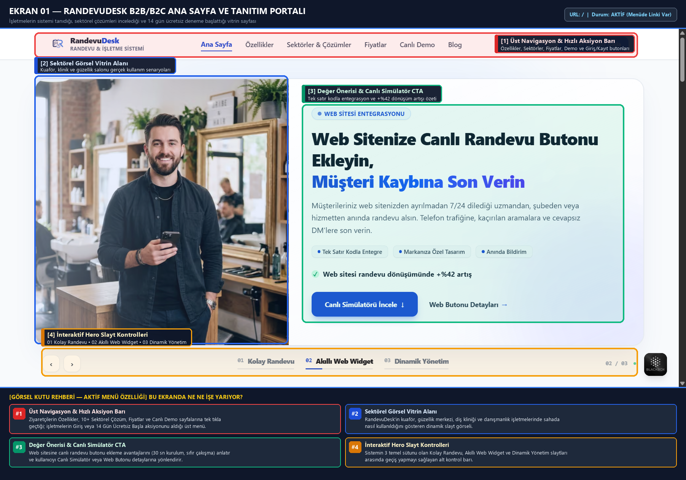

| Görseldeki Kutu No | Kutu Başlığı (Bölge / Modül) | Kısa Özeti | Bu Kutu Tam Olarak Ne İşe Yarıyor? |
| :---: | :--- | :--- | :--- |
| **`[1]`** | **Üst Navigasyon & Hızlı Aksiyon Barı** | _Özellikler, Sektörler, Fiyatlar, Demo ve Giriş/Kayıt butonları_ | Ziyaretçilerin Özellikler, 10+ Sektörel Çözüm, Fiyatlar ve Canlı Demo sayfalarına tek tıkla geçtiği; işletmelerin Giriş veya 14 Gün Ücretsiz Başla aksiyonunu aldığı üst menü. |
| **`[2]`** | **Sektörel Görsel Vitrin Alanı** | _Kuaför, klinik ve güzellik salonu gerçek kullanım senaryoları_ | RandevuDesk'in kuaför, güzellik merkezi, diş kliniği ve danışmanlık işletmelerinde sahada nasıl kullanıldığını gösteren dinamik slayt görseli. |
| **`[3]`** | **Değer Önerisi & Canlı Simülatör CTA** | _Tek satır kodla entegrasyon ve +%42 dönüşüm artışı özeti_ | Web sitesine canlı randevu butonu ekleme avantajlarını (30 sn kurulum, sıfır çakışma) anlatır ve kullanıcıyı Canlı Simülatör veya Web Butonu detaylarına yönlendirir. |
| **`[4]`** | **İnteraktif Hero Slayt Kontrolleri** | _01 Kolay Randevu • 02 Akıllı Web Widget • 03 Dinamik Yönetim_ | Sistemin 3 temel sütunu olan Kolay Randevu, Akıllı Web Widget ve Dinamik Yönetim slaytları arasında geçiş yapmayı sağlayan alt kontrol barı. |

---

#### 📸 EKRAN 02 — MÜŞTERİ CANLI RANDEVU ALMA FORMU (B2C REZERVASYON MASASI)
- **Sayfa Rotası (URL):** `/form/[slug]` | **Erişim Rolü:** `Müşteri / Hasta (B2C)`
- **Menü & Geliştirme Durumu:** ✅ **[AKTİF — Menüde Doğrudan Linki Var]**
- **Bu Sayfa Ne İşe Yarar?** Müşterilerin üye olmadan hizmet, uzman, tarih/saat seçip SMS OTP doğrulamasıyla 30 saniyede randevu aldığı ekran.

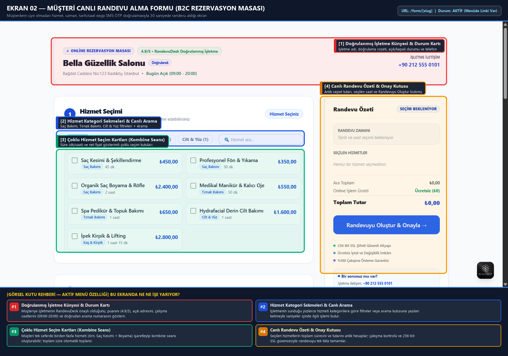

| Görseldeki Kutu No | Kutu Başlığı (Bölge / Modül) | Kısa Özeti | Bu Kutu Tam Olarak Ne İşe Yarıyor? |
| :---: | :--- | :--- | :--- |
| **`[1]`** | **Doğrulanmış İşletme Künyesi & Durum Kartı** | _İşletme adı, doğrulama rozeti, açık/kapalı durumu ve telefon_ | Müşteriye işletmenin RandevuDesk onaylı olduğunu, puanını (4.9/5), açık adresini, çalışma saatlerini (09:00-20:00) ve doğrudan arama numarasını gösterir. |
| **`[2]`** | **Hizmet Kategori Sekmeleri & Canlı Arama** | _Saç Bakımı, Tırnak Bakımı, Cilt & Yüz filtreleri + Arama_ | İşletmenin sunduğu yüzlerce hizmeti kategorilere göre filtreler veya arama kutusuna yazılan kelimeyle saniyeler içinde ilgili işlemi bulur. |
| **`[3]`** | **Çoklu Hizmet Seçim Kartları (Kombine Seans)** | _Süre (dk/saat) ve net fiyat gösterimli çoklu seçim kutuları_ | Müşteri tek seferde birden fazla hizmeti (örn. Saç Kesimi + Boyama) işaretleyip kombine seans oluşturabilir; toplam süre otomatik toplanır. |
| **`[4]`** | **Canlı Randevu Özeti & Onay Kutusu** | _Anlık sepet tutarı, seçilen saat ve Randevuyu Oluştur butonu_ | Seçilen hizmetlerin toplam süresini ve tutarını anlık hesaplar; çakışma kontrolü ve 256-bit SSL güvencesiyle randevuyu tek tıkla tamamlar. |

---

#### 📸 EKRAN 03 — DİJİTAL SOKAK VİTRİNİ & CANLI MÜSAİTLİK TABELASI (SLAYT 1) — 🚧 [GELİŞTİRİLME AŞAMASINDA]
- **Sayfa Rotası (URL):** `/vitrin/[slug]` | **Erişim Rolü:** `Vitrin TV / Sokak Ekranı`
- **Menü & Geliştirme Durumu:** 🚧 **[GELİŞTİRİLME AŞAMASINDA — Menüde Doğrudan Linki Yok / URL ile Erişilir]**
- **Bu Sayfa Ne İşe Yarar?** Salonun dış cephe veya vitrin ekranında yoldan geçen müşterileri içeri çeken canlı kontenjan ve dev QR ekranı.

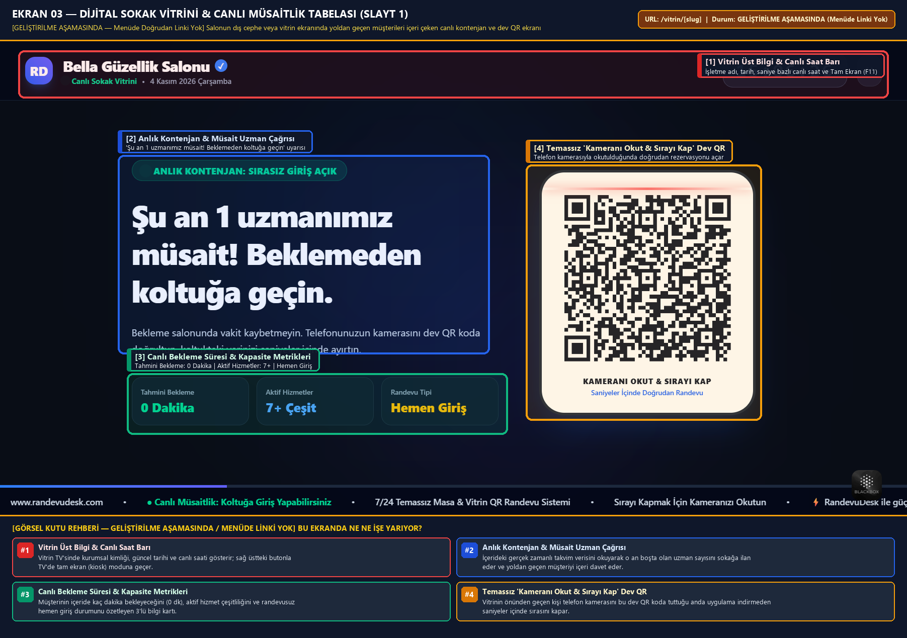

| Görseldeki Kutu No | Kutu Başlığı (Bölge / Modül) | Kısa Özeti | Bu Kutu Tam Olarak Ne İşe Yarıyor? |
| :---: | :--- | :--- | :--- |
| **`[1]`** | **Vitrin Üst Bilgi & Canlı Saat Barı** | _İşletme adı, tarih, saniye bazlı canlı saat ve Tam Ekran (F11)_ | Vitrin TV'sinde kurumsal kimliği, güncel tarihi ve canlı saati gösterir; sağ üstteki butonla TV'de tam ekran (kiosk) moduna geçer. |
| **`[2]`** | **Anlık Kontenjan & Müsait Uzman Çağrısı** | _'Şu an 1 uzmanımız müsait! Beklemeden koltuğa geçin' uyarısı_ | İçerideki gerçek zamanlı takvim verisini okuyarak o an boşta olan uzman sayısını sokağa ilan eder ve yoldan geçen müşteriyi içeri davet eder. |
| **`[3]`** | **Canlı Bekleme Süresi & Kapasite Metrikleri** | _Tahmini Bekleme: 0 Dakika | Aktif Hizmetler: 7+ | Hemen Giriş_ | Müşterinin içeride kaç dakika bekleyeceğini (0 dk), aktif hizmet çeşitliliğini ve randevusuz hemen giriş durumunu özetleyen 3'lü bilgi kartı. |
| **`[4]`** | **Temassız 'Kameranı Okut & Sırayı Kap' Dev QR** | _Telefon kamerasıyla okutulduğunda doğrudan rezervasyonu açar_ | Vitrinin önünden geçen kişi telefon kamerasını bu dev QR koda tuttuğu anda uygulama indirmeden saniyeler içinde sırasını kapar. |

---

#### 📸 EKRAN 04 — TEMASSIZ QR DİJİTAL HİZMET & FİYAT MENÜSÜ
- **Sayfa Rotası (URL):** `/menu/[slug]` | **Erişim Rolü:** `Müşteri Mobil QR Menü (B2C)`
- **Menü & Geliştirme Durumu:** ✅ **[AKTİF — Menüde Doğrudan Linki Var]**
- **Bu Sayfa Ne İşe Yarar?** Bekleme salonunda veya masadaki QR kodu okutan müşterilerin güncel fiyat listesini inceleyip randevu aldığı ekran.

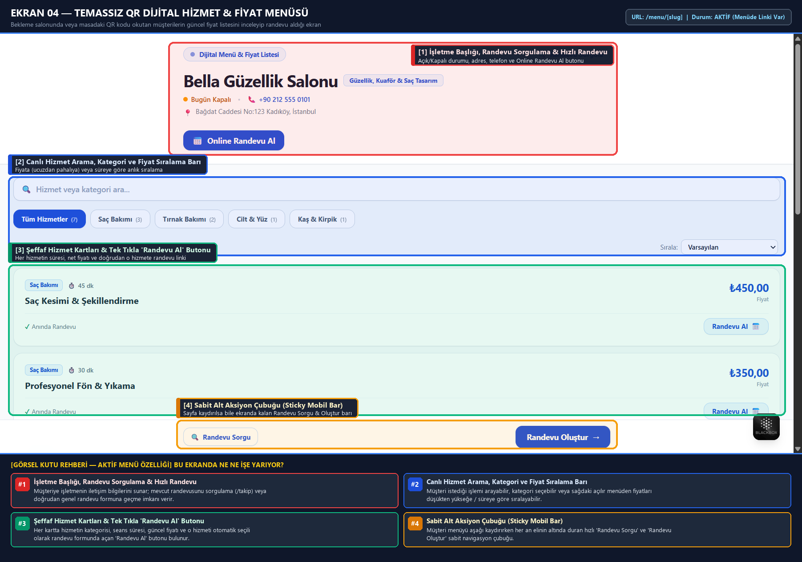

| Görseldeki Kutu No | Kutu Başlığı (Bölge / Modül) | Kısa Özeti | Bu Kutu Tam Olarak Ne İşe Yarıyor? |
| :---: | :--- | :--- | :--- |
| **`[1]`** | **İşletme Başlığı, Randevu Sorgulama & Hızlı Randevu** | _Açık/Kapalı durumu, adres, telefon ve Online Randevu Al butonu_ | Müşteriye işletmenin iletişim bilgilerini sunar; mevcut randevusunu sorgulama (/takip) veya doğrudan genel randevu formuna geçme imkanı verir. |
| **`[2]`** | **Canlı Hizmet Arama, Kategori ve Fiyat Sıralama Barı** | _Fiyata (ucuzdan pahalıya) veya süreye göre anlık sıralama_ | Müşteri istediği işlemi arayabilir, kategori seçebilir veya sağdaki açılır menüden fiyatları düşükten yükseğe / süreye göre sıralayabilir. |
| **`[3]`** | **Şeffaf Hizmet Kartları & Tek Tıkla 'Randevu Al' Butonu** | _Her hizmetin süresi, net fiyatı ve doğrudan o hizmete randevu linki_ | Her kartta hizmetin kategorisi, seans süresi, güncel fiyatı ve o hizmeti otomatik seçili olarak randevu formunda açan 'Randevu Al' butonu bulunur. |
| **`[4]`** | **Sabit Alt Aksiyon Çubuğu (Sticky Mobil Bar)** | _Sayfa kaydırılsa bile ekranda kalan Randevu Sorgu & Oluştur barı_ | Müşteri menüyü aşağı kaydırırken her an elinin altında duran hızlı 'Randevu Sorgu' ve 'Randevu Oluştur' sabit navigasyon çubuğu. |

---

#### 📸 EKRAN 05 — SALON İÇİ TV KİOSK & TREND HİZMETLER EKRANI (SLAYT 2) — 🚧 [GELİŞTİRİLME AŞAMASINDA]
- **Sayfa Rotası (URL):** `/kiosk/[slug]` | **Erişim Rolü:** `Salon İçi TV / Kiosk Modu`
- **Menü & Geliştirme Durumu:** 🚧 **[GELİŞTİRİLME AŞAMASINDA — Menüde Doğrudan Linki Yok / URL ile Erişilir]**
- **Bu Sayfa Ne İşe Yarar?** Bekleme salonundaki TV ekranında periyodik dönen 'Günün Öne Çıkan İşlemleri' ve çapraz satış (upsell) panosu.

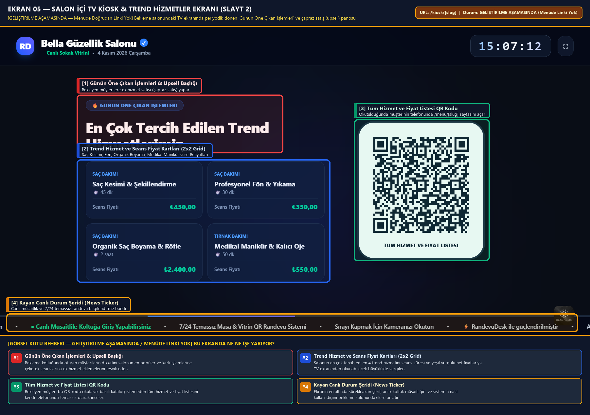

| Görseldeki Kutu No | Kutu Başlığı (Bölge / Modül) | Kısa Özeti | Bu Kutu Tam Olarak Ne İşe Yarıyor? |
| :---: | :--- | :--- | :--- |
| **`[1]`** | **Günün Öne Çıkan İşlemleri & Upsell Başlığı** | _Bekleyen müşterilere ek hizmet satışı (çapraz satış) yapar_ | Bekleme koltuğunda oturan müşterilerin dikkatini salonun en popüler ve karlı işlemlerine çekerek seanslarına ek hizmet eklemelerini teşvik eder. |
| **`[2]`** | **Trend Hizmet ve Seans Fiyat Kartları (2x2 Grid)** | _Saç Kesimi, Fön, Organik Boyama, Medikal Manikür süre & fiyatları_ | Salonun en çok tercih edilen 4 trend hizmetini seans süresi ve yeşil vurgulu net fiyatlarıyla TV ekranından okunabilecek büyüklükte sergiler. |
| **`[3]`** | **Tüm Hizmet ve Fiyat Listesi QR Kodu** | _Okutulduğunda müşterinin telefonunda /menu/[slug] sayfasını açar_ | Bekleyen müşteri bu QR kodu okutarak basılı katalog istemeden tüm hizmet ve fiyat listesini kendi telefonunda temassız olarak inceler. |
| **`[4]`** | **Kayan Canlı Durum Şeridi (News Ticker)** | _Canlı müsaitlik ve 7/24 temassız randevu bilgilendirme bandı_ | Ekranın en altında sürekli akan şerit; anlık koltuk müsaitliğini ve sistemin nasıl kullanıldığını bekleme salonundakilere anlatır. |

---

#### 📸 EKRAN 06 — CANLI RANDEVU SORGULAMA, ERTELEME VE İPTAL RADARI
- **Sayfa Rotası (URL):** `/takip` | **Erişim Rolü:** `Müşteri / Hasta (B2C)`
- **Menü & Geliştirme Durumu:** ✅ **[AKTİF — Menüde Doğrudan Linki Var]**
- **Bu Sayfa Ne İşe Yarar?** Müşterilerin telefon numarası veya takip koduyla randevu durumunu görüp self-servis saat değiştirebildiği ekran.

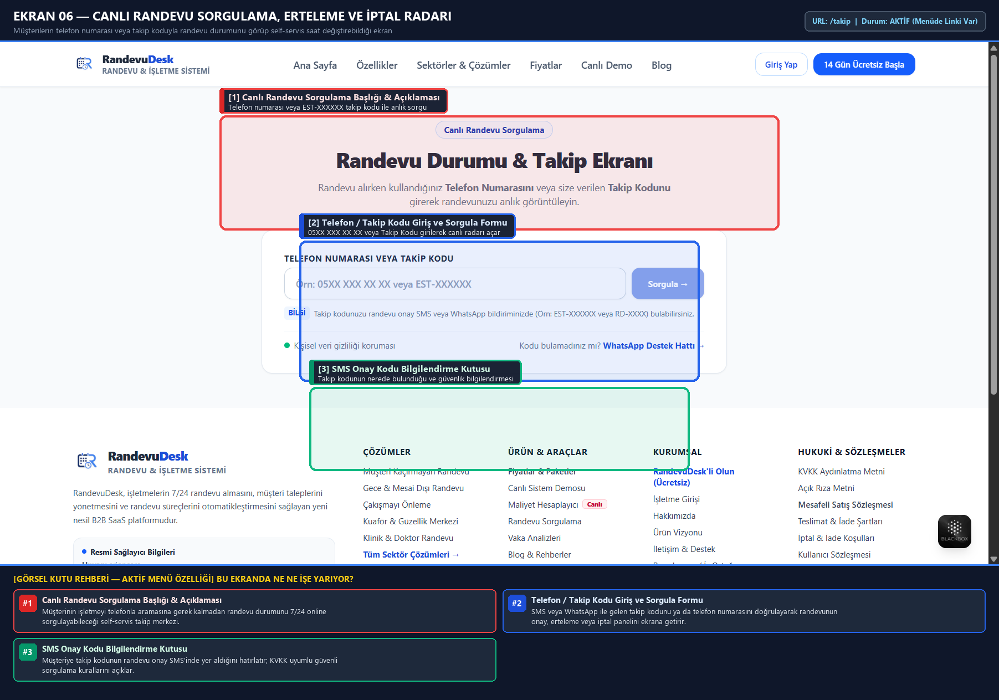

| Görseldeki Kutu No | Kutu Başlığı (Bölge / Modül) | Kısa Özeti | Bu Kutu Tam Olarak Ne İşe Yarıyor? |
| :---: | :--- | :--- | :--- |
| **`[1]`** | **Canlı Randevu Sorgulama Başlığı & Açıklaması** | _Telefon numarası veya EST-XXXXXX takip kodu ile anlık sorgu_ | Müşterinin işletmeyi telefonla aramasına gerek kalmadan randevu durumunu 7/24 online sorgulayabileceği self-servis takip merkezi. |
| **`[2]`** | **Telefon / Takip Kodu Giriş ve Sorgula Formu** | _05XX XXX XX XX veya Takip Kodu girilerek canlı radarı açar_ | SMS veya WhatsApp ile gelen takip kodunu ya da telefon numarasını doğrulayarak randevunun onay, erteleme veya iptal panelini ekrana getirir. |
| **`[3]`** | **SMS Onay Kodu Bilgilendirme Kutusu** | _Takip kodunun nerede bulunduğu ve güvenlik bilgilendirmesi_ | Müşteriye takip kodunun randevu onay SMS'inde yer aldığını hatırlatır; KVKK uyumlu güvenli sorgulama kurallarını açıklar. |

---

#### 📸 EKRAN 07 — B2B ABONELİK PAKETLERİ VE ŞEFFAF FİYATLANDIRMA SAYFASI
- **Sayfa Rotası (URL):** `/fiyatlar` | **Erişim Rolü:** `Herkese Açık (B2B Satış)`
- **Menü & Geliştirme Durumu:** ✅ **[AKTİF — Menüde Doğrudan Linki Var]**
- **Bu Sayfa Ne İşe Yarar?** İşletmelerin Starter, Pro ve Kurumsal (Enterprise) paket özelliklerini karşılaştırıp abonelik seçtiği ekran.

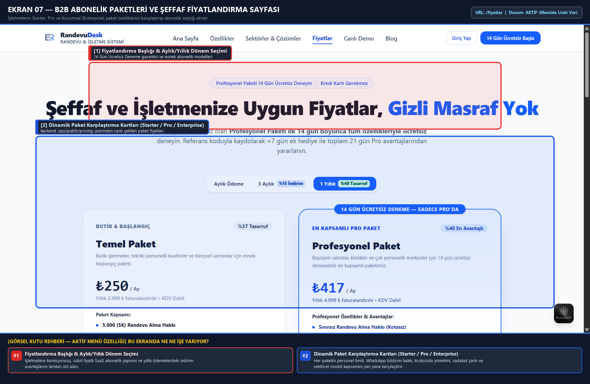

| Görseldeki Kutu No | Kutu Başlığı (Bölge / Modül) | Kısa Özeti | Bu Kutu Tam Olarak Ne İşe Yarıyor? |
| :---: | :--- | :--- | :--- |
| **`[1]`** | **Fiyatlandırma Başlığı & Aylık/Yıllık Dönem Seçimi** | _14 Gün Ücretsiz Deneme garantisi ve esnek abonelik modelleri_ | İşletmelere komisyonsuz, sabit fiyatlı SaaS abonelik yapısını ve yıllık ödemelerdeki indirim avantajlarını tanıtan üst alan. |
| **`[2]`** | **Dinamik Paket Karşılaştırma Kartları (Starter / Pro / Enterprise)** | _Backend /api/public/pricing üzerinden canlı çekilen paket fiyatları_ | Her paketin personel limiti, WhatsApp bildirim hakkı, kroki/oda yönetimi, sadakat çarkı ve sektörel modül kapsamını yan yana karşılaştırır. |

---

#### 📸 EKRAN 08 — KAÇIRILAN RANDEVU (NO-SHOW) VE KAYIP CİRO HESAPLAYICI
- **Sayfa Rotası (URL):** `/araclar/kacirilan-randevu-maliyeti` | **Erişim Rolü:** `B2B Karar Destek Aracı`
- **Menü & Geliştirme Durumu:** ✅ **[AKTİF — Menüde Doğrudan Linki Var]**
- **Bu Sayfa Ne İşe Yarar?** İşletmelerin gelmeyen müşteriler ve cevapsız telefonlar yüzünden aylık/yıllık ne kadar para kaybettiğini hesaplayan araç.

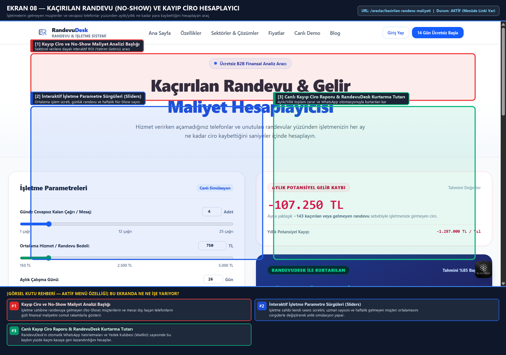

| Görseldeki Kutu No | Kutu Başlığı (Bölge / Modül) | Kısa Özeti | Bu Kutu Tam Olarak Ne İşe Yarıyor? |
| :---: | :--- | :--- | :--- |
| **`[1]`** | **Kayıp Ciro ve No-Show Maliyet Analizi Başlığı** | _Sektörel verilere dayalı interaktif ROI (Yatırım Getirisi) aracı_ | İşletme sahibine randevuya gelmeyen (No-Show) müşterilerin ve mesai dışı kaçan telefonların gizli finansal maliyetini somut rakamlarla gösterir. |
| **`[2]`** | **İnteraktif İşletme Parametre Sürgüleri (Sliders)** | _Ortalama işlem ücreti, günlük randevu ve haftalık No-Show sayısı_ | İşletme sahibi kendi seans ücretini, uzman sayısını ve haftalık gelmeyen müşteri ortalamasını sürgülerle değiştirerek anlık simülasyon yapar. |
| **`[3]`** | **Canlı Kayıp Ciro Raporu & RandevuDesk Kurtarma Tutarı** | _Aylık/Yıllık toplam zarar ve WhatsApp otomasyonuyla kurtarılan kar_ | RandevuDesk'in otomatik WhatsApp hatırlatmaları ve Yedek Kulübesi (Waitlist) sayesinde bu kaybın yüzde kaçını kasaya geri kazandırdığını hesaplar. |

---

#### 📸 EKRAN 09 — 8 SEKTÖRLÜ CANLI İNTERAKTİF DEMO MERKEZİ
- **Sayfa Rotası (URL):** `/demo` | **Erişim Rolü:** `Herkese Açık (Canlı Simülatör)`
- **Menü & Geliştirme Durumu:** ✅ **[AKTİF — Menüde Doğrudan Linki Var]**
- **Bu Sayfa Ne İşe Yarar?** Diş kliniği, kuaför, güzellik, psikolog, diyetisyen, pilates, oto kuaför ve veteriner akışlarının canlı denendiği ekran.

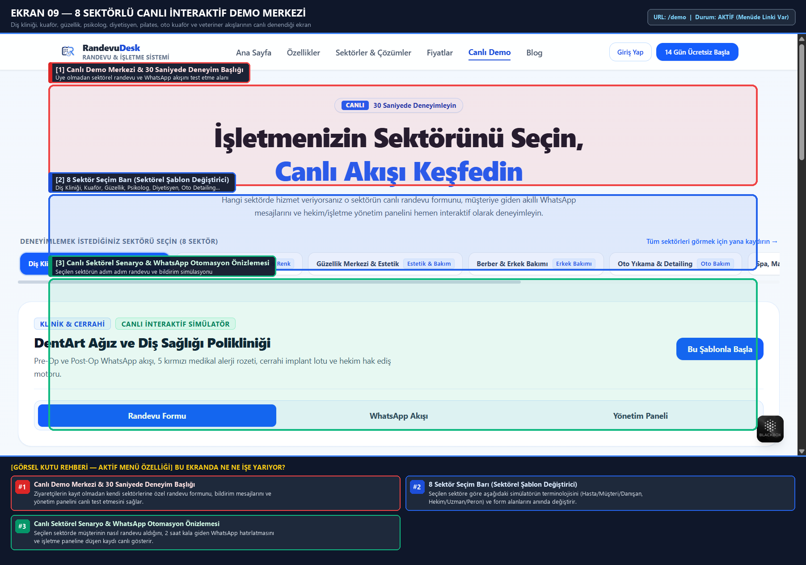

| Görseldeki Kutu No | Kutu Başlığı (Bölge / Modül) | Kısa Özeti | Bu Kutu Tam Olarak Ne İşe Yarıyor? |
| :---: | :--- | :--- | :--- |
| **`[1]`** | **Canlı Demo Merkezi & 30 Saniyede Deneyim Başlığı** | _Üye olmadan sektörel randevu ve WhatsApp akışını test etme alanı_ | Ziyaretçilerin kayıt olmadan kendi sektörlerine özel randevu formunu, bildirim mesajlarını ve yönetim panelini canlı test etmesini sağlar. |
| **`[2]`** | **8 Sektör Seçim Barı (Sektörel Şablon Değiştirici)** | _Diş Kliniği, Kuaför, Güzellik, Psikolog, Diyetisyen, Oto Detailing..._ | Seçilen sektöre göre aşağıdaki simülatörün terminolojisini (Hasta/Müşteri/Danışan, Hekim/Uzman/Peron) ve form alanlarını anında değiştirir. |
| **`[3]`** | **Canlı Sektörel Senaryo & WhatsApp Otomasyon Önizlemesi** | _Seçilen sektörün adım adım randevu ve bildirim simülasyonu_ | Seçilen sektörde müşterinin nasıl randevu aldığını, 2 saat kala giden WhatsApp hatırlatmasını ve işletme paneline düşen kaydı canlı gösterir. |

---

#### 📸 EKRAN 10 — YENİ İŞLETME KAYIT VE 14 GÜN ÜCRETSİZ DENEME SİHİRBAZI
- **Sayfa Rotası (URL):** `/register` | **Erişim Rolü:** `Yeni İşletme Adayı (B2B)`
- **Menü & Geliştirme Durumu:** ✅ **[AKTİF — Menüde Doğrudan Linki Var]**
- **Bu Sayfa Ne İşe Yarar?** İşletmelerin kredi kartı girmeden sektörünü seçip 60 saniyede kendi RandevuDesk panelini açtığı kayıt ekranı.

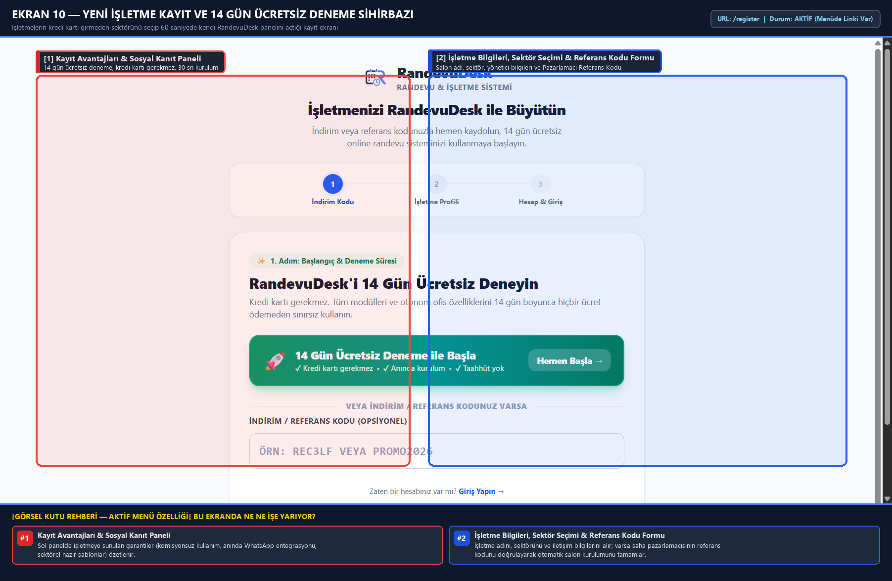

| Görseldeki Kutu No | Kutu Başlığı (Bölge / Modül) | Kısa Özeti | Bu Kutu Tam Olarak Ne İşe Yarıyor? |
| :---: | :--- | :--- | :--- |
| **`[1]`** | **Kayıt Avantajları & Sosyal Kanıt Paneli** | _14 gün ücretsiz deneme, kredi kartı gerekmez, 30 sn kurulum_ | Sol panelde işletmeye sunulan garantiler (komisyonsuz kullanım, anında WhatsApp entegrasyonu, sektörel hazır şablonlar) özetlenir. |
| **`[2]`** | **İşletme Bilgileri, Sektör Seçimi & Referans Kodu Formu** | _Salon adı, sektör, yönetici bilgileri ve Pazarlamacı Referans Kodu_ | İşletme adını, sektörünü ve iletişim bilgilerini alır; varsa saha pazarlamacısının referans kodunu doğrulayarak otomatik salon kurulumunu tamamlar. |

---

### 26.2. İşletme Yönetim Paneli (`/dashboard` Mini Ofis) & Sektörel Modül Ekranları (Ekran 11 – 32)

#### 📸 EKRAN 11 — İŞLETME YÖNETİM PANELİ (/dashboard) — GENEL BAKIŞ & MİNİ OFİS
- **Sayfa Rotası (URL):** `/dashboard?salon=1` | **Erişim Rolü:** `İşletme Sahibi / Yönetici`
- **Menü & Geliştirme Durumu:** ✅ **[AKTİF — Menüde Doğrudan Linki Var]**
- **Bu Sayfa Ne İşe Yarar?** İşletme sahibinin günlük ciroyu, aktif randevuları, doluluk oranını ve hızlı aksiyonları tek ekrandan yönettiği merkez.

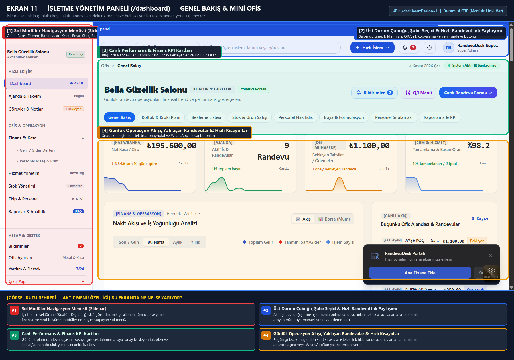

| Görseldeki Kutu No | Kutu Başlığı (Bölge / Modül) | Kısa Özeti | Bu Kutu Tam Olarak Ne İşe Yarıyor? |
| :---: | :--- | :--- | :--- |
| **`[1]`** | **Sol Modüler Navigasyon Menüsü (Sidebar)** | _Genel Bakış, Takvim, Randevular, Kroki, Boya, Stok, Bordro, Ayarlar_ | İşletmenin sektörüne (Kuaför, Diş Kliniği vb.) göre dinamik şekillenen; tüm operasyonel, finansal ve viral büyüme modüllerine erişim sağlayan sol menü. |
| **`[2]`** | **Üst Durum Çubuğu, Şube Seçici & Hızlı RandevuLink Paylaşımı** | _Salon durumu, bildirim zili, QR/Link kopyalama ve yeni randevu butonu_ | Aktif şubeyi değiştirme, işletmenin online randevu linkini tek tıkla kopyalama ve telefonla arayan müşteriye manuel randevu ekleme barı. |
| **`[3]`** | **Canlı Performans & Finans KPI Kartları** | _Bugünkü Randevular, Tahmini Ciro, Onay Bekleyenler ve Doluluk Oranı_ | Günün toplam randevu sayısını, kasaya girecek tahmini ciroyu, onay bekleyen talepleri ve koltuk/uzman doluluk yüzdesini anlık özetler. |
| **`[4]`** | **Günlük Operasyon Akışı, Yaklaşan Randevular & Hızlı Kısayollar** | _Sıradaki müşteriler, tek tıkla onay/iptal ve WhatsApp mesaj butonları_ | Bugün gelecek müşterileri saat sırasıyla listeler; tek tıkla randevu onaylama, tamamlama, adisyon açma veya WhatsApp'tan yazma imkanı verir. |

---

#### 📸 EKRAN 12 — İNTERAKTİF ÇOKLU UZMAN VE ODA/KOLTUK TAKVİMİ — 🚧 [GELİŞTİRİLME AŞAMASINDA]
- **Sayfa Rotası (URL):** `/dashboard?tab=calendar` | **Erişim Rolü:** `İşletme Sahibi / Resepsiyon`
- **Menü & Geliştirme Durumu:** 🚧 **[GELİŞTİRİLME AŞAMASINDA — Menüde Doğrudan Linki Yok / URL ile Erişilir]**
- **Bu Sayfa Ne İşe Yarar?** Uzmanların ve odaların saatlik doluluğunu gösteren, sürükle-bırak ve tek tıkla boş saate randevu ekleyen akıllı ajanda.

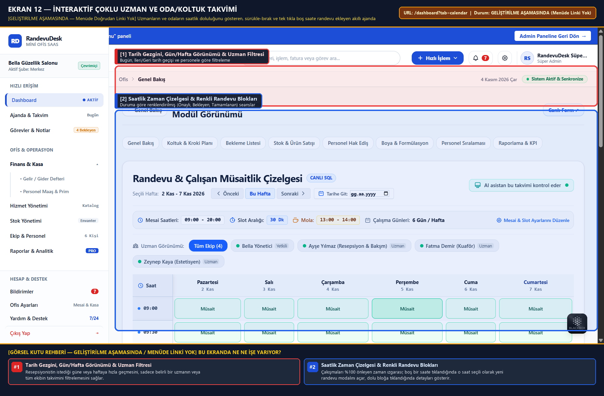

| Görseldeki Kutu No | Kutu Başlığı (Bölge / Modül) | Kısa Özeti | Bu Kutu Tam Olarak Ne İşe Yarıyor? |
| :---: | :--- | :--- | :--- |
| **`[1]`** | **Tarih Gezgini, Gün/Hafta Görünümü & Uzman Filtresi** | _Bugün, İleri/Geri tarih geçişi ve personele göre filtreleme_ | Resepsiyonistin istediği güne veya haftaya hızla geçmesini, sadece belirli bir uzmanın veya tüm ekibin takvimini filtrelemesini sağlar. |
| **`[2]`** | **Saatlik Zaman Çizelgesi & Renkli Randevu Blokları** | _Duruma göre renklendirilmiş (Onaylı, Bekleyen, Tamamlanan) seanslar_ | Çakışmaları %100 önleyen zaman ızgarası; boş bir saate tıklandığında o saat seçili olarak yeni randevu modalını açar, dolu bloğa tıklandığında detayları gösterir. |

---

#### 📸 EKRAN 13 — DETAYLI RANDEVU YÖNETİMİ, FİLTRELEME VE ADİSYON MERKEZİ
- **Sayfa Rotası (URL):** `/dashboard/appointments` | **Erişim Rolü:** `İşletme Sahibi / Resepsiyon`
- **Menü & Geliştirme Durumu:** ✅ **[AKTİF — Menüde Doğrudan Linki Var]**
- **Bu Sayfa Ne İşe Yarar?** Tüm geçmiş ve gelecek randevuların arandığı, durumlarının güncellendiği ve No-Show / tahsilat takibinin yapıldığı ekran.

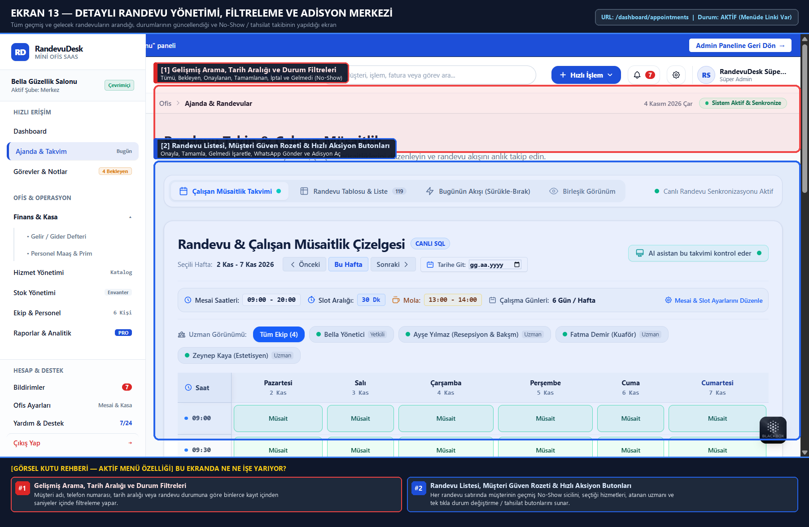

| Görseldeki Kutu No | Kutu Başlığı (Bölge / Modül) | Kısa Özeti | Bu Kutu Tam Olarak Ne İşe Yarıyor? |
| :---: | :--- | :--- | :--- |
| **`[1]`** | **Gelişmiş Arama, Tarih Aralığı ve Durum Filtreleri** | _Tümü, Bekleyen, Onaylanan, Tamamlanan, İptal ve Gelmedi (No-Show)_ | Müşteri adı, telefon numarası, tarih aralığı veya randevu durumuna göre binlerce kayıt içinden saniyeler içinde filtreleme yapar. |
| **`[2]`** | **Randevu Listesi, Müşteri Güven Rozeti & Hızlı Aksiyon Butonları** | _Onayla, Tamamla, Gelmedi İşaretle, WhatsApp Gönder ve Adisyon Aç_ | Her randevu satırında müşterinin geçmiş No-Show sicilini, seçtiği hizmetleri, atanan uzmanı ve tek tıkla durum değiştirme / tahsilat butonlarını sunar. |

---

#### 📸 EKRAN 14 — CANLI SALON KROKİSİ, ODA, KOLTUK VE PERON YÖNETİMİ
- **Sayfa Rotası (URL):** `/dashboard?tab=spaces` | **Erişim Rolü:** `İşletme Sahibi / Operasyon`
- **Menü & Geliştirme Durumu:** ✅ **[AKTİF — Menüde Doğrudan Linki Var]**
- **Bu Sayfa Ne İşe Yarar?** İşletmedeki fiziksel odaların, koltukların, lazer cihazlarının veya yıkama peronlarının kapasite ve doluluk ekranı.

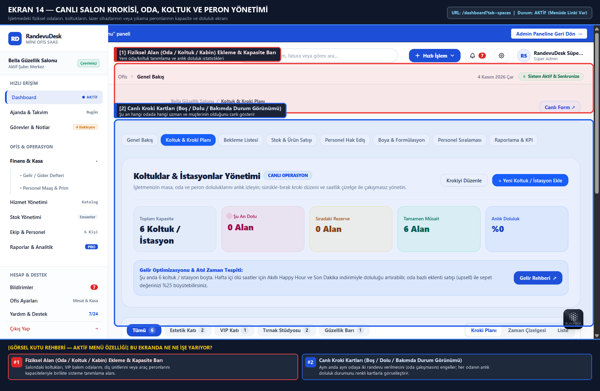

| Görseldeki Kutu No | Kutu Başlığı (Bölge / Modül) | Kısa Özeti | Bu Kutu Tam Olarak Ne İşe Yarıyor? |
| :---: | :--- | :--- | :--- |
| **`[1]`** | **Fiziksel Alan (Oda / Koltuk / Kabin) Ekleme & Kapasite Barı** | _Yeni oda/koltuk tanımlama ve anlık doluluk istatistikleri_ | Salondaki koltukları, VIP bakım odalarını, diş ünitlerini veya araç peronlarını kapasiteleriyle birlikte sisteme tanımlama alanı. |
| **`[2]`** | **Canlı Kroki Kartları (Boş / Dolu / Bakımda Durum Görünümü)** | _Şu an hangi odada hangi uzman ve müşterinin olduğunu canlı gösterir_ | Aynı anda aynı odaya iki randevu verilmesini (oda çakışmasını) engeller; her odanın anlık doluluk durumunu renkli kartlarla görselleştirir. |

---

#### 📸 EKRAN 15 — AKILLI BEKLEME LİSTESİ (YEDEK KULÜBESİ / WAITLIST)
- **Sayfa Rotası (URL):** `/dashboard?tab=waitlist` | **Erişim Rolü:** `İşletme Sahibi / Resepsiyon`
- **Menü & Geliştirme Durumu:** ✅ **[AKTİF — Menüde Doğrudan Linki Var]**
- **Bu Sayfa Ne İşe Yarar?** Dolu günler için yedek sıraya yazılan müşterileri, bir randevu iptal olduğunda tek tıkla WhatsApp'tan çağıran modül.

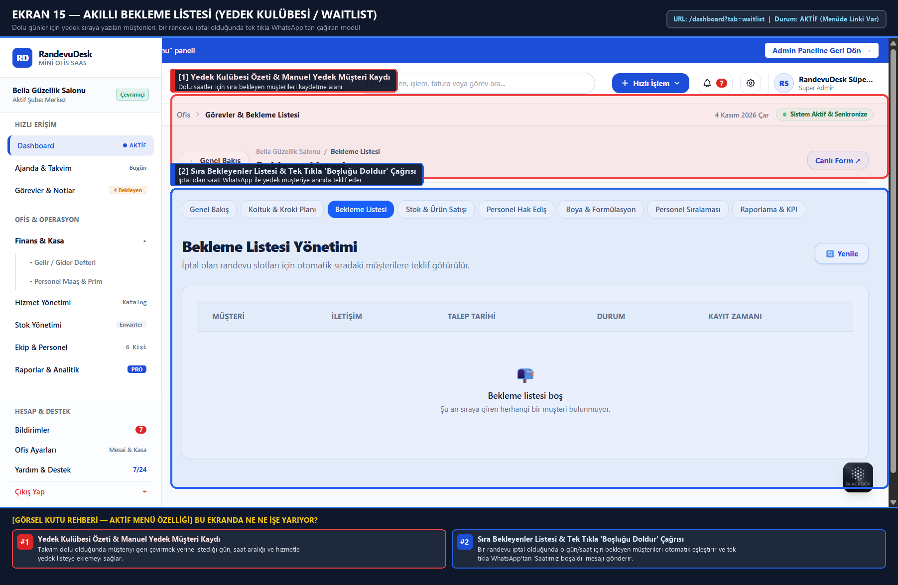

| Görseldeki Kutu No | Kutu Başlığı (Bölge / Modül) | Kısa Özeti | Bu Kutu Tam Olarak Ne İşe Yarıyor? |
| :---: | :--- | :--- | :--- |
| **`[1]`** | **Yedek Kulübesi Özeti & Manuel Yedek Müşteri Kaydı** | _Dolu saatler için sıra bekleyen müşterileri kaydetme alanı_ | Takvim dolu olduğunda müşteriyi geri çevirmek yerine istediği gün, saat aralığı ve hizmetle yedek listeye eklemeyi sağlar. |
| **`[2]`** | **Sıra Bekleyenler Listesi & Tek Tıkla 'Boşluğu Doldur' Çağrısı** | _İptal olan saati WhatsApp ile yedek müşteriye anında teklif eder_ | Bir randevu iptal olduğunda o gün/saat için bekleyen müşterileri otomatik eşleştirir ve tek tıkla WhatsApp'tan 'Saatimiz boşaldı' mesajı gönderir. |

---

#### 📸 EKRAN 16 — MÜŞTERİ BOYA & KİMYASAL FORMÜLASYON DEFTERİ (KUAFÖR/ESTETİK)
- **Sayfa Rotası (URL):** `/dashboard?tab=formulations` | **Erişim Rolü:** `Kuaför / Renk Uzmanı`
- **Menü & Geliştirme Durumu:** ✅ **[AKTİF — Menüde Doğrudan Linki Var]**
- **Bu Sayfa Ne İşe Yarar?** Müşteriye uygulanan saç boyası tüp numaraları, oksidan oranları, gramajlar ve alerji notlarının saklandığı dijital hafıza.

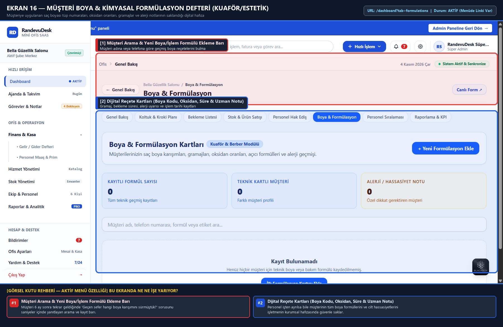

| Görseldeki Kutu No | Kutu Başlığı (Bölge / Modül) | Kısa Özeti | Bu Kutu Tam Olarak Ne İşe Yarıyor? |
| :---: | :--- | :--- | :--- |
| **`[1]`** | **Müşteri Arama & Yeni Boya/İşlem Formülü Ekleme Barı** | _Müşteri adına veya telefona göre geçmiş boya reçetelerini bulma_ | Müşteri 6 ay sonra tekrar geldiğinde 'Geçen sefer hangi boya karışımını sürmüştük?' sorusunu saniyeler içinde yanıtlayan arama ve kayıt barı. |
| **`[2]`** | **Dijital Reçete Kartları (Boya Kodu, Oksidan, Süre & Uzman Notu)** | _Gramaj, bekleme süresi, alerji uyarısı ve işlem tarihi kayıtları_ | Personel işten ayrılsa bile müşterinin tüm boya formüllerini ve cilt hassasiyetlerini işletmenin kurumsal hafızasında güvenle saklar. |

---

#### 📸 EKRAN 17 — DİŞ KLİNİĞİ PROTEZ & LABORATUVAR İŞ TAKİP MODÜLÜ
- **Sayfa Rotası (URL):** `/dashboard/dental/laboratuvar` | **Erişim Rolü:** `Diş Hekimi / Klinik Yöneticisi`
- **Menü & Geliştirme Durumu:** ✅ **[AKTİF — Menüde Doğrudan Linki Var]**
- **Bu Sayfa Ne İşe Yarar?** Zirkonyum, lamina, protez ve gece plağı işlerinin laboratuvara gidiş-dönüş ve prova aşamalarını takip eden ekran.

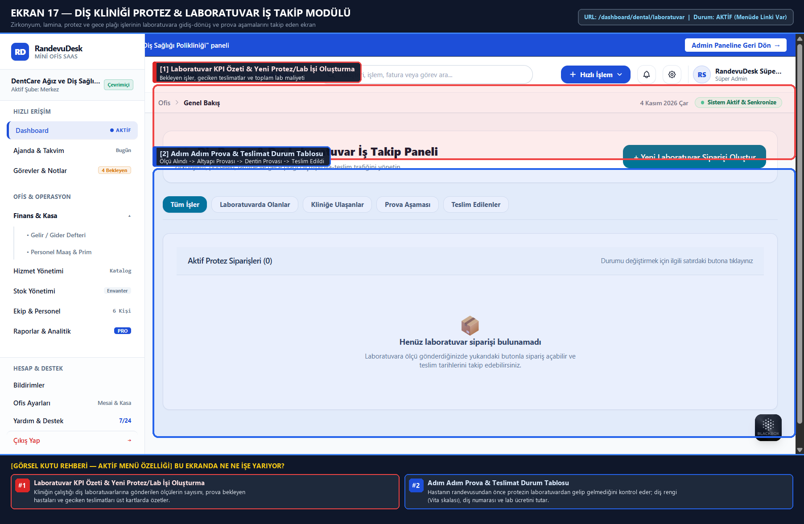

| Görseldeki Kutu No | Kutu Başlığı (Bölge / Modül) | Kısa Özeti | Bu Kutu Tam Olarak Ne İşe Yarıyor? |
| :---: | :--- | :--- | :--- |
| **`[1]`** | **Laboratuvar KPI Özeti & Yeni Protez/Lab İşi Oluşturma** | _Bekleyen işler, geciken teslimatlar ve toplam lab maliyeti_ | Kliniğin çalıştığı diş laboratuvarlarına gönderilen ölçülerin sayısını, prova bekleyen hastaları ve geciken teslimatları üst kartlarda özetler. |
| **`[2]`** | **Adım Adım Prova & Teslimat Durum Tablosu** | _Ölçü Alındı -> Altyapı Provası -> Dentin Provası -> Teslim Edildi_ | Hastanın randevusundan önce protezin laboratuvardan gelip gelmediğini kontrol eder; diş rengi (Vita skalası), diş numarası ve lab ücretini tutar. |

---

#### 📸 EKRAN 18 — DİŞ KLİNİĞİ İMPLANT BARKOD, LOT NO VE DİJİTAL GARANTİ SERTİFİKASI
- **Sayfa Rotası (URL):** `/dashboard/dental/implants` | **Erişim Rolü:** `Diş Hekimi / Çene Cerrahı`
- **Menü & Geliştirme Durumu:** ✅ **[AKTİF — Menüde Doğrudan Linki Var]**
- **Bu Sayfa Ne İşe Yarar?** Hastaya uygulanan implantın marka, çap/boy, seri/lot numarası ve kemik kaynaşma (osseointegrasyon) takip ekranı.

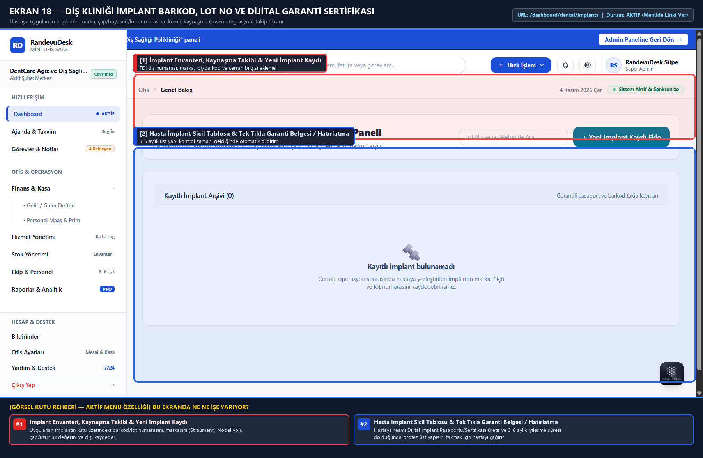

| Görseldeki Kutu No | Kutu Başlığı (Bölge / Modül) | Kısa Özeti | Bu Kutu Tam Olarak Ne İşe Yarıyor? |
| :---: | :--- | :--- | :--- |
| **`[1]`** | **İmplant Envanteri, Kaynaşma Takibi & Yeni İmplant Kaydı** | _FDI diş numarası, marka, lot/barkod ve cerrah bilgisi ekleme_ | Uygulanan implantın kutu üzerindeki barkod/lot numarasını, markasını (Straumann, Nobel vb.), çap/uzunluk değerini ve dişi kaydeder. |
| **`[2]`** | **Hasta İmplant Sicil Tablosu & Tek Tıkla Garanti Belgesi / Hatırlatma** | _3-6 aylık üst yapı kontrol zamanı geldiğinde otomatik bildirim_ | Hastaya resmi Dijital İmplant Pasaportu/Sertifikası üretir ve 3-6 aylık iyileşme süresi dolduğunda protez üst yapısını takmak için hastayı çağırır. |

---

#### 📸 EKRAN 19 — DİŞ HEKİMİ HAKEDİŞ, PRİM VE LABORATUVAR KESİNTİ MOTORU — 🚧 [GELİŞTİRİLME AŞAMASINDA]
- **Sayfa Rotası (URL):** `/dashboard/dental/hakedis` | **Erişim Rolü:** `Klinik Sahibi / Başhekim`
- **Menü & Geliştirme Durumu:** 🚧 **[GELİŞTİRİLME AŞAMASINDA — Menüde Doğrudan Linki Yok / URL ile Erişilir]**
- **Bu Sayfa Ne İşe Yarar?** Klinikteki hekimlerin yaptığı tedavilerden doğan brüt ciro, düşülen lab maliyeti ve net hekim primini hesaplayan ekran.

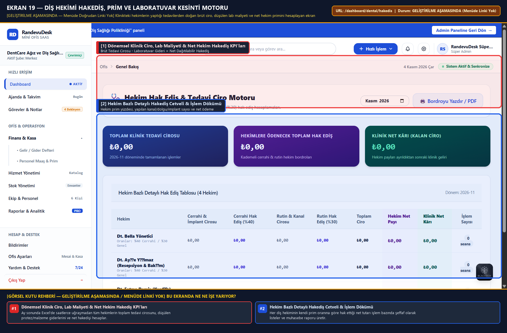

| Görseldeki Kutu No | Kutu Başlığı (Bölge / Modül) | Kısa Özeti | Bu Kutu Tam Olarak Ne İşe Yarıyor? |
| :---: | :--- | :--- | :--- |
| **`[1]`** | **Dönemsel Klinik Ciro, Lab Maliyeti & Net Hekim Hakediş KPI'ları** | _Brüt Tedavi Cirosu - Laboratuvar Gideri = Net Dağıtılabilir Hakediş_ | Ay sonunda Excel'de saatlerce uğraşmadan tüm hekimlerin toplam tedavi cirosunu, düşülen protez/malzeme giderlerini ve net hakedişi hesaplar. |
| **`[2]`** | **Hekim Bazlı Detaylı Hakediş Cetveli & İşlem Dökümü** | _Hekim prim yüzdesi, yapılan kanal/dolgu/implant sayısı ve net ödeme_ | Her diş hekiminin kendi prim oranına göre hak ettiği net tutarı işlem bazında şeffaf olarak listeler ve muhasebe raporu üretir. |

---

#### 📸 EKRAN 20 — HİZMETLER, KATEGORİLER VE SEANS FİYAT YÖNETİMİ
- **Sayfa Rotası (URL):** `/dashboard/services` | **Erişim Rolü:** `İşletme Sahibi / Yönetici`
- **Menü & Geliştirme Durumu:** ✅ **[AKTİF — Menüde Doğrudan Linki Var]**
- **Bu Sayfa Ne İşe Yarar?** İşletmenin sunduğu tüm işlemlerin, sürelerin, fiyatların ve hazırlık/temizlik tampon sürelerinin yönetildiği ekran.

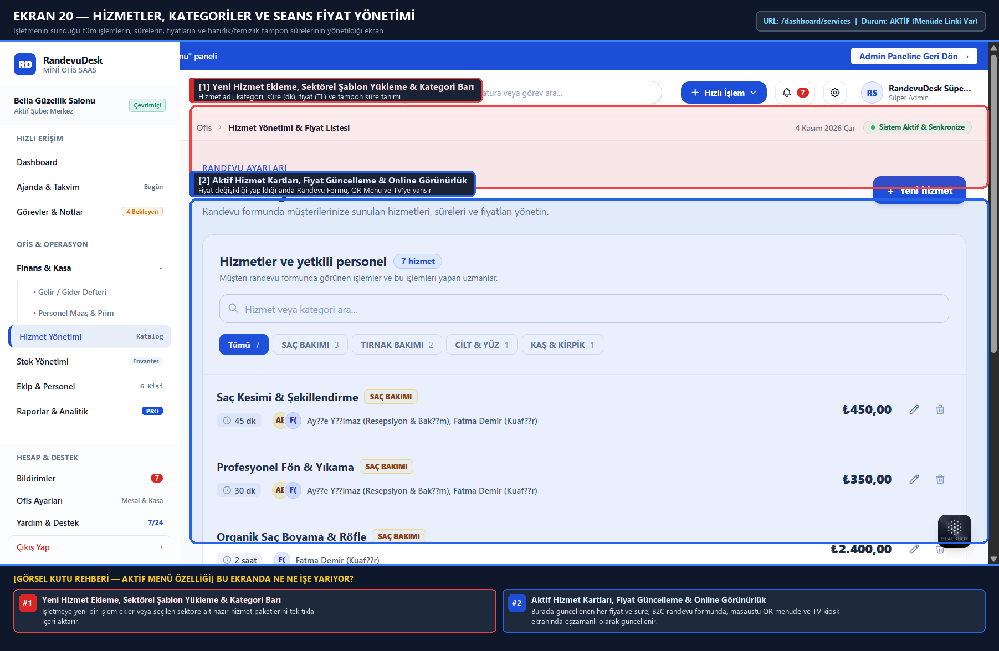

| Görseldeki Kutu No | Kutu Başlığı (Bölge / Modül) | Kısa Özeti | Bu Kutu Tam Olarak Ne İşe Yarıyor? |
| :---: | :--- | :--- | :--- |
| **`[1]`** | **Yeni Hizmet Ekleme, Sektörel Şablon Yükleme & Kategori Barı** | _Hizmet adı, kategori, süre (dk), fiyat (TL) ve tampon süre tanımı_ | İşletmeye yeni bir işlem ekler veya seçilen sektöre ait hazır hizmet paketlerini tek tıkla içeri aktarır. |
| **`[2]`** | **Aktif Hizmet Kartları, Fiyat Güncelleme & Online Görünürlük** | _Fiyat değişikliği yapıldığı anda Randevu Formu, QR Menü ve TV'ye yansır_ | Burada güncellenen her fiyat ve süre; B2C randevu formunda, masaüstü QR menüde ve TV kiosk ekranında eşzamanlı olarak güncellenir. |

---

#### 📸 EKRAN 21 — STOK TAKİBİ, KRİTİK ENVANTER VE ADİSYON (POS) YÖNETİMİ
- **Sayfa Rotası (URL):** `/dashboard?tab=inventory` | **Erişim Rolü:** `İşletme Sahibi / Depo Sorumlusu`
- **Menü & Geliştirme Durumu:** ✅ **[AKTİF — Menüde Doğrudan Linki Var]**
- **Bu Sayfa Ne İşe Yarar?** Salonda kullanılan sarf malzemelerin (boya, şampuan, dolgu, serum) ve satılan ürünlerin stok/barkod takip ekranı.

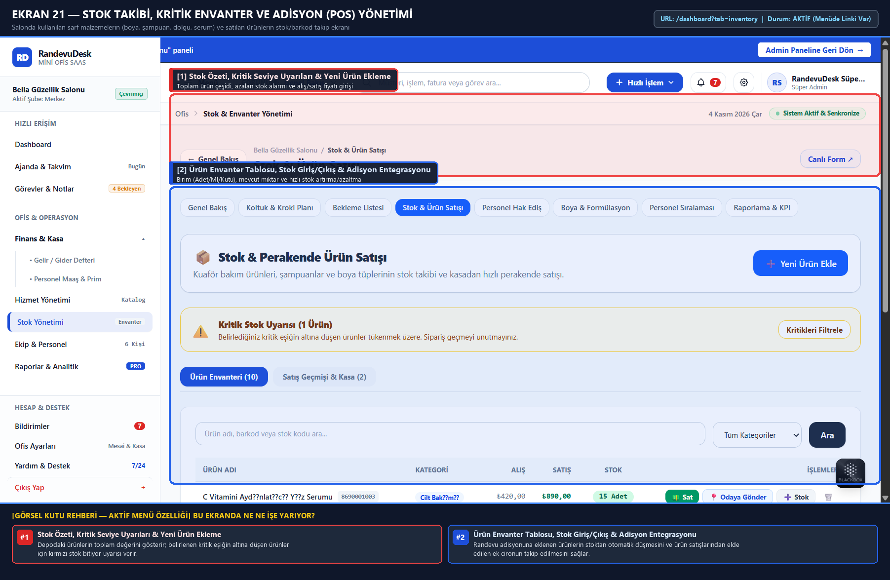

| Görseldeki Kutu No | Kutu Başlığı (Bölge / Modül) | Kısa Özeti | Bu Kutu Tam Olarak Ne İşe Yarıyor? |
| :---: | :--- | :--- | :--- |
| **`[1]`** | **Stok Özeti, Kritik Seviye Uyarıları & Yeni Ürün Ekleme** | _Toplam ürün çeşidi, azalan stok alarmı ve alış/satış fiyatı girişi_ | Depodaki ürünlerin toplam değerini gösterir; belirlenen kritik eşiğin altına düşen ürünler için kırmızı stok bitiyor uyarısı verir. |
| **`[2]`** | **Ürün Envanter Tablosu, Stok Giriş/Çıkış & Adisyon Entegrasyonu** | _Birim (Adet/Ml/Kutu), mevcut miktar ve hızlı stok artırma/azaltma_ | Randevu adisyonuna eklenen ürünlerin stoktan otomatik düşmesini ve ürün satışlarından elde edilen ek cironun takip edilmesini sağlar. |

---

#### 📸 EKRAN 22 — PERSONEL YÖNETİMİ, PRİM, BAHŞİŞ VE BORDRO HESAPLAYICI
- **Sayfa Rotası (URL):** `/dashboard?tab=payroll` | **Erişim Rolü:** `İşletme Sahibi / İnsan Kaynakları`
- **Menü & Geliştirme Durumu:** ✅ **[AKTİF — Menüde Doğrudan Linki Var]**
- **Bu Sayfa Ne İşe Yarar?** Uzmanların çalışma saatleri, uzmanlık alanları, sabit maaşları ve yaptıkları işlemlerden doğan primlerinin hesaplandığı ekran.

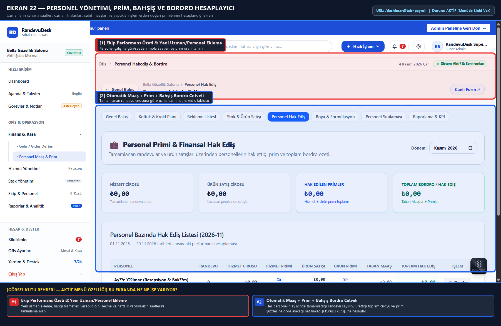

| Görseldeki Kutu No | Kutu Başlığı (Bölge / Modül) | Kısa Özeti | Bu Kutu Tam Olarak Ne İşe Yarıyor? |
| :---: | :--- | :--- | :--- |
| **`[1]`** | **Ekip Performans Özeti & Yeni Uzman/Personel Ekleme** | _Personel çalışma gün/saatleri, mola saatleri ve prim oranı tanımı_ | Yeni uzman ekleme, hangi hizmetleri verebildiğini seçme ve haftalık vardiya/izin saatlerini tanımlama alanı. |
| **`[2]`** | **Otomatik Maaş + Prim + Bahşiş Bordro Cetveli** | _Tamamlanan randevu cirosuna göre uzmanların net hakediş tablosu_ | Her personelin ay içinde tamamladığı randevu sayısını, ürettiği toplam ciroyu ve prim yüzdesine göre alacağı net hakedişi kuruşu kuruşuna hesaplar. |

---

#### 📸 EKRAN 23 — PERSONEL MEMNUNİYET LİGİ VE PERFORMANS REKABET TABLOSU
- **Sayfa Rotası (URL):** `/dashboard?tab=competition` | **Erişim Rolü:** `İşletme Sahibi / Ekip Lideri`
- **Menü & Geliştirme Durumu:** ✅ **[AKTİF — Menüde Doğrudan Linki Var]**
- **Bu Sayfa Ne İşe Yarar?** Müşterilerin seans sonrası verdiği puanlara, sadakat oranına ve ciroya göre uzmanları sıralayan oyunlaştırma ekranı.

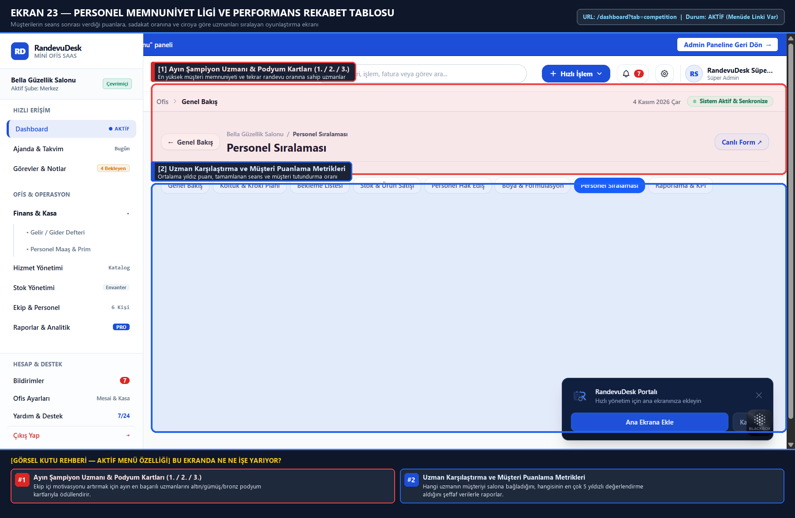

| Görseldeki Kutu No | Kutu Başlığı (Bölge / Modül) | Kısa Özeti | Bu Kutu Tam Olarak Ne İşe Yarıyor? |
| :---: | :--- | :--- | :--- |
| **`[1]`** | **Ayın Şampiyon Uzmanı & Podyum Kartları (1. / 2. / 3.)** | _En yüksek müşteri memnuniyeti ve tekrar randevu oranına sahip uzmanlar_ | Ekip içi motivasyonu artırmak için ayın en başarılı uzmanlarını altın/gümüş/bronz podyum kartlarıyla ödüllendirir. |
| **`[2]`** | **Uzman Karşılaştırma ve Müşteri Puanlama Metrikleri** | _Ortalama yıldız puanı, tamamlanan seans ve müşteri tutundurma oranı_ | Hangi uzmanın müşteriyi salona bağladığını, hangisinin en çok 5 yıldızlı değerlendirme aldığını şeffaf verilerle raporlar. |

---

#### 📸 EKRAN 24 — GELİŞMİŞ ANALİTİK, CİRO GRAFİKLERİ VE RFM MÜŞTERİ SEGMENTASYONU
- **Sayfa Rotası (URL):** `/dashboard?tab=analytics` | **Erişim Rolü:** `İşletme Sahibi / Pazarlama`
- **Menü & Geliştirme Durumu:** ✅ **[AKTİF — Menüde Doğrudan Linki Var]**
- **Bu Sayfa Ne İşe Yarar?** Müşterileri VIP, Sadık, Risk Altında (Unutulan) olarak ayıran ve tek tıkla geri kazanım kampanyası başlatan zeka ekranı.

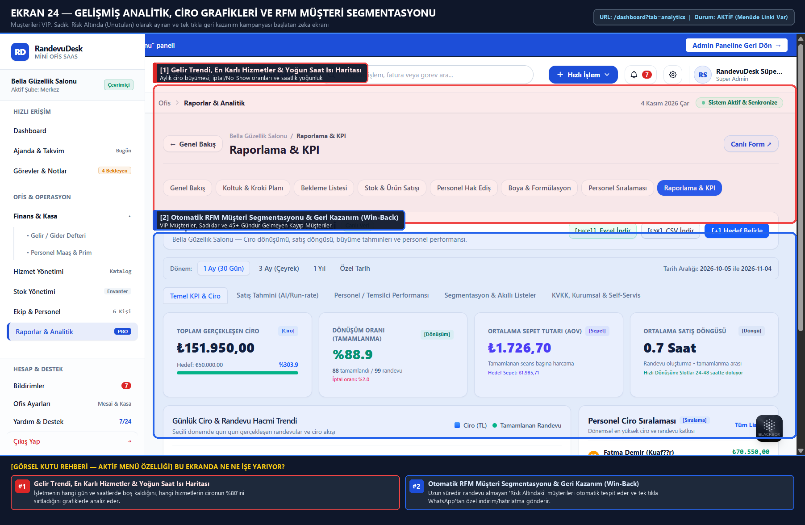

| Görseldeki Kutu No | Kutu Başlığı (Bölge / Modül) | Kısa Özeti | Bu Kutu Tam Olarak Ne İşe Yarıyor? |
| :---: | :--- | :--- | :--- |
| **`[1]`** | **Gelir Trendi, En Karlı Hizmetler & Yoğun Saat Isı Haritası** | _Aylık ciro büyümesi, iptal/No-Show oranları ve saatlik yoğunluk_ | İşletmenin hangi gün ve saatlerde boş kaldığını, hangi hizmetlerin cironun %80'ini sırtladığını grafiklerle analiz eder. |
| **`[2]`** | **Otomatik RFM Müşteri Segmentasyonu & Geri Kazanım (Win-Back)** | _VIP Müşteriler, Sadıklar ve 45+ Gündür Gelmeyen Kayıp Müşteriler_ | Uzun süredir randevu almayan 'Risk Altındaki' müşterileri otomatik tespit eder ve tek tıkla WhatsApp'tan özel indirim/hatırlatma gönderir. |

---

#### 📸 EKRAN 25 — İŞLETME ABONELİK, PAKET YÜKSELTME VE PAYTR GÜVENLİ ÖDEME — 🚧 [GELİŞTİRİLME AŞAMASINDA]
- **Sayfa Rotası (URL):** `/dashboard/subscription` | **Erişim Rolü:** `İşletme Sahibi`
- **Menü & Geliştirme Durumu:** 🚧 **[GELİŞTİRİLME AŞAMASINDA — Menüde Doğrudan Linki Yok / URL ile Erişilir]**
- **Bu Sayfa Ne İşe Yarar?** İşletmenin mevcut paket süresini gördüğü, aktivasyon kodu girdiği veya PayTR 3D Secure ile abonelik yenilediği ekran.

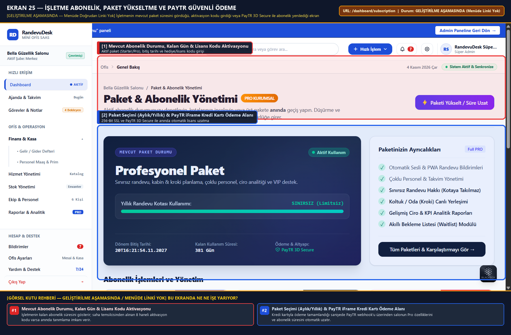

| Görseldeki Kutu No | Kutu Başlığı (Bölge / Modül) | Kısa Özeti | Bu Kutu Tam Olarak Ne İşe Yarıyor? |
| :---: | :--- | :--- | :--- |
| **`[1]`** | **Mevcut Abonelik Durumu, Kalan Gün & Lisans Kodu Aktivasyonu** | _Aktif paket (Starter/Pro), bitiş tarihi ve hediye/lisans kodu girişi_ | İşletmenin kalan abonelik süresini gösterir; saha temsilcisinden alınan 8 haneli aktivasyon kodu varsa anında tanımlama imkanı verir. |
| **`[2]`** | **Paket Seçimi (Aylık/Yıllık) & PayTR iFrame Kredi Kartı Ödeme Alanı** | _256-Bit SSL ve PayTR 3D Secure ile anında otomatik lisans uzatma_ | Kredi kartıyla ödeme tamamlandığı saniyede PayTR webhook'u üzerinden salonun Pro özelliklerini ve abonelik süresini otomatik uzatır. |

---

#### 📸 EKRAN 26 — AKILLI WHATSAPP & SMS BİLDİRİM MERKEZİ VE ŞABLON YÖNETİMİ
- **Sayfa Rotası (URL):** `/dashboard/notifications` | **Erişim Rolü:** `İşletme Sahibi / Operasyon`
- **Menü & Geliştirme Durumu:** ✅ **[AKTİF — Menüde Doğrudan Linki Var]**
- **Bu Sayfa Ne İşe Yarar?** Randevu onayı, 24 saat/2 saat kala hatırlatma ve Google Harita yıldız isteme mesajlarının yönetildiği ekran.

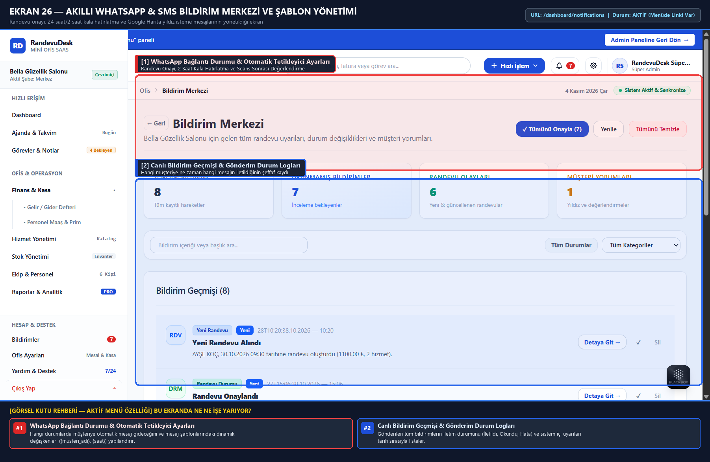

| Görseldeki Kutu No | Kutu Başlığı (Bölge / Modül) | Kısa Özeti | Bu Kutu Tam Olarak Ne İşe Yarıyor? |
| :---: | :--- | :--- | :--- |
| **`[1]`** | **WhatsApp Bağlantı Durumu & Otomatik Tetikleyici Ayarları** | _Randevu Onayı, 2 Saat Kala Hatırlatma ve Seans Sonrası Değerlendirme_ | Hangi durumlarda müşteriye otomatik mesaj gideceğini ve mesaj şablonlarındaki dinamik değişkenleri ({musteri_adi}, {saat}) yapılandırır. |
| **`[2]`** | **Canlı Bildirim Geçmişi & Gönderim Durum Logları** | _Hangi müşteriye ne zaman hangi mesajın iletildiğinin şeffaf kaydı_ | Gönderilen tüm bildirimlerin iletim durumunu (İletildi, Okundu, Hata) ve sistem içi uyarıları tarih sırasıyla listeler. |

---

#### 📸 EKRAN 27 — DİJİTAL QR MENÜ, MASA KARTI VE SOKAK VİTRİNİ TASARIM STÜDYOSU — 🚧 [GELİŞTİRİLME AŞAMASINDA]
- **Sayfa Rotası (URL):** `/dashboard/qr-menu` | **Erişim Rolü:** `İşletme Sahibi / Pazarlama`
- **Menü & Geliştirme Durumu:** 🚧 **[GELİŞTİRİLME AŞAMASINDA — Menüde Doğrudan Linki Yok / URL ile Erişilir]**
- **Bu Sayfa Ne İşe Yarar?** İşletmenin kendi masaüstü QR kodunu, vitrin posterini ve TV kiosk ekran linklerini indirip yönettiği stüdyo.

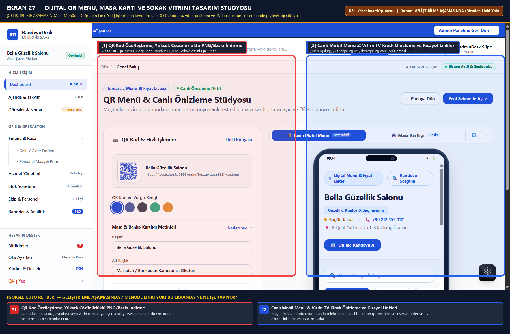

| Görseldeki Kutu No | Kutu Başlığı (Bölge / Modül) | Kısa Özeti | Bu Kutu Tam Olarak Ne İşe Yarıyor? |
| :---: | :--- | :--- | :--- |
| **`[1]`** | **QR Kod Özelleştirme, Yüksek Çözünürlüklü PNG/Baskı İndirme** | _Masaüstü QR Menü, Doğrudan Randevu QR ve Sokak Vitrini QR üretici_ | Salondaki masalara, aynalara veya vitrin camına yapıştırılacak yüksek çözünürlüklü QR kodları ve hazır baskı şablonlarını üretir. |
| **`[2]`** | **Canlı Mobil Menü & Vitrin TV Kiosk Önizleme ve Kısayol Linkleri** | _/menu/[slug], /vitrin/[slug] ve /kiosk/[slug] canlı önizlemesi_ | Müşterinin QR kodu okuttuğunda telefonunda nasıl bir ekran göreceğini canlı simüle eder ve TV ekranı linklerini tek tıkla kopyalar. |

---

#### 📸 EKRAN 28 — WEB SİTESİ CANLI WIDGET ENTEGRASYONU VE SOSYAL MEDYA LİNK MERKEZİ — 🚧 [GELİŞTİRİLME AŞAMASINDA]
- **Sayfa Rotası (URL):** `/dashboard/integration` | **Erişim Rolü:** `İşletme Sahibi / Webmaster`
- **Menü & Geliştirme Durumu:** 🚧 **[GELİŞTİRİLME AŞAMASINDA — Menüde Doğrudan Linki Yok / URL ile Erişilir]**
- **Bu Sayfa Ne İşe Yarar?** İşletmenin mevcut web sitesine 1 satır kodla yüzen randevu butonu eklediği ve Instagram/Google linklerini aldığı ekran.

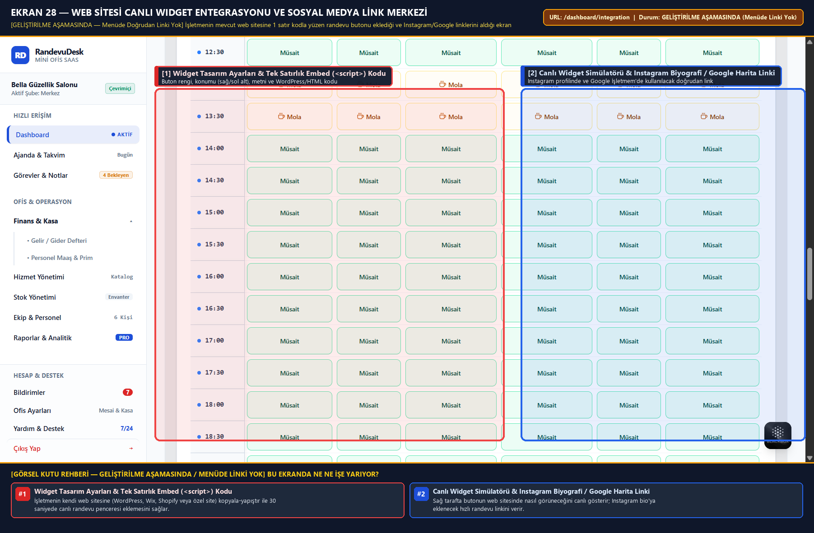

| Görseldeki Kutu No | Kutu Başlığı (Bölge / Modül) | Kısa Özeti | Bu Kutu Tam Olarak Ne İşe Yarıyor? |
| :---: | :--- | :--- | :--- |
| **`[1]`** | **Widget Tasarım Ayarları & Tek Satırlık Embed (<script>) Kodu** | _Buton rengi, konumu (sağ/sol alt), metni ve WordPress/HTML kodu_ | İşletmenin kendi web sitesine (WordPress, Wix, Shopify veya özel site) kopyala-yapıştır ile 30 saniyede canlı randevu penceresi eklemesini sağlar. |
| **`[2]`** | **Canlı Widget Simülatörü & Instagram Biyografi / Google Harita Linki** | _Instagram profilinde ve Google İşletmem'de kullanılacak doğrudan link_ | Sağ tarafta butonun web sitesinde nasıl görüneceğini canlı gösterir; Instagram bio'ya eklenecek hızlı randevu linkini verir. |

---

#### 📸 EKRAN 29 — İŞLETME GENEL AYARLARI, ÇALIŞMA SAATLERİ VE GÜVENLİK KURALLARI
- **Sayfa Rotası (URL):** `/dashboard/settings` | **Erişim Rolü:** `İşletme Sahibi`
- **Menü & Geliştirme Durumu:** ✅ **[AKTİF — Menüde Doğrudan Linki Var]**
- **Bu Sayfa Ne İşe Yarar?** Salon kimliği, çalışma gün/saatleri, randevu onay modu (otomatik/manuel), tatil günleri ve Google Harita link ayarları.

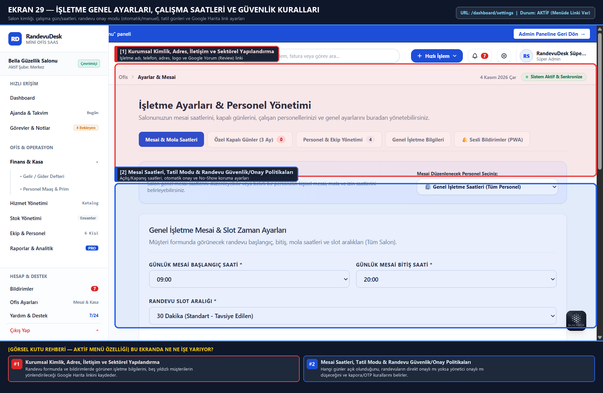

| Görseldeki Kutu No | Kutu Başlığı (Bölge / Modül) | Kısa Özeti | Bu Kutu Tam Olarak Ne İşe Yarıyor? |
| :---: | :--- | :--- | :--- |
| **`[1]`** | **Kurumsal Kimlik, Adres, İletişim ve Sektörel Yapılandırma** | _İşletme adı, telefon, adres, logo ve Google Yorum (Review) linki_ | Randevu formunda ve bildirimlerde görünen işletme bilgilerini, beş yıldızlı müşterilerin yönlendirileceği Google Harita linkini kaydeder. |
| **`[2]`** | **Mesai Saatleri, Tatil Modu & Randevu Güvenlik/Onay Politikaları** | _Açılış/Kapanış saatleri, otomatik onay ve No-Show koruma ayarları_ | Hangi günler açık olunduğunu, randevuların direkt onaylı mı yoksa yönetici onaylı mı düşeceğini ve kapora/OTP kurallarını belirler. |

---

#### 📸 EKRAN 30 — AKILLI AYNA (SMART MIRROR) & KOLTUK BAZLI NFC/QR İSTASYONLARI — 🚧 [GELİŞTİRİLME AŞAMASINDA]
- **Sayfa Rotası (URL):** `/dashboard/smart-mirrors` | **Erişim Rolü:** `İşletme Sahibi / VIP Deneyim`
- **Menü & Geliştirme Durumu:** 🚧 **[GELİŞTİRİLME AŞAMASINDA — Menüde Doğrudan Linki Yok / URL ile Erişilir]**
- **Bu Sayfa Ne İşe Yarar?** Salondaki her ayna/koltuk için özel üretilen QR/NFC kodlarıyla müşteriye koltukta dijital ikram ve ek hizmet sunan modül.

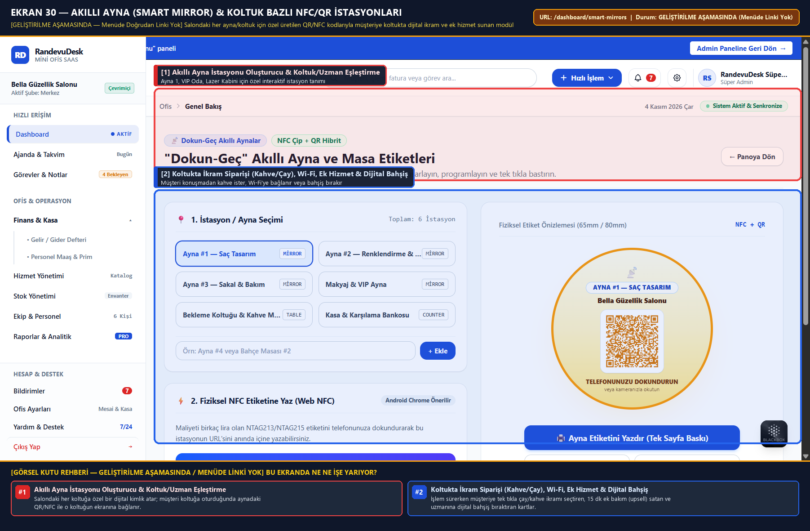

| Görseldeki Kutu No | Kutu Başlığı (Bölge / Modül) | Kısa Özeti | Bu Kutu Tam Olarak Ne İşe Yarıyor? |
| :---: | :--- | :--- | :--- |
| **`[1]`** | **Akıllı Ayna İstasyonu Oluşturucu & Koltuk/Uzman Eşleştirme** | _Ayna 1, VIP Oda, Lazer Kabini için özel interaktif istasyon tanımı_ | Salondaki her koltuğa özel bir dijital kimlik atar; müşteri koltuğa oturduğunda aynadaki QR/NFC ile o koltuğun ekranına bağlanır. |
| **`[2]`** | **Koltukta İkram Siparişi (Kahve/Çay), Wi-Fi, Ek Hizmet & Dijital Bahşiş** | _Müşteri konuşmadan kahve ister, Wi-Fi'ye bağlanır veya bahşiş bırakır_ | İşlem sürerken müşteriye tek tıkla çay/kahve ikramı seçtiren, 15 dk ek bakım (upsell) satan ve uzmanına dijital bahşiş bıraktıran kartlar. |

---

#### 📸 EKRAN 31 — OTONOM INSTAGRAM STORY & SOSYAL MEDYA TASARIM STÜDYOSU — 🚧 [GELİŞTİRİLME AŞAMASINDA]
- **Sayfa Rotası (URL):** `/dashboard/story-studio` | **Erişim Rolü:** `İşletme Sahibi / Sosyal Medya`
- **Menü & Geliştirme Durumu:** 🚧 **[GELİŞTİRİLME AŞAMASINDA — Menüde Doğrudan Linki Yok / URL ile Erişilir]**
- **Bu Sayfa Ne İşe Yarar?** O günkü boş saatleri tek tıkla 1080x1920 piksel Instagram Hikaye (Story) afişine dönüştürüp indiren viral pazarlama aracı.

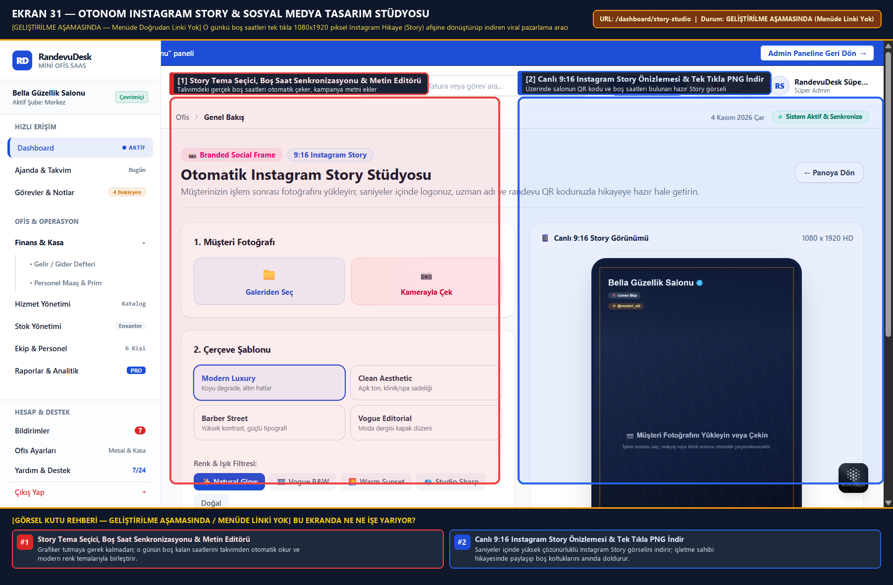

| Görseldeki Kutu No | Kutu Başlığı (Bölge / Modül) | Kısa Özeti | Bu Kutu Tam Olarak Ne İşe Yarıyor? |
| :---: | :--- | :--- | :--- |
| **`[1]`** | **Story Tema Seçici, Boş Saat Senkronizasyonu & Metin Editörü** | _Takvimdeki gerçek boş saatleri otomatik çeker, kampanya metni ekler_ | Grafiker tutmaya gerek kalmadan; o günün boş kalan saatlerini takvimden otomatik okur ve modern renk temalarıyla birleştirir. |
| **`[2]`** | **Canlı 9:16 Instagram Story Önizlemesi & Tek Tıkla PNG İndir** | _Üzerinde salonun QR kodu ve boş saatleri bulunan hazır Story görseli_ | Saniyeler içinde yüksek çözünürlüklü Instagram Story görselini indirir; işletme sahibi hikayesinde paylaşıp boş koltuklarını anında doldurur. |

---

#### 📸 EKRAN 32 — VIP SADAKAT KULÜBÜ, HEDİYE ÇARKI VE ARKADAŞINI GETİR (REFERRAL) — 🚧 [GELİŞTİRİLME AŞAMASINDA]
- **Sayfa Rotası (URL):** `/dashboard/loyalty` | **Erişim Rolü:** `İşletme Sahibi / CRM & Sadakat`
- **Menü & Geliştirme Durumu:** 🚧 **[GELİŞTİRİLME AŞAMASINDA — Menüde Doğrudan Linki Yok / URL ile Erişilir]**
- **Bu Sayfa Ne İşe Yarar?** Müşterilerin her randevuda puan/damga topladığı, şans çarkı çevirdiği ve arkadaşını davet ederek ödül kazandığı modül.

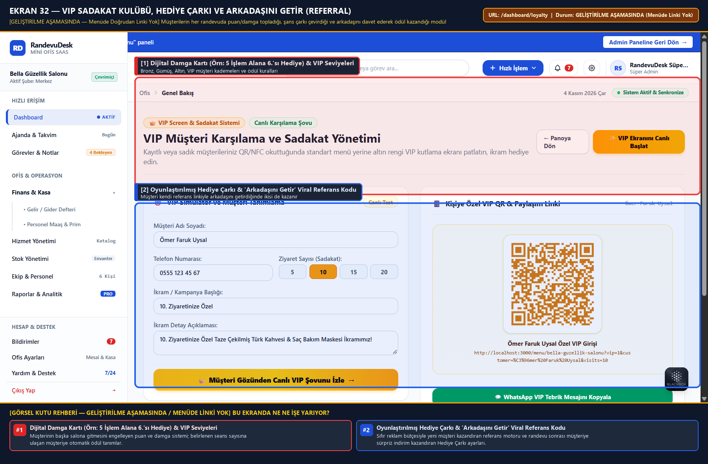

| Görseldeki Kutu No | Kutu Başlığı (Bölge / Modül) | Kısa Özeti | Bu Kutu Tam Olarak Ne İşe Yarıyor? |
| :---: | :--- | :--- | :--- |
| **`[1]`** | **Dijital Damga Kartı (Örn: 5 İşlem Alana 6.'sı Hediye) & VIP Seviyeleri** | _Bronz, Gümüş, Altın, VIP müşteri kademeleri ve ödül kuralları_ | Müşterinin başka salona gitmesini engelleyen puan ve damga sistemi; belirlenen seans sayısına ulaşan müşteriye otomatik ödül tanımlar. |
| **`[2]`** | **Oyunlaştırılmış Hediye Çarkı & 'Arkadaşını Getir' Viral Referans Kodu** | _Müşteri kendi referans linkiyle arkadaşını getirdiğinde ikisi de kazanır_ | Sıfır reklam bütçesiyle yeni müşteri kazandıran referans motoru ve randevu sonrası müşteriye sürpriz indirim kazandıran Hediye Çarkı ayarları. |

---

### 26.3. Süper Admin Platform Komuta Merkezi (`/admin/*`) & Pazarlamacı CRM Portalı (`/pazarlamaci`) (Ekran 33 – 44)

#### 📸 EKRAN 33 — SÜPER ADMİN PANELİ (/admin) — TÜM İŞLETMELER VE MERKEZİ KONTROL
- **Sayfa Rotası (URL):** `/admin` | **Erişim Rolü:** `Süper Admin (Platform Sahibi)`
- **Menü & Geliştirme Durumu:** ✅ **[AKTİF — Menüde Doğrudan Linki Var]**
- **Bu Sayfa Ne İşe Yarar?** Platformdaki tüm kayıtlı salonların, kliniklerin, abonelik durumlarının ve sistem genel metriklerinin yönetildiği ana merkez.

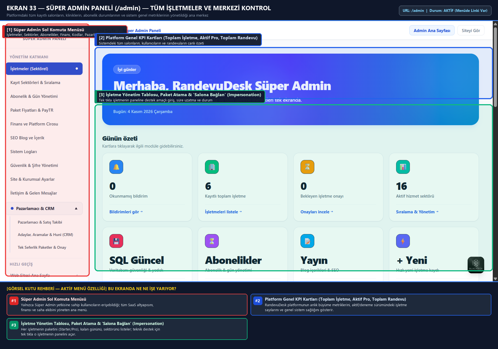

| Görseldeki Kutu No | Kutu Başlığı (Bölge / Modül) | Kısa Özeti | Bu Kutu Tam Olarak Ne İşe Yarıyor? |
| :---: | :--- | :--- | :--- |
| **`[1]`** | **Süper Admin Sol Komuta Menüsü** | _İşletmeler, Sektörler, Abonelikler, Finans, Kodlar, Pazarlamacılar, Güvenlik_ | Yalnızca Süper Admin yetkisine sahip kullanıcıların erişebildiği; tüm SaaS altyapısını, finansı ve saha ekibini yöneten ana menü. |
| **`[2]`** | **Platform Genel KPI Kartları (Toplam İşletme, Aktif Pro, Toplam Randevu)** | _Sistemdeki tüm salonların, kullanıcıların ve randevuların canlı özeti_ | RandevuDesk platformunun anlık büyüme metriklerini, aktif/deneme sürümündeki işletme sayılarını ve genel sistem sağlığını gösterir. |
| **`[3]`** | **İşletme Yönetim Tablosu, Paket Atama & 'Salona Bağlan' (Impersonation)** | _Tek tıkla işletmenin paneline destek amaçlı giriş, süre uzatma ve durum_ | Her işletmenin paketini (Starter/Pro), kalan gününü, sektörünü listeler; teknik destek için tek tıkla o işletmenin panelini açar. |

---

#### 📸 EKRAN 34 — SÜPER ADMİN — DİNAMİK SEKTÖRLER VE ŞABLON YÖNETİMİ
- **Sayfa Rotası (URL):** `/admin/sektorler` | **Erişim Rolü:** `Süper Admin`
- **Menü & Geliştirme Durumu:** ✅ **[AKTİF — Menüde Doğrudan Linki Var]**
- **Bu Sayfa Ne İşe Yarar?** Platformun desteklediği sektörlerin, sektörel özel form alanlarının ve varsayılan hizmetlerin yönetildiği ekran.

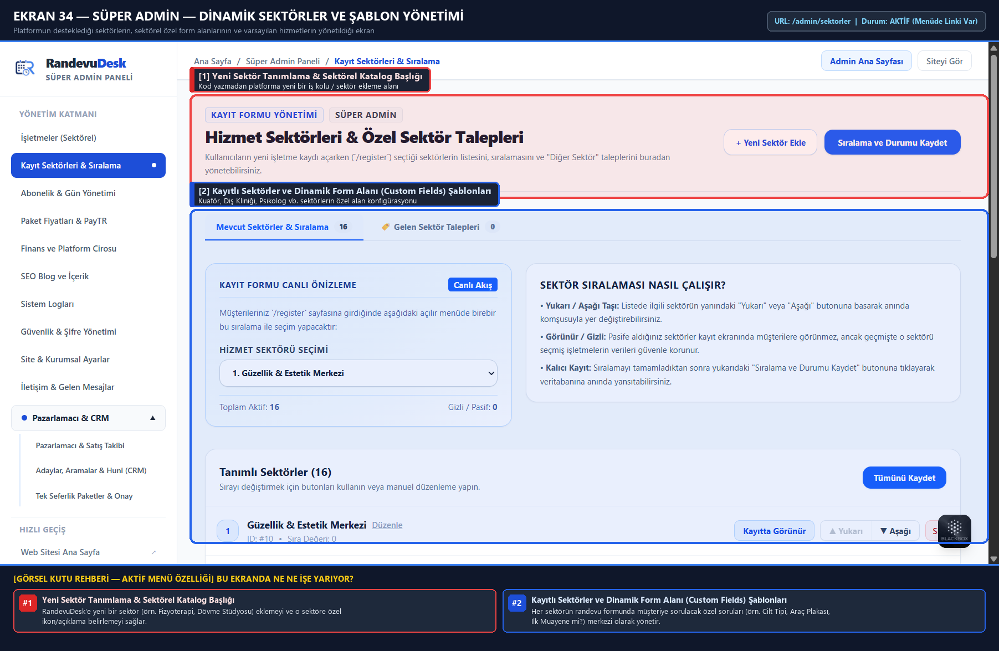

| Görseldeki Kutu No | Kutu Başlığı (Bölge / Modül) | Kısa Özeti | Bu Kutu Tam Olarak Ne İşe Yarıyor? |
| :---: | :--- | :--- | :--- |
| **`[1]`** | **Yeni Sektör Tanımlama & Sektörel Katalog Başlığı** | _Kod yazmadan platforma yeni bir iş kolu / sektör ekleme alanı_ | RandevuDesk'e yeni bir sektör (örn. Fizyoterapi, Dövme Stüdyosu) eklemeyi ve o sektöre özel ikon/açıklama belirlemeyi sağlar. |
| **`[2]`** | **Kayıtlı Sektörler ve Dinamik Form Alanı (Custom Fields) Şablonları** | _Kuaför, Diş Kliniği, Psikolog vb. sektörlerin özel alan konfigürasyonu_ | Her sektörün randevu formunda müşteriye sorulacak özel soruları (örn. Cilt Tipi, Araç Plakası, İlk Muayene mi?) merkezi olarak yönetir. |

---

#### 📸 EKRAN 35 — SÜPER ADMİN — ABONELİKLER, SÜRE UZATMA VE LİSANS TAKİBİ
- **Sayfa Rotası (URL):** `/admin/abonelikler` | **Erişim Rolü:** `Süper Admin`
- **Menü & Geliştirme Durumu:** ✅ **[AKTİF — Menüde Doğrudan Linki Var]**
- **Bu Sayfa Ne İşe Yarar?** Tüm işletmelerin abonelik bitiş tarihlerinin izlendiği, manuel gün eklendiği ve paket yükseltmelerinin yapıldığı ekran.

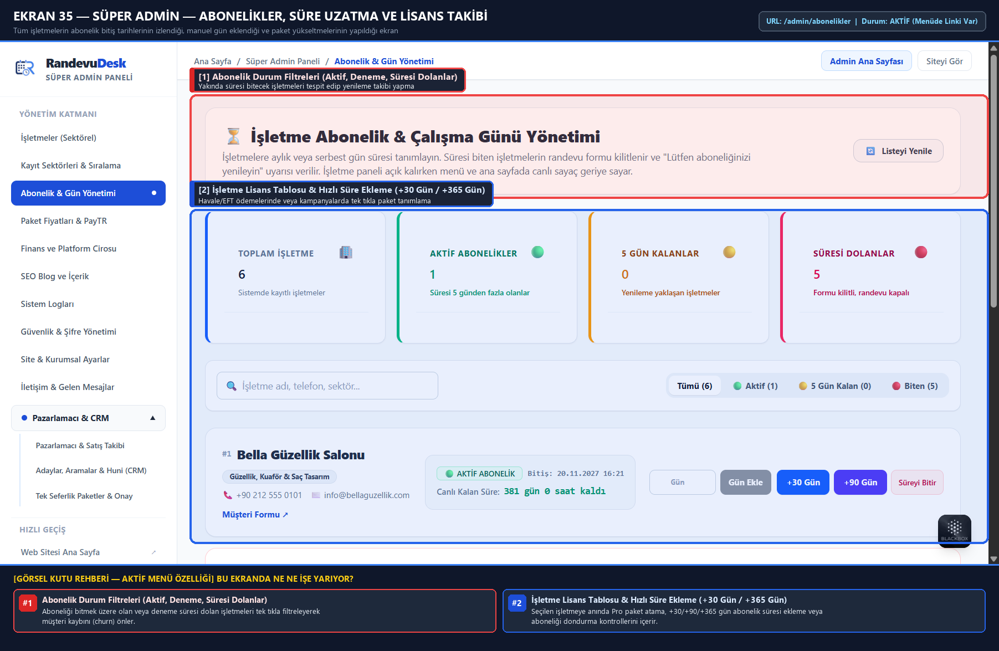

| Görseldeki Kutu No | Kutu Başlığı (Bölge / Modül) | Kısa Özeti | Bu Kutu Tam Olarak Ne İşe Yarıyor? |
| :---: | :--- | :--- | :--- |
| **`[1]`** | **Abonelik Durum Filtreleri (Aktif, Deneme, Süresi Dolanlar)** | _Yakında süresi bitecek işletmeleri tespit edip yenileme takibi yapma_ | Aboneliği bitmek üzere olan veya deneme süresi dolan işletmeleri tek tıkla filtreleyerek müşteri kaybını (churn) önler. |
| **`[2]`** | **İşletme Lisans Tablosu & Hızlı Süre Ekleme (+30 Gün / +365 Gün)** | _Havale/EFT ödemelerinde veya kampanyalarda tek tıkla paket tanımlama_ | Seçilen işletmeye anında Pro paket atama, +30/+90/+365 gün abonelik süresi ekleme veya aboneliği dondurma kontrollerini içerir. |

---

#### 📸 EKRAN 36 — SÜPER ADMİN — MERKEZİ PAKET FİYATLARI VE KAMPANYA YÖNETİMİ
- **Sayfa Rotası (URL):** `/admin/paket-fiyatlari` | **Erişim Rolü:** `Süper Admin`
- **Menü & Geliştirme Durumu:** ✅ **[AKTİF — Menüde Doğrudan Linki Var]**
- **Bu Sayfa Ne İşe Yarar?** Starter, Pro ve Enterprise paketlerinin aylık/yıllık fiyatlarını ve özellik maddelerini canlı değiştiren yönetim ekranı.

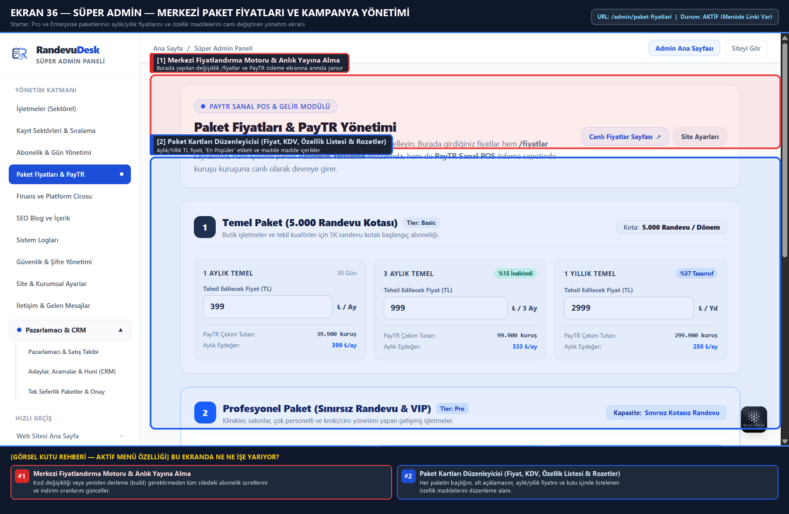

| Görseldeki Kutu No | Kutu Başlığı (Bölge / Modül) | Kısa Özeti | Bu Kutu Tam Olarak Ne İşe Yarıyor? |
| :---: | :--- | :--- | :--- |
| **`[1]`** | **Merkezi Fiyatlandırma Motoru & Anlık Yayına Alma** | _Burada yapılan değişiklik /fiyatlar ve PayTR ödeme ekranına anında yansır_ | Kod değişikliği veya yeniden derleme (build) gerektirmeden tüm sitedeki abonelik ücretlerini ve indirim oranlarını günceller. |
| **`[2]`** | **Paket Kartları Düzenleyicisi (Fiyat, KDV, Özellik Listesi & Rozetler)** | _Aylık/Yıllık TL fiyatı, 'En Popüler' etiketi ve madde madde içerikler_ | Her paketin başlığını, alt açıklamasını, aylık/yıllık fiyatını ve kutu içinde listelenen özellik maddelerini düzenleme alanı. |

---

#### 📸 EKRAN 37 — SÜPER ADMİN — FİNANS, PAYTR TAHSİLATLARI, KOMİSYON VE KDV RAPORU
- **Sayfa Rotası (URL):** `/admin/finans` | **Erişim Rolü:** `Süper Admin / Finans`
- **Menü & Geliştirme Durumu:** ✅ **[AKTİF — Menüde Doğrudan Linki Var]**
- **Bu Sayfa Ne İşe Yarar?** Platformun toplam SaaS abonelik gelirlerini, ödenen pazarlamacı komisyonlarını, KDV'yi ve net karı hesaplayan ekran.

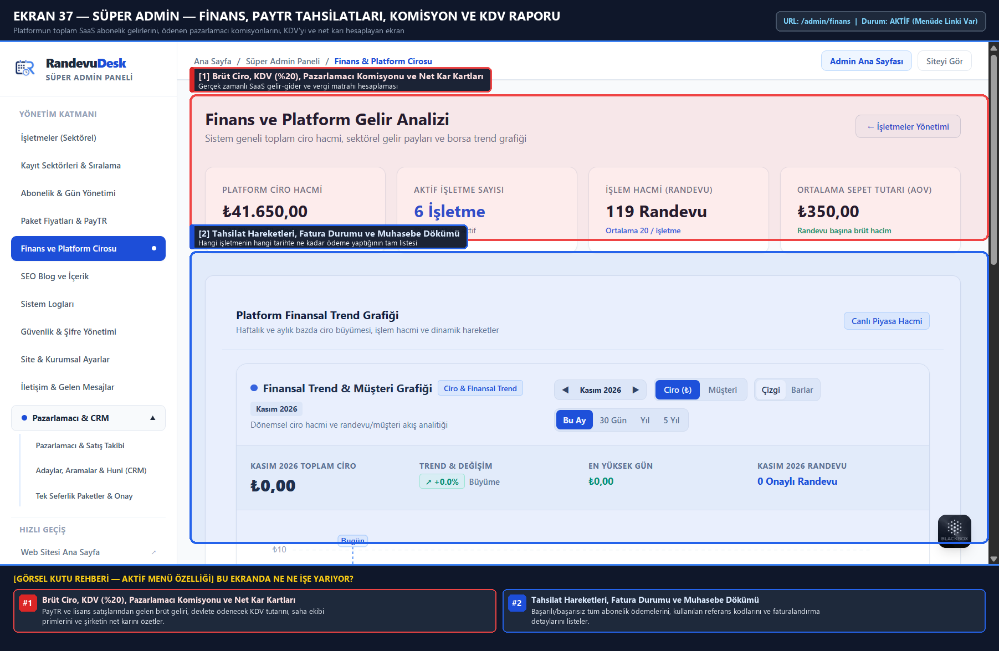

| Görseldeki Kutu No | Kutu Başlığı (Bölge / Modül) | Kısa Özeti | Bu Kutu Tam Olarak Ne İşe Yarıyor? |
| :---: | :--- | :--- | :--- |
| **`[1]`** | **Brüt Ciro, KDV (%20), Pazarlamacı Komisyonu ve Net Kar Kartları** | _Gerçek zamanlı SaaS gelir-gider ve vergi matrahı hesaplaması_ | PayTR ve lisans satışlarından gelen brüt geliri, devlete ödenecek KDV tutarını, saha ekibi primlerini ve şirketin net karını özetler. |
| **`[2]`** | **Tahsilat Hareketleri, Fatura Durumu ve Muhasebe Dökümü** | _Hangi işletmenin hangi tarihte ne kadar ödeme yaptığının tam listesi_ | Başarılı/başarısız tüm abonelik ödemelerini, kullanılan referans kodlarını ve faturalandırma detaylarını listeler. |

---

#### 📸 EKRAN 38 — SÜPER ADMİN — LİSANS & AKTİVASYON KODU ÜRETİM MERKEZİ — 🚧 [GELİŞTİRİLME AŞAMASINDA]
- **Sayfa Rotası (URL):** `/admin/kodlar` | **Erişim Rolü:** `Süper Admin`
- **Menü & Geliştirme Durumu:** 🚧 **[GELİŞTİRİLME AŞAMASINDA — Menüde Doğrudan Linki Yok / URL ile Erişilir]**
- **Bu Sayfa Ne İşe Yarar?** Saha satışlarında veya kurumsal anlaşmalarda kullanılmak üzere tek/çok kullanımlık Pro aktivasyon kodu üreten ekran.

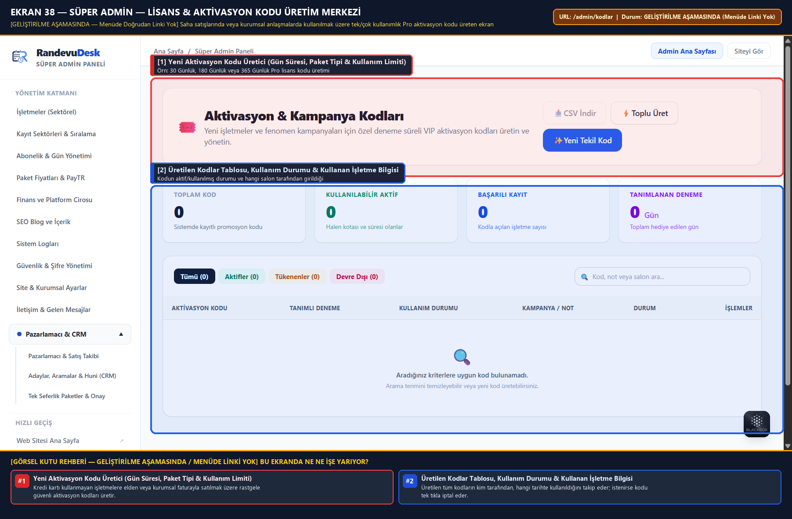

| Görseldeki Kutu No | Kutu Başlığı (Bölge / Modül) | Kısa Özeti | Bu Kutu Tam Olarak Ne İşe Yarıyor? |
| :---: | :--- | :--- | :--- |
| **`[1]`** | **Yeni Aktivasyon Kodu Üretici (Gün Süresi, Paket Tipi & Kullanım Limiti)** | _Örn: 30 Günlük, 180 Günlük veya 365 Günlük Pro lisans kodu üretimi_ | Kredi kartı kullanmayan işletmelere elden veya kurumsal faturayla satılmak üzere rastgele güvenli aktivasyon kodları üretir. |
| **`[2]`** | **Üretilen Kodlar Tablosu, Kullanım Durumu & Kullanan İşletme Bilgisi** | _Kodun aktif/kullanılmış durumu ve hangi salon tarafından girildiği_ | Üretilen tüm kodların kim tarafından, hangi tarihte kullanıldığını takip eder; istenirse kodu tek tıkla iptal eder. |

---

#### 📸 EKRAN 39 — SÜPER ADMİN — SAHA PAZARLAMACILARI (SATIŞ ORTAKLARI) VE PRİM YÖNETİMİ
- **Sayfa Rotası (URL):** `/admin/pazarlamacilar` | **Erişim Rolü:** `Süper Admin / Satış Direktörü`
- **Menü & Geliştirme Durumu:** ✅ **[AKTİF — Menüde Doğrudan Linki Var]**
- **Bu Sayfa Ne İşe Yarar?** Saha satış temsilcilerinin referans kodlarını, getirdikleri işletmeleri, hak ettikleri komisyonları ve ödemeleri yöneten ekran.

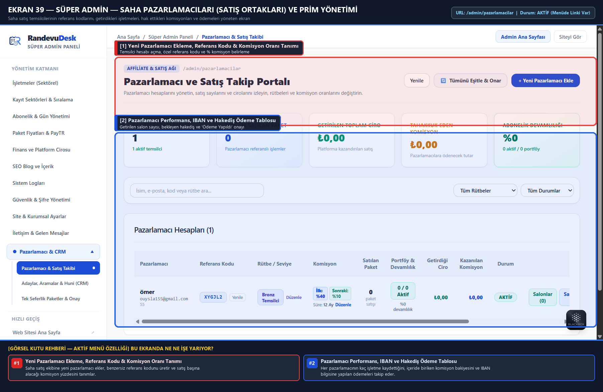

| Görseldeki Kutu No | Kutu Başlığı (Bölge / Modül) | Kısa Özeti | Bu Kutu Tam Olarak Ne İşe Yarıyor? |
| :---: | :--- | :--- | :--- |
| **`[1]`** | **Yeni Pazarlamacı Ekleme, Referans Kodu & Komisyon Oranı Tanımı** | _Temsilci hesabı açma, özel referans kodu ve % komisyon belirleme_ | Saha satış ekibine yeni pazarlamacı ekler, benzersiz referans kodunu üretir ve satış başına alacağı komisyon yüzdesini tanımlar. |
| **`[2]`** | **Pazarlamacı Performans, IBAN ve Hakediş Ödeme Tablosu** | _Getirilen salon sayısı, bekleyen hakediş ve 'Ödeme Yapıldı' onayı_ | Her pazarlamacının kaç işletme kaydettiğini, içeride biriken komisyon bakiyesini ve IBAN bilgisine yapılan ödemeleri takip eder. |

---

#### 📸 EKRAN 40 — SÜPER ADMİN — PAZARLAMACI ADAY BAŞVURULARI VE ONAY EKRANI
- **Sayfa Rotası (URL):** `/admin/pazarlamaci-adaylari` | **Erişim Rolü:** `Süper Admin / İK`
- **Menü & Geliştirme Durumu:** ✅ **[AKTİF — Menüde Doğrudan Linki Var]**
- **Bu Sayfa Ne İşe Yarar?** Web sitesinden 'Satış Ortağı Ol' formuyla başvuran saha pazarlamacı adaylarının incelenip tek tıkla onaylandığı ekran.

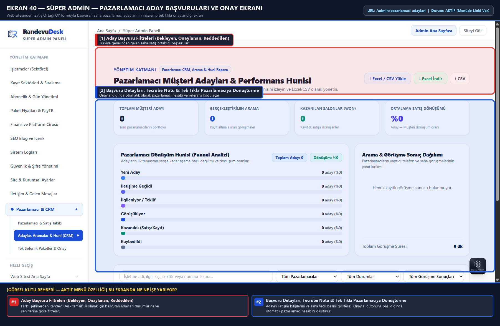

| Görseldeki Kutu No | Kutu Başlığı (Bölge / Modül) | Kısa Özeti | Bu Kutu Tam Olarak Ne İşe Yarıyor? |
| :---: | :--- | :--- | :--- |
| **`[1]`** | **Aday Başvuru Filtreleri (Bekleyen, Onaylanan, Reddedilen)** | _Türkiye genelinden gelen saha satış ortaklığı başvuruları_ | Farklı şehirlerden RandevuDesk temsilcisi olmak için başvuran adayları durumlarına ve şehirlerine göre filtreler. |
| **`[2]`** | **Başvuru Detayları, Tecrübe Notu & Tek Tıkla Pazarlamacıya Dönüştürme** | _Onaylandığında otomatik olarak pazarlamacı hesabı ve referans kodu açar_ | Adayın iletişim bilgilerini ve saha tecrübesini gösterir; 'Onayla' butonuna basıldığında otomatik pazarlamacı hesabını oluşturur. |

---

#### 📸 EKRAN 41 — SÜPER ADMİN — KURUMSAL WEB SİTESİ PAKETLERİ VE EK HİZMETLER
- **Sayfa Rotası (URL):** `/admin/web-paketleri` | **Erişim Rolü:** `Süper Admin`
- **Menü & Geliştirme Durumu:** ✅ **[AKTİF — Menüde Doğrudan Linki Var]**
- **Bu Sayfa Ne İşe Yarar?** Web sitesi olmayan işletmelere sunulan anahtar teslim kurumsal web sitesi + SEO paketlerinin yönetildiği ekran.

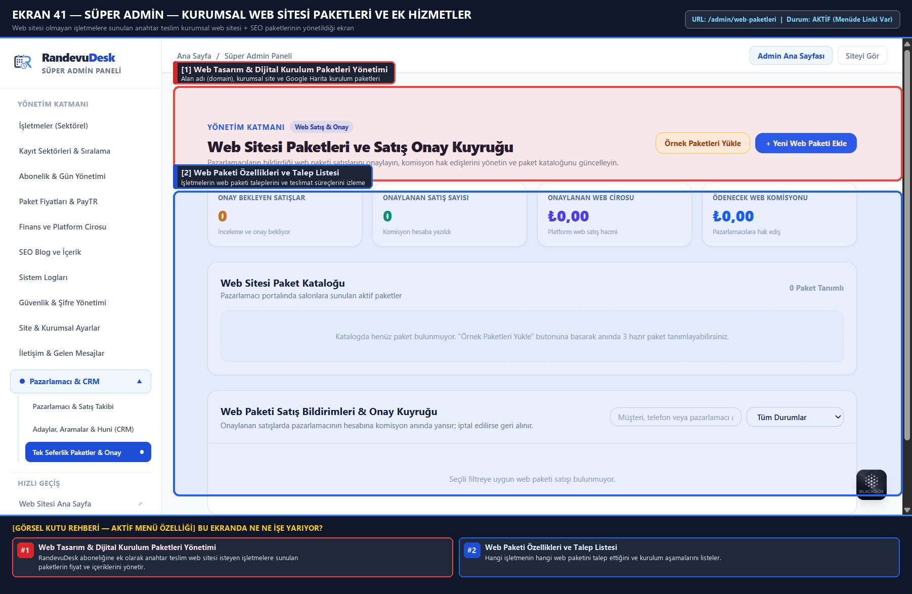

| Görseldeki Kutu No | Kutu Başlığı (Bölge / Modül) | Kısa Özeti | Bu Kutu Tam Olarak Ne İşe Yarıyor? |
| :---: | :--- | :--- | :--- |
| **`[1]`** | **Web Tasarım & Dijital Kurulum Paketleri Yönetimi** | _Alan adı (domain), kurumsal site ve Google Harita kurulum paketleri_ | RandevuDesk aboneliğine ek olarak anahtar teslim web sitesi isteyen işletmelere sunulan paketlerin fiyat ve içeriklerini yönetir. |
| **`[2]`** | **Web Paketi Özellikleri ve Talep Listesi** | _İşletmelerin web paketi taleplerini ve teslimat süreçlerini izleme_ | Hangi işletmenin hangi web paketini talep ettiğini ve kurulum aşamalarını listeler. |

---

#### 📸 EKRAN 42 — SÜPER ADMİN — SİBER GÜVENLİK, IP ENGELLEME VE DENETİM LOGLARI (AUDIT)
- **Sayfa Rotası (URL):** `/admin/guvenlik` | **Erişim Rolü:** `Süper Admin / SecOps`
- **Menü & Geliştirme Durumu:** ✅ **[AKTİF — Menüde Doğrudan Linki Var]**
- **Bu Sayfa Ne İşe Yarar?** Başarısız giriş denemelerinin, şüpheli IP'lerin, admin işlemlerinin ve kara listenin (Blacklist) izlendiği güvenlik merkezi.

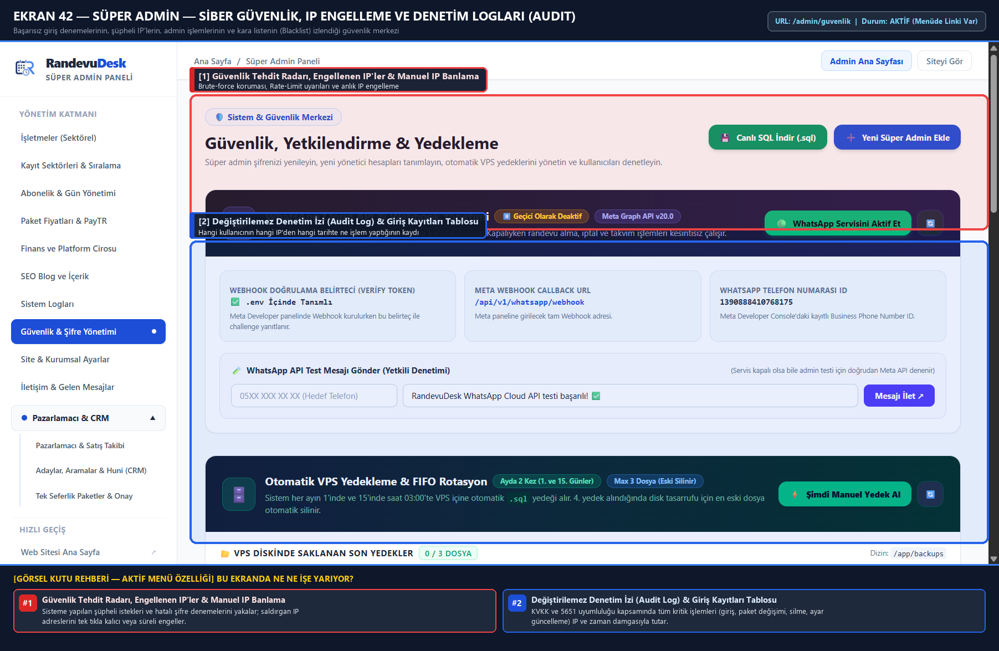

| Görseldeki Kutu No | Kutu Başlığı (Bölge / Modül) | Kısa Özeti | Bu Kutu Tam Olarak Ne İşe Yarıyor? |
| :---: | :--- | :--- | :--- |
| **`[1]`** | **Güvenlik Tehdit Radarı, Engellenen IP'ler & Manuel IP Banlama** | _Brute-force koruması, Rate-Limit uyarıları ve anlık IP engelleme_ | Sisteme yapılan şüpheli istekleri ve hatalı şifre denemelerini yakalar; saldırgan IP adreslerini tek tıkla kalıcı veya süreli engeller. |
| **`[2]`** | **Değiştirilemez Denetim İzi (Audit Log) & Giriş Kayıtları Tablosu** | _Hangi kullanıcının hangi IP'den hangi tarihte ne işlem yaptığının kaydı_ | KVKK ve 5651 uyumluluğu kapsamında tüm kritik işlemleri (giriş, paket değişimi, silme, ayar güncelleme) IP ve zaman damgasıyla tutar. |

---

#### 📸 EKRAN 43 — SÜPER ADMİN — PLATFORM GENEL SİTE, İLETİŞİM VE DUYURU AYARLARI
- **Sayfa Rotası (URL):** `/admin/site-ayarlari` | **Erişim Rolü:** `Süper Admin`
- **Menü & Geliştirme Durumu:** ✅ **[AKTİF — Menüde Doğrudan Linki Var]**
- **Bu Sayfa Ne İşe Yarar?** RandevuDesk ana sayfasındaki iletişim bilgileri, WhatsApp destek hattı, bakım modu ve global ayarların yönetildiği ekran.

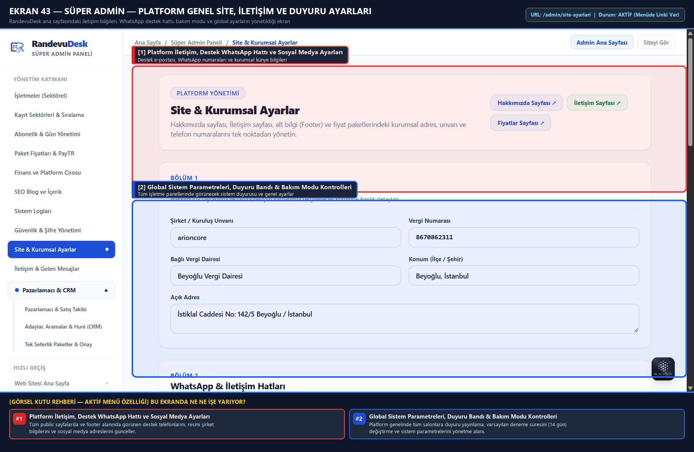

| Görseldeki Kutu No | Kutu Başlığı (Bölge / Modül) | Kısa Özeti | Bu Kutu Tam Olarak Ne İşe Yarıyor? |
| :---: | :--- | :--- | :--- |
| **`[1]`** | **Platform İletişim, Destek WhatsApp Hattı ve Sosyal Medya Ayarları** | _Destek e-postası, WhatsApp numaraları ve kurumsal künye bilgileri_ | Tüm public sayfalarda ve footer alanında görünen destek telefonlarını, resmi şirket bilgilerini ve sosyal medya adreslerini günceller. |
| **`[2]`** | **Global Sistem Parametreleri, Duyuru Bandı & Bakım Modu Kontrolleri** | _Tüm işletme panellerinde görünecek sistem duyurusu ve genel ayarlar_ | Platform genelinde tüm salonlara duyuru yayınlama, varsayılan deneme süresini (14 gün) değiştirme ve sistem parametrelerini yönetme alanı. |

---

#### 📸 EKRAN 44 — SAHA PAZARLAMACI PORTALI (/pazarlamaci) & MİNİ SAHA CRM
- **Sayfa Rotası (URL):** `/pazarlamaci` | **Erişim Rolü:** `Pazarlamacı (Saha Satış Ortağı)`
- **Menü & Geliştirme Durumu:** ✅ **[AKTİF — Menüde Doğrudan Linki Var]**
- **Bu Sayfa Ne İşe Yarar?** Satış ortaklarının kendi referans linklerini paylaştığı, sahada ziyaret ettikleri salonları (Lead) ve primlerini takip ettiği portal.

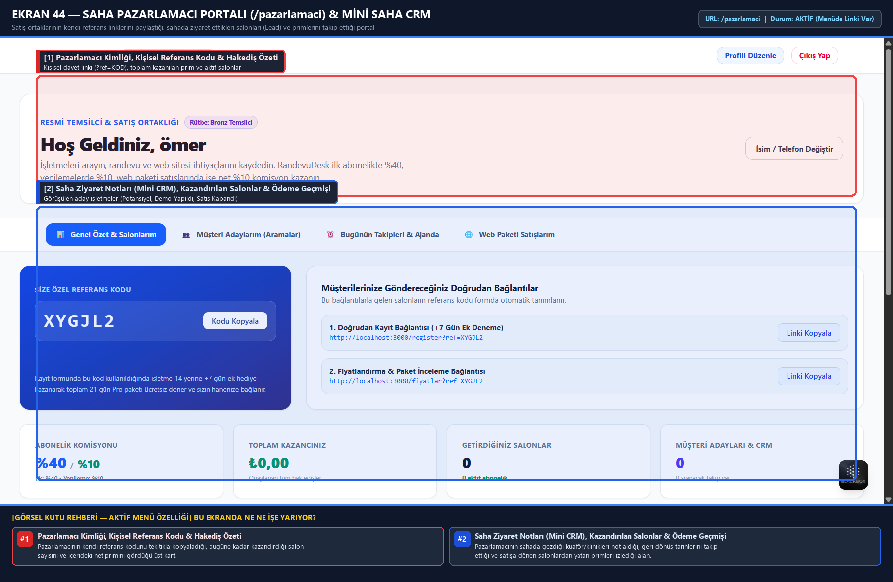

| Görseldeki Kutu No | Kutu Başlığı (Bölge / Modül) | Kısa Özeti | Bu Kutu Tam Olarak Ne İşe Yarıyor? |
| :---: | :--- | :--- | :--- |
| **`[1]`** | **Pazarlamacı Kimliği, Kişisel Referans Kodu & Hakediş Özeti** | _Kişisel davet linki (?ref=KOD), toplam kazanılan prim ve aktif salonlar_ | Pazarlamacının kendi referans kodunu tek tıkla kopyaladığı, bugüne kadar kazandırdığı salon sayısını ve içerideki net primini gördüğü üst kart. |
| **`[2]`** | **Saha Ziyaret Notları (Mini CRM), Kazandırılan Salonlar & Ödeme Geçmişi** | _Görüşülen aday işletmeler (Potansiyel, Demo Yapıldı, Satış Kapandı)_ | Pazarlamacının sahada gezdiği kuaför/klinikleri not aldığı, geri dönüş tarihlerini takip ettiği ve satışa dönen salonlardan yatan primleri izlediği alan. |

---

### 26.4. Ürün Vizyonu ve 10 Radikal İnovasyon Modülü Canlı Ekranları (Ekran 45 – 55) — 🚧 [GELİŞTİRİLME AŞAMASINDA]

#### 📸 EKRAN 45 — ÜRÜN VİZYONU VE 10 RADİKAL İNOVASYON MERKEZİ (/vizyon) — 🚧 [GELİŞTİRİLME AŞAMASINDA]
- **Sayfa Rotası (URL):** `/vizyon` | **Erişim Rolü:** `Herkese Açık (Vizyon Vitrin)`
- **Menü & Geliştirme Durumu:** 🚧 **[GELİŞTİRİLME AŞAMASINDA — Menüde Doğrudan Linki Yok / URL ile Erişilir]**
- **Bu Sayfa Ne İşe Yarar?** RandevuDesk'i klasik randevu programlarından ayıran 10 otonom ve ezber bozan modülün toplu tanıtım ve geçiş merkezi.

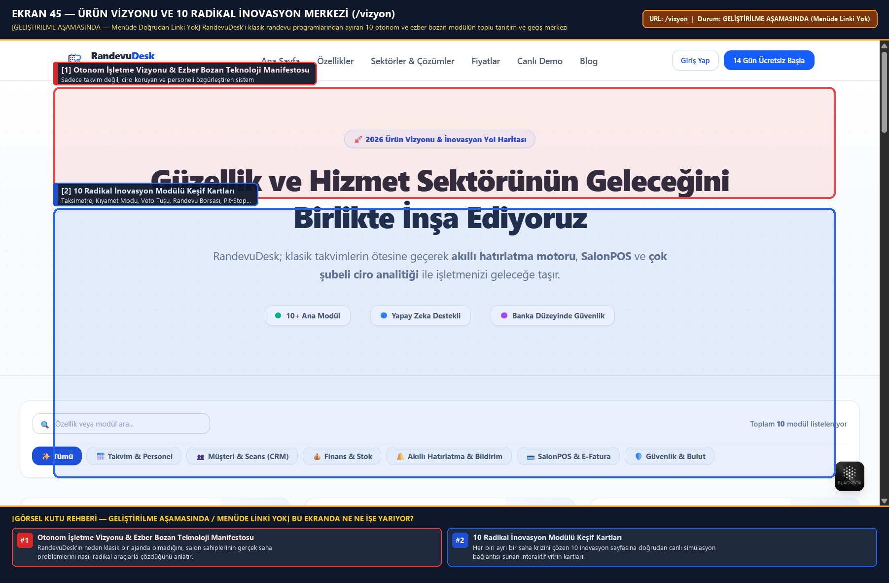

| Görseldeki Kutu No | Kutu Başlığı (Bölge / Modül) | Kısa Özeti | Bu Kutu Tam Olarak Ne İşe Yarıyor? |
| :---: | :--- | :--- | :--- |
| **`[1]`** | **Otonom İşletme Vizyonu & Ezber Bozan Teknoloji Manifestosu** | _Sadece takvim değil; ciro koruyan ve personeli özgürleştiren sistem_ | RandevuDesk'in neden klasik bir ajanda olmadığını, salon sahiplerinin gerçek saha problemlerini nasıl radikal araçlarla çözdüğünü anlatır. |
| **`[2]`** | **10 Radikal İnovasyon Modülü Keşif Kartları** | _Taksimetre, Kıyamet Modu, Veto Tuşu, Randevu Borsası, Pit-Stop..._ | Her biri ayrı bir saha krizini çözen 10 inovasyon sayfasına doğrudan canlı simülasyon bağlantısı sunan interaktif vitrin kartları. |

---

#### 📸 EKRAN 46 — İNOVASYON 01: CANLI KOLTUK TAKSİMETRESİ (/taksimetre) — 🚧 [GELİŞTİRİLME AŞAMASINDA]
- **Sayfa Rotası (URL):** `/taksimetre` | **Erişim Rolü:** `İnovasyon Simülatörü`
- **Menü & Geliştirme Durumu:** 🚧 **[GELİŞTİRİLME AŞAMASINDA — Menüde Doğrudan Linki Yok / URL ile Erişilir]**
- **Bu Sayfa Ne İşe Yarar?** Koltuk boş kaldığında saniye saniye akan zararı, müşteri oturduğunda ise kazanılan ciroyu canlı sayan finansal farkındalık ekranı.

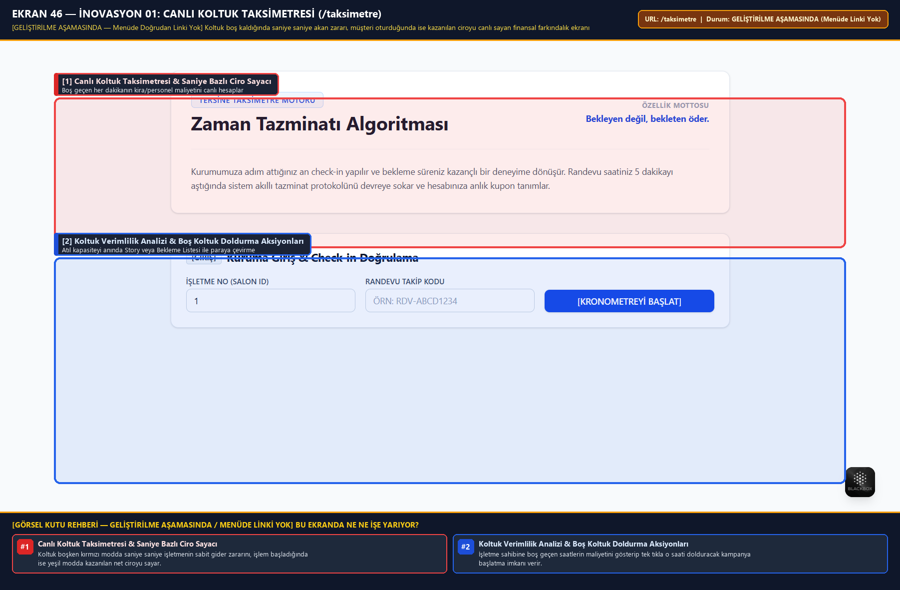

| Görseldeki Kutu No | Kutu Başlığı (Bölge / Modül) | Kısa Özeti | Bu Kutu Tam Olarak Ne İşe Yarıyor? |
| :---: | :--- | :--- | :--- |
| **`[1]`** | **Canlı Koltuk Taksimetresi & Saniye Bazlı Ciro Sayacı** | _Boş geçen her dakikanın kira/personel maliyetini canlı hesaplar_ | Koltuk boşken kırmızı modda saniye saniye işletmenin sabit gider zararını, işlem başladığında ise yeşil modda kazanılan net ciroyu sayar. |
| **`[2]`** | **Koltuk Verimlilik Analizi & Boş Koltuk Doldurma Aksiyonları** | _Atıl kapasiteyi anında Story veya Bekleme Listesi ile paraya çevirme_ | İşletme sahibine boş geçen saatlerin maliyetini gösterip tek tıkla o saati dolduracak kampanya başlatma imkanı verir. |

---

#### 📸 EKRAN 47 — İNOVASYON 02: KIYAMET MODU — ACİL KRİZ VE TAKVİM KURTARICI (/kiyamet-modu) — 🚧 [GELİŞTİRİLME AŞAMASINDA]
- **Sayfa Rotası (URL):** `/kiyamet-modu` | **Erişim Rolü:** `İnovasyon / Kriz Yönetimi`
- **Menü & Geliştirme Durumu:** 🚧 **[GELİŞTİRİLME AŞAMASINDA — Menüde Doğrudan Linki Yok / URL ile Erişilir]**
- **Bu Sayfa Ne İşe Yarar?** Uzman aniden hastalandığında veya elektrik/su kesildiğinde o günün tüm randevularını 1 tıkla kaydıran acil durum butonu.

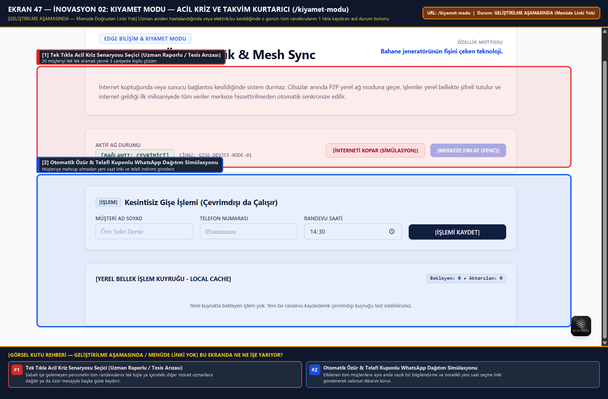

| Görseldeki Kutu No | Kutu Başlığı (Bölge / Modül) | Kısa Özeti | Bu Kutu Tam Olarak Ne İşe Yarıyor? |
| :---: | :--- | :--- | :--- |
| **`[1]`** | **Tek Tıkla Acil Kriz Senaryosu Seçici (Uzman Raporlu / Tesis Arızası)** | _20 müşteriyi tek tek aramak yerine 3 saniyede toplu çözüm_ | Sabah işe gelemeyen personelin tüm randevularını tek tuşla ya içerideki diğer müsait uzmanlara dağıtır ya da özür mesajıyla başka güne kaydırır. |
| **`[2]`** | **Otomatik Özür & Telafi Kuponlu WhatsApp Dağıtım Simülasyonu** | _Müşteriye mahcup olmadan yeni saat linki ve telafi indirimi gönderir_ | Etkilenen tüm müşterilere aynı anda nazik bir bilgilendirme ve öncelikli yeni saat seçme linki göndererek salonun itibarını korur. |

---

#### 📸 EKRAN 48 — İNOVASYON 03: GİZLİ VETO TUŞU — PERSONEL KORUMA KALKANI (/veto) — 🚧 [GELİŞTİRİLME AŞAMASINDA]
- **Sayfa Rotası (URL):** `/veto` | **Erişim Rolü:** `İnovasyon / Personel Güvenliği`
- **Menü & Geliştirme Durumu:** 🚧 **[GELİŞTİRİLME AŞAMASINDA — Menüde Doğrudan Linki Yok / URL ile Erişilir]**
- **Bu Sayfa Ne İşe Yarar?** Uzmanı huzursuz eden veya sürekli sorun çıkaran müşteriyi, müşteriye 'Kara listedesiniz' demeden kibarca engelleyen sistem.

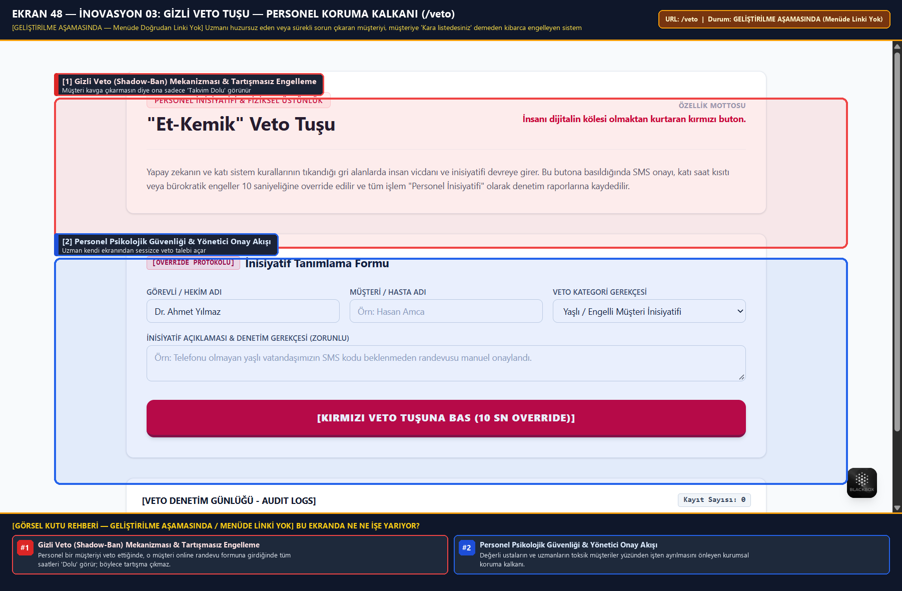

| Görseldeki Kutu No | Kutu Başlığı (Bölge / Modül) | Kısa Özeti | Bu Kutu Tam Olarak Ne İşe Yarıyor? |
| :---: | :--- | :--- | :--- |
| **`[1]`** | **Gizli Veto (Shadow-Ban) Mekanizması & Tartışmasız Engelleme** | _Müşteri kavga çıkarmasın diye ona sadece 'Takvim Dolu' görünür_ | Personel bir müşteriyi veto ettiğinde, o müşteri online randevu formuna girdiğinde tüm saatleri 'Dolu' görür; böylece tartışma çıkmaz. |
| **`[2]`** | **Personel Psikolojik Güvenliği & Yönetici Onay Akışı** | _Uzman kendi ekranından sessizce veto talebi açar_ | Değerli ustaların ve uzmanların toksik müşteriler yüzünden işten ayrılmasını önleyen kurumsal koruma kalkanı. |

---

#### 📸 EKRAN 49 — İNOVASYON 04: NO-SHOW KARA LİSTE VE GÜVEN SKORU RADARI (/ifsa-ekrani) — 🚧 [GELİŞTİRİLME AŞAMASINDA]
- **Sayfa Rotası (URL):** `/ifsa-ekrani` | **Erişim Rolü:** `İnovasyon / Gelir Koruma`
- **Menü & Geliştirme Durumu:** 🚧 **[GELİŞTİRİLME AŞAMASINDA — Menüde Doğrudan Linki Yok / URL ile Erişilir]**
- **Bu Sayfa Ne İşe Yarar?** Randevu alıp habersiz gelmeyen (No-Show) müşterilerin sicilini tutan ve bir sonraki randevuda ön ödeme/kapora şartı koyan ekran.

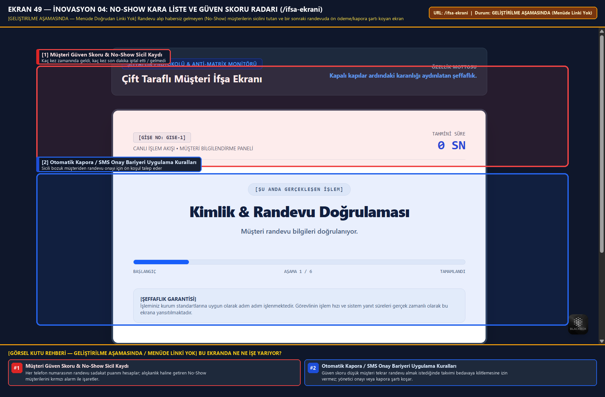

| Görseldeki Kutu No | Kutu Başlığı (Bölge / Modül) | Kısa Özeti | Bu Kutu Tam Olarak Ne İşe Yarıyor? |
| :---: | :--- | :--- | :--- |
| **`[1]`** | **Müşteri Güven Skoru & No-Show Sicil Kaydı** | _Kaç kez zamanında geldi, kaç kez son dakika iptal etti / gelmedi_ | Her telefon numarasının randevu sadakat puanını hesaplar; alışkanlık haline getiren No-Show müşterilerini kırmızı alarm ile işaretler. |
| **`[2]`** | **Otomatik Kapora / SMS Onay Bariyeri Uygulama Kuralları** | _Sicili bozuk müşteriden randevu onayı için ön koşul talep eder_ | Güven skoru düşük müşteri tekrar randevu almak istediğinde takvimi bedavaya kilitlemesine izin vermez; yönetici onayı veya kapora şartı koşar. |

---

#### 📸 EKRAN 50 — İNOVASYON 05: DİNAMİK RANDEVU BORSASI (HAPPY HOUR & PRİM SAATLER) — 🚧 [GELİŞTİRİLME AŞAMASINDA]
- **Sayfa Rotası (URL):** `/randevu-borsasi` | **Erişim Rolü:** `İnovasyon / Dinamik Fiyatlama`
- **Menü & Geliştirme Durumu:** 🚧 **[GELİŞTİRİLME AŞAMASINDA — Menüde Doğrudan Linki Yok / URL ile Erişilir]**
- **Bu Sayfa Ne İşe Yarar?** Hafta içi ölü saatlerde otomatik indirim yapan, Cuma/Cumartesi yoğun saatlerde ise VIP fiyat uygulayan akıllı fiyatlama.

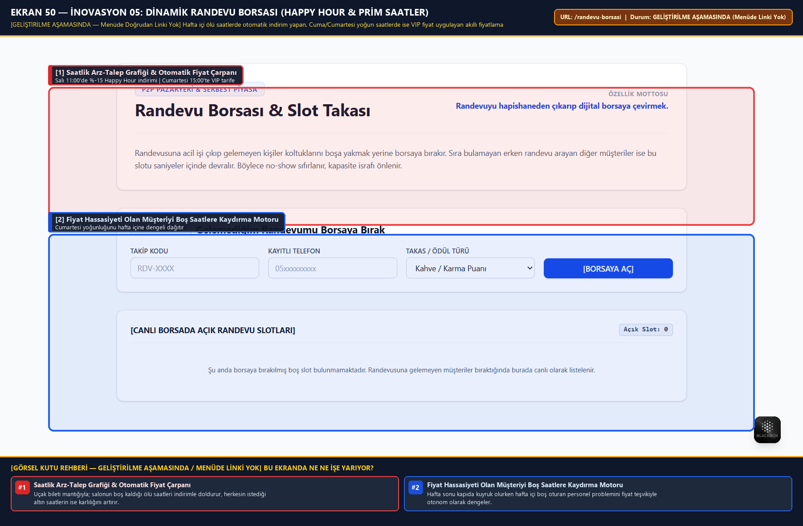

| Görseldeki Kutu No | Kutu Başlığı (Bölge / Modül) | Kısa Özeti | Bu Kutu Tam Olarak Ne İşe Yarıyor? |
| :---: | :--- | :--- | :--- |
| **`[1]`** | **Saatlik Arz-Talep Grafiği & Otomatik Fiyat Çarpanı** | _Salı 11:00'de %-15 Happy Hour indirimi | Cumartesi 15:00'te VIP tarife_ | Uçak bileti mantığıyla; salonun boş kaldığı ölü saatleri indirimle doldurur, herkesin istediği altın saatlerin ise karlılığını artırır. |
| **`[2]`** | **Fiyat Hassasiyeti Olan Müşteriyi Boş Saatlere Kaydırma Motoru** | _Cumartesi yoğunluğunu hafta içine dengeli dağıtır_ | Hafta sonu kapıda kuyruk olurken hafta içi boş oturan personel problemini fiyat teşvikiyle otonom olarak dengeler. |

---

#### 📸 EKRAN 51 — İNOVASYON 06: PATRON ÖZGÜRLÜK RADARI (/ozgurluk-radari) — 🚧 [GELİŞTİRİLME AŞAMASINDA]
- **Sayfa Rotası (URL):** `/ozgurluk-radari` | **Erişim Rolü:** `İnovasyon / Otonom Yönetim`
- **Menü & Geliştirme Durumu:** 🚧 **[GELİŞTİRİLME AŞAMASINDA — Menüde Doğrudan Linki Yok / URL ile Erişilir]**
- **Bu Sayfa Ne İşe Yarar?** İşletme sahibinin salona gitmeden, telefon trafiğinden kurtularak ne kadar kişisel zaman kazandığını ölçen otonomi ekranı.


| Görseldeki Kutu No | Kutu Başlığı (Bölge / Modül) | Kısa Özeti | Bu Kutu Tam Olarak Ne İşe Yarıyor? |
| :---: | :--- | :--- | :--- |
| **`[1]`** | **Otonom Çalışma Skoru & Kazanılan Saat Sayacı** | _Kaç randevu hiç telefon çalmadan kendi kendine alındı ve onaylandı_ | Gece 23:00'te veya pazar günü müşterilerin kendi kendine aldığı randevuları sayarak patrona kazandırılan net özgürlük süresini gösterir. |
| **`[2]`** | **Uzaktan Denetim & Sıfır Telefon Trafiği Metrikleri** | _İşletme sahibi tatildeyken bile tıkır tıkır işleyen salon raporu_ | İşletmenin patrona bağımlı olmadan kendi kendine ciro üretme ve müşteri ağırlama kapasitesini analiz eder. |

---

#### 📸 EKRAN 52 — İNOVASYON 07: GÖLGE PLANLAMA (BOYA BEKLEME SÜRESİ OPTİMİZASYONU) — 🚧 [GELİŞTİRİLME AŞAMASINDA]
- **Sayfa Rotası (URL):** `/golge-planlama` | **Erişim Rolü:** `İnovasyon / Kapasite Katlama`
- **Menü & Geliştirme Durumu:** 🚧 **[GELİŞTİRİLME AŞAMASINDA — Menüde Doğrudan Linki Yok / URL ile Erişilir]**
- **Bu Sayfa Ne İşe Yarar?** Saç boyası veya anestezinin 40 dakikalık bekleme süresinde uzmanın araya 1 fön/kesim müşterisi daha almasını sağlayan algoritma.


| Görseldeki Kutu No | Kutu Başlığı (Bölge / Modül) | Kısa Özeti | Bu Kutu Tam Olarak Ne İşe Yarıyor? |
| :---: | :--- | :--- | :--- |
| **`[1]`** | **İşlem Fazı Ayrıştırıcı (Uygulama -> Pasif Bekleme -> Yıkama/Bitiş)** | _2 saatlik boya randevusunun ortasındaki 45 dk pasif süreyi açığa çıkarır_ | Klasik takvimler 2 saatlik boya işleminde uzmanı 2 saat kilitler; Gölge Planlama ise boya sürülüp beklenirken o 45 dakikayı yeni müşteriye açar. |
| **`[2]`** | **İç İçe (Interleaved) Randevu Yerleştirme & Ekstra Ciro Hesabı** | _Aynı mesai saatinde uzman yorulmadan +%35 daha fazla müşteri alır_ | Bekleme sürelerini ölü zaman olmaktan çıkarıp araya kısa işlemler (kesim, fön, kaş) yerleştirerek günlük ciroyu katlar. |

---

#### 📸 EKRAN 53 — İNOVASYON 08: FORMULA 1 PİT-STOP — KOLTUK DEVİR HIZI (/pit-stop) — 🚧 [GELİŞTİRİLME AŞAMASINDA]
- **Sayfa Rotası (URL):** `/pit-stop` | **Erişim Rolü:** `İnovasyon / Hız & Hijyen`
- **Menü & Geliştirme Durumu:** 🚧 **[GELİŞTİRİLME AŞAMASINDA — Menüde Doğrudan Linki Yok / URL ile Erişilir]**
- **Bu Sayfa Ne İşe Yarar?** İki müşteri arasındaki koltuk temizliği, sterilizasyon ve hazırlık süresini saniye bazında optimize eden operasyon ekranı.


| Görseldeki Kutu No | Kutu Başlığı (Bölge / Modül) | Kısa Özeti | Bu Kutu Tam Olarak Ne İşe Yarıyor? |
| :---: | :--- | :--- | :--- |
| **`[1]`** | **Canlı Pit-Stop Geri Sayım Sayacı (Temizlik & Sterilizasyon Süresi)** | _Müşteri kalktığı anda başlayan hazırlık kronometresi_ | Seans bittiği anda yardımcı personele bildirim gönderir; koltuğun bir sonraki müşteriye kaç dakikada hazırlandığını kronometreyle ölçer. |
| **`[2]`** | **Günlük Kayıp Hazırlık Süresi Analizi & Ekstra Seans Kazanımı** | _Her randevuda 5 dk tasarruf = Günde 1 ekstra tam seans cirosu_ | Randevular arasındaki dağınıklığı önleyerek hem hijyen standartlarını korur hem de sarkan randevu zincirini sıfırlar. |

---

#### 📸 EKRAN 54 — İNOVASYON 09: HAYALET CHECK-İN — RESEPSİYONSUZ KARŞILAMA (/hayalet-checkin) — 🚧 [GELİŞTİRİLME AŞAMASINDA]
- **Sayfa Rotası (URL):** `/hayalet-checkin` | **Erişim Rolü:** `İnovasyon / VIP Karşılama`
- **Menü & Geliştirme Durumu:** 🚧 **[GELİŞTİRİLME AŞAMASINDA — Menüde Doğrudan Linki Yok / URL ile Erişilir]**
- **Bu Sayfa Ne İşe Yarar?** Müşteri kapıdan girdiğinde kimseye 'Ben geldim' demeden tek tıkla gelişini bildirdiği ve uzmanın saatine düşen karşılama.


| Görseldeki Kutu No | Kutu Başlığı (Bölge / Modül) | Kısa Özeti | Bu Kutu Tam Olarak Ne İşe Yarıyor? |
| :---: | :--- | :--- | :--- |
| **`[1]`** | **Temassız 'Salona Geldim' Bildirimi & Otomatik İkram Tercihi** | _Müşteri kapıdaki QR'ı okutur veya SMS linkine basar, kahvesini seçer_ | Resepsiyonda görevli olmasa bile müşteri içeri adım attığında gelişini bildirir ve bekleme koltuğuna geçerken içeceğini seçer. |
| **`[2]`** | **Uzman Ekranına Anlık 'Müşteriniz Bekleme Salonunda' Uyarısı** | _İçerideki uzmana müşterinin adı, işlemi ve içecek tercihi anında düşer_ | Müşteriye ismiyle hitap edilerek VIP bir karşılama yapılmasını sağlar; küçük işletmeleri tam zamanlı resepsiyonist maaşından kurtarır. |

---

#### 📸 EKRAN 55 — İNOVASYON 10: HAVALİMANI TİPİ CANLI GECİKME VE DURUM PANOSU (/gecikme-panosu) — 🚧 [GELİŞTİRİLME AŞAMASINDA]
- **Sayfa Rotası (URL):** `/gecikme-panosu` | **Erişim Rolü:** `İnovasyon / Şeffaf İletişim`
- **Menü & Geliştirme Durumu:** 🚧 **[GELİŞTİRİLME AŞAMASINDA — Menüde Doğrudan Linki Yok / URL ile Erişilir]**
- **Bu Sayfa Ne İşe Yarar?** Olası işlem sarkmalarını havalimanı uçuş ekranı şeffaflığında gösteren ve sıradaki müşteriye otomatik bildiren pano.


| Görseldeki Kutu No | Kutu Başlığı (Bölge / Modül) | Kısa Özeti | Bu Kutu Tam Olarak Ne İşe Yarıyor? |
| :---: | :--- | :--- | :--- |
| **`[1]`** | **Canlı Seans Durum Tablosu (Zamanında / İşlemde / +10 Dk Rötar)** | _Havalimanı kalkış ekranı netliğinde tüm uzmanların anlık durumu_ | Zorlu bir işlem (örn. kanal tedavisi veya renk açma) uzadığında uzman tek tuşla '+15 dk uzadı' işaretler; tüm pano anında güncellenir. |
| **`[2]`** | **Sıradaki Müşteriye Otomatik '15 Dk Geç Gelebilirsiniz' Bildirimi** | _Müşteri bekleme salonunda sıkılmaz, dışarıda kahvesini içip tam vaktinde gelir_ | Sıradaki müşteriye daha evden çıkmadan veya yoldayken gecikmeyi haber verir; bekleme salonundaki gerginliği %100 ortadan kaldırır. |

---

## 27. ⚙️ Backend Kod Mimarisi: Router, Servis ve Veritabanı Modelleri Analizi

`backend/app/` dizini katmanlı mimari (Layered Architecture) ile yapılandırılmıştır:

1. **API Router Katmanı (`backend/app/routers/`):**
   - `auth.py`: Giriş (`/auth/login`), çıkış (`/auth/logout`), işletme kaydı (`/auth/register-business`), mevcut kullanıcı (`/auth/me`).
   - `salons.py`: Salon CRUD, müsait saatler (`occupied-slots`), telefonla müşteri tanıma (`customer-lookup`), personel yönetimi, izinler, kapalı günler, abonelik iptal/düşürme ve personel memnuniyet ligi.
   - `appointments.py`: Randevu oluşturma, durum/saat güncelleme, takip kodu/telefon araması, Google Calendar ve iCal üretimi, müşteri yorumu ekleme.
   - `services.py`: Hizmet detayı, güncelleme ve soft-delete (IDOR korumalı).
   - `spaces.py`: 2D mekan/koltuk/ünit CRUD ve canlı doluluk durumu.
   - `waitlist.py`: Bekleme listesi kaydı, FIFO teklif gönderimi ve 15 dk token onayı.
   - `dental.py`: Diş kliniği hasta anamnez profili, implant & lot kayıtları, protez laboratuvar siparişleri, hekim bordro raporu.
   - `formulations.py`: Kuaför müşteri boya reçetesi ve alerji notları CRUD.
   - `inventory.py`: Ürün/stok CRUD, kasadan perakende satış (`ProductSale`) ve stok hareketleri (`StockMovement`).
   - `commissions.py`: Personel maaş ve prim oranları tanımlama, aylık hak ediş hesaplama.
   - `analytics.py`: Ciro hedefleri, RFM müşteri analizi, yoğun saat ısı haritası ve ciro tahmini.
   - `payments.py`: PayTR iFrame token üretimi, 3D Secure webhook callback doğrulaması ve paket yükseltme.
   - `marketers.py`, `marketer_crm.py`, `marketer_crm_admin.py`: Pazarlamacı referans sistemi, müşteri adayı (Lead) yönetimi, arama geçmişi, Excel/CSV aktarım ve Web Sitesi Paketi satış/onay akışı.
   - `admin.py`: Süper Admin salon, kullanıcı, sektör, abonelik, aktivasyon kodu, blog, güvenlik ve yedekleme uçları.
   - `whatsapp.py`, `notifications.py`, `site_settings.py`, `contact.py`, `blog.py`, `sectors.py` ve 10 inovasyon router'ı.
2. **İş Mantığı ve Zamanlayıcı Servisler (`backend/app/services/`):**
   - `crypto_service.py`: AES-256-GCM AEAD şifreleme/çözme motoru.
   - `backup_scheduler.py` & `backup_service.py`: Her gece 03:00'te çalışan otomatik MySQL dump ve ZIP yedekleme servisi.
   - `reminder_service.py` & `whatsapp_service.py`: Randevuya 24 saat ve 2 saat kala otomatik WhatsApp hatırlatması gönderen arka plan döngüsü.
   - `marketer_cleanup_service.py`: Pazarlamacı portföylerindeki salonların abonelik devamlılığını denetleyen periyodik servis.

---

## 28. 🛠️ Yapılması Planlanan Değişiklikler

Kaynak kodları üzerinde yapılan statik ve mimari analiz sonucunda, mevcut sistemin performansını, güvenliğini, kod bakım kolaylığını ve ticari özellik kapsamını bir üst seviyeye taşımak için **yapılması planlanan değişiklikler ve öneriler** aşağıda listelenmiştir:

### 1. Veritabanı ve API Performans Optimizasyonları (N+1 Sorgu Darboğazlarının Giderilmesi)
- **Admin Salon Listesi N+1 Sorgu Optimizasyonu (`backend/app/routers/admin.py` — `list_admin_salons`):**
  - *Tespit:* `for s in salons:` döngüsü içinde her işletme için 3 ayrı `SELECT COUNT` sorgusu (`User`, `Appointment`, `Service`) çalıştırılmaktadır (200 işletmede toplam 601 SQL sorgusu).
  - *Öneri:* `GROUP BY salon_id` kullanan alt sorgular (subquery) ve `selectinload(Salon.sector)` kullanılarak tüm salon metriklerinin **tek bir SQL sorgusunda** çekilmesi.
- **Admin Pazarlamacı CRM İstatistikleri N+1 Optimizasyonu (`backend/app/routers/marketer_crm_admin.py` — `get_admin_crm_stats`):**
  - *Tespit:* `for m in marketers:` döngüsü içinde her pazarlamacı için 6 ayrı `SELECT COUNT` sorgusu (`leads_cnt`, `won_cnt`, `due_cnt`, `calls_cnt`, `pending_ws`, `member_count`) çalıştırılmaktadır.
  - *Öneri:* İlgili tabloların `GROUP BY marketer_id` ile toplu olarak tek seferde sorgulanıp bellek içinde eşleştirilmesi.
- **Personel Memnuniyet Ligi Sorgu Optimizasyonu (`backend/app/routers/salons.py` — `get_staff_competition`):**
  - *Tespit:* Her personel için döngü içinde ayrı `COUNT(Appointment.id)` ve `AVG(AppointmentReview.rating)` sorguları atılmaktadır.
  - *Öneri:* Tek bir `LEFT JOIN` + `GROUP BY User.id` sorgusu ile tüm personel skorlarının tek seferde hesaplanması.

### 2. Mimari Temizlik ve Kod Bakım Kolaylığı (Modülerleştirme)
- **Monolitik `api.ts` Dosyasının Modüllere Bölünmesi (`frontend/src/lib/api.ts`):**
  - *Tespit:* `frontend/src/lib/api.ts` dosyası **4.242 satıra** ulaşmıştır.
  - *Öneri:* Tıpkı `src/lib/api/marketerCrm.ts` örneğinde olduğu gibi, `api.ts` dosyasının `src/lib/api/auth.ts`, `salons.ts`, `appointments.ts`, `dental.ts`, `inventory.ts`, `admin.ts` alt modüllerine ayrılması ve ana `api.ts` dosyasının geriye dönük uyumluluk için `export *` (barrel file) olarak bırakılması.
- **Büyük Backend Router Dosyalarının Alt Modüllere Ayrılması:**
  - *Tespit:* `admin.py` (1.522 satır), `salons.py` (1.484 satır), `marketer_crm.py` (1.043 satır) ve `marketers.py` (~1.000 satır) tek dosyada çok fazla sorumluluk taşımaktadır.
  - *Öneri:* `routers/admin/` ve `routers/salons/` paket dizinleri oluşturularak uç noktaların mantıksal alt dosyalara bölünmesi.
- **Uygulama Açılışındaki (`lifespan`) Ham `ALTER TABLE` Komutlarının Alembic'e Taşınması (`backend/app/main.py`):**
  - *Tespit:* `main.py` satır 80-169 arasında her sunucu açılışında `salons`, `notifications` ve `marketers` tabloları için ham SQL `ALTER TABLE` kontrolleri çalışmaktadır.
  - *Öneri:* Çoklu worker açılışlarında tablo kilitlemesi (metadata lock) yaşanmaması adına tüm şema değişikliklerinin yalnızca `alembic/versions/` ve `mysql/vps_safe_migration_2026.sql` üzerinden yürütülmesi.
- **Fiyat Sabitlerinin Senkronizasyonu (`backend/app/constants.py`):**
  - *Tespit:* `constants.py` içindeki `PLAN_PRICES` sözlüğünde eski paket isimleri (`starter: 499`, `pro: 999`, `enterprise: 2499`) kalmıştır; aktif sistem ise `payments.py` içinde `Temel` (399/999/2999 TL) ve `Profesyonel` (699/1699/4999 TL) yapısını kullanmaktadır.
  - *Öneri:* `constants.py` içindeki sabitlerin güncel paket mimarisiyle eşitlenmesi.

### 3. Siber Güvenlik, Oturum ve Proxy İyileştirmeleri
- **JWT Token Saklama Mimarisi (`HttpOnly Cookie` Geçişi):**
  - *Tespit:* Frontend'de JWT token `localStorage` (`esteti_token`, `randevudesk_token`) ve JS erişimine açık cookie içinde saklanmaktadır.
  - *Öneri:* Olası XSS vektörlerine karşı oturum belirtecinin `HttpOnly; Secure; SameSite=Lax` bayraklı çerezler üzerinden taşınması.
- **Next.js API Proxy IP Doğrulaması ve Rate-Limit Tekilleştirmesi (`frontend/src/app/api/proxy/[...path]/route.ts`):**
  - *Tespit:* Next.js proxy katmanı hız sınırlamasını Node.js belleğindeki `ipRequestMap` içinde tutmakta ve `x-forwarded-for` başlığını doğrudan `X-Real-IP` üzerine yazmaktadır.
  - *Öneri:* Yalnızca güvenilir proxy (Nginx/Cloudflare) IP'lerinden gelen başlıkların kabul edilmesi ve hız sınırlamasının merkezi olarak FastAPI + Redis (`SlowAPI`) katmanına devredilmesi.

### 4. Ürün Yol Haritasındaki Eksik / Yeni Modüllerin Tamamlanması
- **Pazarlamacı CRM Faz 6 — Aday (Lead) ile Kayıt Olan Salonun Otomatik Eşleştirilmesi (`plan.md` Madde 4.4 & 8):**
  - *Öneri:* `/register` sayfasından yeni bir işletme kaydolduğunda, işletme telefonu veya kullanılan referans kodu `marketer_leads` tablosundaki bir adayla eşleşirse ilgili adayın `converted_salon_id` alanının otomatik doldurulması ve durumunun `won` (Kazanıldı) olarak işaretlenmesi.
- **Modül 13 — Paket & Çoklu Seans Yönetimi (Lazer Epilasyon, Cilt Bakımı, Fizyoterapi, Diyetisyen):**
  - *Öneri:* İşletmelerin müşterilerine 6, 8 veya 10 seanslık paket satışı yapabileceği, her tamamlanan randevuda kalan seans hakkının otomatik düşüldüğü ve müşteriye kalan seans bilgisinin WhatsApp ile iletildiği **Paket & Seans Takip Modülü** (`SessionPackage` & `CustomerSessionUsage`) eklenmesi.
- **Modül 14 — İşletme Gider & Masraf Yönetimi (Gerçek Net Kâr Tablosu):**
  - *Öneri:* Kira, elektrik, su, internet, mutfak ve personel avansı gibi sabit/değişken giderlerin kaydedilebildiği bir **Gider Modülü** (`SalonExpense`) eklenerek, `AnalyticsDashboardView` içinde `Brüt Ciro - (Ürün Maliyeti + Personel Primleri + İşletme Giderleri) = Gerçek Net Kâr` raporunun sunulması.
- **Ana Sayfa İnteraktif Simülatörün (`HeroInteractiveWidget`) Yeniden Devreye Alınması (`frontend/src/app/page.tsx`):**
  - *Tespit:* `HeroInteractiveWidget` bileşeni ilk sayfa yükleme (TBT) optimizasyonu amacıyla `page.tsx` içinde yorum satırına alınmıştır.
  - *Öneri:* Bileşenin "Tıkla ve Canlı Simülatörü Başlat" (Interaction-on-Demand Facade) mimarisiyle sayfa açılış hızını hiç etkilemeden tekrar aktif hale getirilmesi.

### 5. SEO, Rota Tekilleştirme ve Tasarım Anayasası Uyumu
- **Çift (Alias) Sayfa Rotalarında Canonical / 308 Yönlendirme Düzenlemesi:**
  - *Tespit:* `/fiyatlar`, `/fiyatlandirma`, `/pricing` ile `/kayit`, `/register` ve `/takip`, `/tracking` ile `/teslimat`, `/teslimat-iade`, `/teslimat-ve-iade` rotaları aynı içeriği farklı URL'lerde sunmaktadır.
  - *Öneri:* Arama motorlarında kopya içerik (duplicate content) oluşmaması için ikincil rotaların `next.config.ts` üzerinden `308 Permanent Redirect` ile ana Türkçe URL'lere (`/fiyatlar`, `/kayit`, `/takip`) yönlendirilmesi.
- **Tasarım Anayasası (`DEGISMEZ_KURALLAR.md`) Açık Tema Uyum Denetimi:**
  - *Öneri:* `DEGISMEZ_KURALLAR.md` Madde 4 uyarınca bazı inovasyon ve vizyon alt sayfalarında kalan koyu arka plan sınıflarının (`bg-slate-900` vb.) taranarak tamamen ferah açık mavi ve beyaz kurumsal temaya (`bg-white`, `bg-slate-50`, `bg-blue-50`) dönüştürülmesi.
